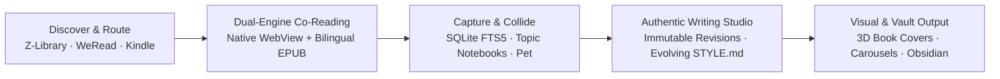
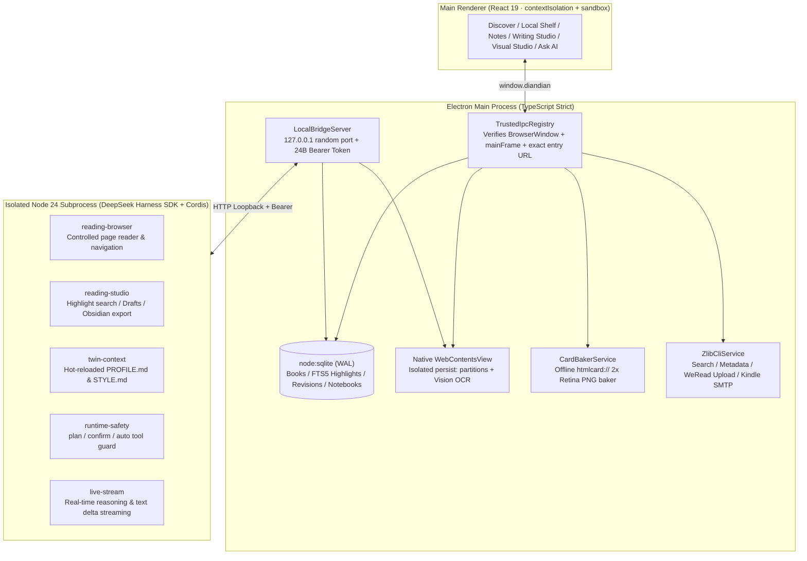

<div align="center">
  
  <h1>diandianreading · 点点读书</h1>
  <p><strong>A local-first desktop studio for deep reading, personal voice writing, and visual publishing.</strong></p>
  <p>Bring book discovery, dual-engine co-reading, FTS5 highlight synthesis, anti-cliché writing, Xiaohongshu 3D book visuals, and Obsidian knowledge export onto one calm desk.</p>
  <p>
    <a href="./README.md">简体中文</a> · <strong>English</strong> · <a href="./SECURITY.md">Security Policy</a>
  </p>
</div>

---

<!-- Screenshot slot: place screenshots in docs/screenshots/ and uncomment below -->
<!--
<p align="center">
  
</p>
-->

## Why diandianreading?

For most serious readers, turning a book into lasting insight or published writing means juggling half a dozen disconnected tools: hunting down EPUBs, pushing files to WeRead or Kindle, pasting passages into a chat window, fighting generic AI-sounding prose, manually designing social cards, and copying notes over to Obsidian.

**diandianreading v2** unifies that entire workflow into a single **local-first** desktop application built on Electron, a native split-screen reading browser, Node 24 SQLite FTS5, and the DeepSeek Harness plugin engine. Every highlight, revision timeline, and personal style profile (`PROFILE.md` / `STYLE.md`) lives on your own disk—no mandatory cloud account, no vendor lock-in.



---

## Highlights

### 1. Frictionless Book Discovery & Shelf Routing
- **Zero-setup book router**: Ships with `heartleo/zlib` bundled inside the app—no Homebrew or CLI setup required. Sign in once in the right-hand browser and **diandianreading** automatically follows SingleLogin mirror redirects and syncs your session with zero extra clicks to unlock personalized recommendations.
- **Douban reviews & metadata repair**: Jump straight to Douban ratings/reviews by ISBN in the split browser, or enrich local ebooks (`EPUB / PDF / MOBI / AZW3`) with clean titles, authors, ISBNs, and embedded high-res covers from Douban, WeRead, Open Library, and Google Books.
- **Seamless WeRead & Kindle delivery**: Push ebooks to Kindle over encrypted SMTP, or send local books straight to your WeRead shelf—if your upload channel isn't linked yet (or its session expired), a WeChat QR modal pops up in place and **automatically resumes the pending upload the moment you scan**.

### 2. Dual Reading Engines: Native Split Browser + Bilingual EPUB Reader
- **Multi-account native `WebContentsView` browser**: Eliminates iframe `X-Frame-Options` limits with isolated `persist:` cookie partitions per account, built-in shortcuts for WeRead, Douban, Xiaohongshu Creator Studio, and WeChat Official Accounts, plus a closed-Shadow-DOM selection bar for 1-click saving, asking AI, or starting a draft.
- **On-device Apple Vision Canvas OCR**: For `<canvas>`-rendered web readers such as WeRead Web, macOS Vision OCR runs **entirely in local memory** to reconstruct clean paragraphs from the visible page—so your AI co-reader understands the exact page on screen without scraping external sites.
- **Reflowable bilingual EPUB reader**: Powered by [foliate-js](https://github.com/johnfactotum/foliate-js) (with interaction patterns inspired by [Readest](https://github.com/readest/readest)), featuring CJK serif/sans/kai typography, 1/2-column pagination, footnote popovers, pull-cord night lamp theming, exact highlight jump-back, and **paragraph-by-paragraph bilingual translation** (via personal DeepL API key or any configured OpenAI-compatible LLM, cached locally for offline re-reading).

### 3. Local FTS5 Knowledge Base, Topic Notebooks & Desktop Companion
- **Sub-millisecond CJK search**: Built on Node 24's native `node:sqlite` with **FTS5 trigram indexing** for instant substring search across Chinese and English highlights; imports Kindle `My Clippings.txt` and syncs WeRead notebooks with SHA-256 deduplication.
- **Topic Notebooks & cross-book collision**: Group books, web references, and drafts into thematic spaces so the AI can synthesize consensus, surface contradictions, and propose sharp writing angles across multiple sources.
- **Golden Retriever desktop pet**: A lightweight floating companion that captures clipboard quotes globally (`⌘⇧D`) and gently resurfaces one forgotten highlight a day.

### 4. Writing Studio That Sounds Like You—Not a Chatbot
- **Immutable revision chain**: Saving an AI reply automatically strips conversational filler into a clean `v1 AI Draft`, while every edit you make appends an immutable `Human Revision` with a side-by-side diff viewer—never overwriting your words.
- **Live FTS5 quote surfacing**: As you write, related highlights from your past reading surface automatically below the editor for 1-click citation.
- **Self-evolving `STYLE.md`**: Whenever you revise an AI draft, the studio diffs your human edits against the AI baseline to distill concrete personal style habits, appending approved rules into `STYLE.md` so the very next AI turn writes closer to your voice.

### 5. Xiaohongshu 3:4 Visual Studio & Non-Destructive Obsidian Export
- **Sandboxed `1080×1440` Retina visual studio**: Automatically extracts key arguments and resolves real book covers from your drafts into four editorial `3:4` layouts (**3D Hardcover Poster Cover**, **Myth vs. Truth Contrast Card**, **Washi-Tape Sketchnote Grid**, and **Kinfolk/Broadsheet Editorial Long-Card**), alongside single-quote cards, multi-slide carousels, and monthly reading posters—baked 100% offline inside a network-blocked `htmlcard://` sandbox.
- **Safe one-way Obsidian sync**: Tracks renamed or moved notes in your Obsidian vault via `diandian_id` frontmatter; if a note was edited manually in Obsidian, writes a `.diandian-conflict.md` copy instead of ever overwriting your edits, with `obsidian://open` deep-link support.

---

## Installation & Quick Start

### Option 1: Standalone Installer (Recommended)
Download the latest installer from [GitHub Releases](https://github.com/Youhai020616/diandianreading/releases) (e.g., `点点读书-<version>-mac-arm64.dmg` for Apple Silicon Macs), drag it to **Applications**, and launch.
> Everything required at runtime—including the ebook router binary and an isolated Node.js runtime—is bundled inside the app. No Homebrew, Node.js, or terminal setup is required. Add your DeepSeek or OpenAI-compatible API key under **Model Settings** in the bottom-left corner to start co-reading.

### Option 2: Run from Source (Developers)
Prerequisites: **Node.js ≥ 24** and **pnpm**.

```bash
git clone https://github.com/Youhai020616/diandianreading.git
cd diandianreading
pnpm install

# Launch development mode (automatically fetches the pinned zlib binary into vendor/ on first run)
pnpm dev

# Start silently in the background without stealing window focus:
DIANDIAN_START_HIDDEN=1 pnpm dev
```

`pnpm dev` hot-reloads every layer without pulling the window to the foreground:

| Changed Files | Reload Behavior |
| :--- | :--- |
| `src/**` (React UI & CSS) | Instant Vite HMR in place |
| `plugins/**`, `electron/agent/sdkBridge.mjs` | Restarts only the background AI Harness child process |
| `electron/**/*.ts` (Main process & IPC) | Incremental `tsc --watch` build + hidden Electron restart (appears when you switch back) |

### Keyboard Shortcuts

| Shortcut | Action |
| :--- | :--- |
| `⌘B` / `Ctrl+B` | Toggle far-left navigation rail |
| `⌘⇧B` / `Ctrl+Shift+B` | Toggle left workspace (focus reading mode) |
| `⌘\` / `Ctrl+\` | Toggle right-hand reading browser |
| `⌘L` / `Ctrl+L` | Toggle right-hand **Ask Diandian** AI co-reading drawer |
| `⌘,` / `Ctrl+,` | Open **Connections & Preferences** |
| `⌘⇧D` / `Ctrl+Shift+D` | Summon the Golden Retriever pet with current clipboard quote |
| Pull-Cord Lamp | Pull the ceiling lamp cord to switch between Cloud-Blue Day and Dark Night themes |

---

## Architecture & Cordis Plugins

diandianreading v2 enforces strict **process-level isolation** across the Electron UI renderer, embedded third-party web pages, the offline card baker, and the DeepSeek Harness agent subprocess.



### Five Custom Cordis Plugins (`plugins/`)
1. **`reading-browser`**: Gives the agent read-only access to the active tab's text/OCR snapshot and selection plus controlled URL navigation—never exposing cookies or credentials.
2. **`reading-studio`**: Exposes domain tools for searching local highlights, saving quotes, appending immutable AI draft revisions, exporting to Obsidian, and checking book-router status.
3. **`twin-context`**: Hot-injects your `PROFILE.md` and anti-cliché `STYLE.md` into the agent context while keeping the system prompt prefix stable for KV-cache hits.
4. **`runtime-safety`**: Enforces `plan` (read-only), `confirm` (guarded), and `auto` execution modes via `ctx.tools.guard`; disables arbitrary `bash / write / edit / workflow` tools at both the overlay and guard layers, and confines file reads via `read-scope.mjs` (`plugins/runtime-safety/tool-policy.json`).
5. **`live-stream`**: Streams root-session `reasoning-delta` and `text-delta` frames over the loopback bridge for low-latency live rendering.

---

## Security & Privacy

See **[SECURITY.md](./SECURITY.md)** for the full threat model and security boundaries:

- **Zero-trust IPC**: All windows run with `contextIsolation: true`, `nodeIntegration: false`, and `sandbox: true`; every `ipcMain` handler is registered through `TrustedIpcRegistry` and validates both `senderFrame === mainFrame` and exact app entry URL matching.
- **Keychain-backed secrets**: LLM API keys, DeepL keys, and Kindle SMTP passwords are encrypted via Electron `safeStorage` (`0700` dir / `0600` atomic file writes) and never enter logs, overlay YAML files, or renderer state.
- **Sandboxed EPUB & card rendering**: EPUB chapters render inside scriptless sandboxed iframes with strict decompression caps (`epubLimits.ts`); share cards and posters render inside a network-blocked `htmlcard://` partition.

---

## Packaging & Verification

### Build Standalone Installer
```bash
pnpm dist:mac   # Outputs release/<version>/点点读书-<version>-mac-arm64.dmg
```

`scripts/before-build.mjs` fetches SHA-256-pinned binaries (`heartleo/zlib` v0.0.16 and Node.js v24.22.3 in `scripts/fetch-binaries.mjs`) and stages a pruned flat production `node_modules` tree (`scripts/stage-runtime.mjs`) for the Harness `sdk` runtime.

### Run Full Verification Suite
```bash
pnpm typecheck && pnpm test && pnpm build
```

---

## Credits & Acknowledgments

- Local EPUB rendering is powered by [foliate-js](https://github.com/johnfactotum/foliate-js), with reader interactions inspired by [Readest](https://github.com/readest/readest) (see [EPUB Reader License Notices](./public/licenses/epub-reader.txt)).
- Optional ebook search, metadata repair, and shelf delivery are powered by the bundled [heartleo/zlib](https://github.com/heartleo/zlib) CLI (MIT).
- Co-reading agent runtime built on `@deepseek-ai/dsh` (DeepSeek Harness SDK) and Cordis.
