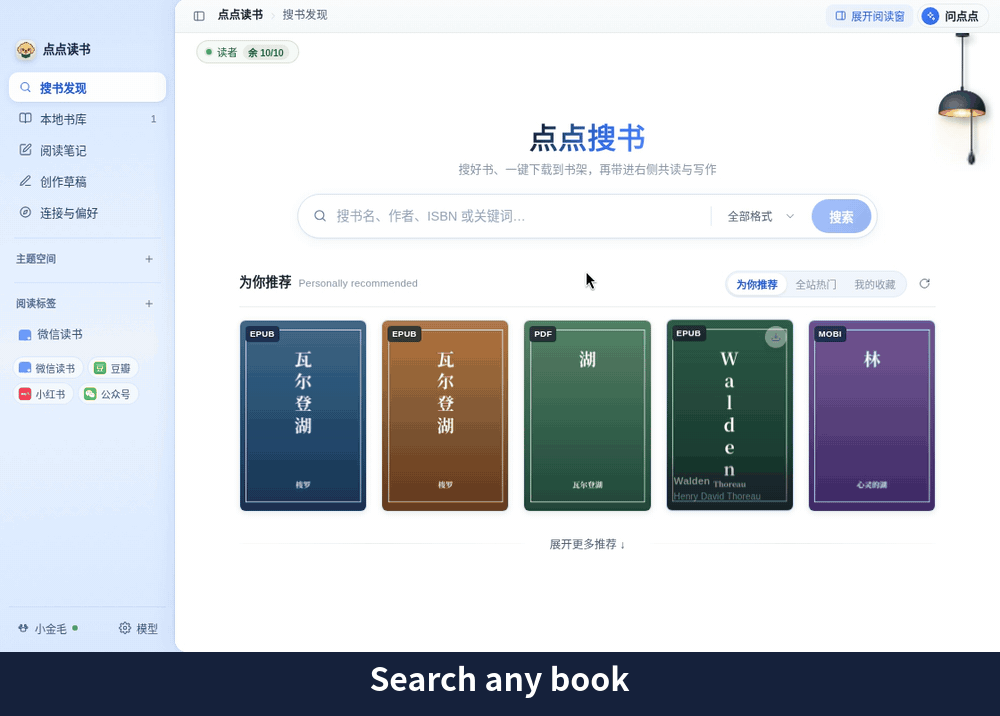
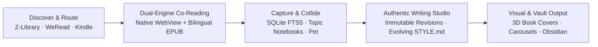
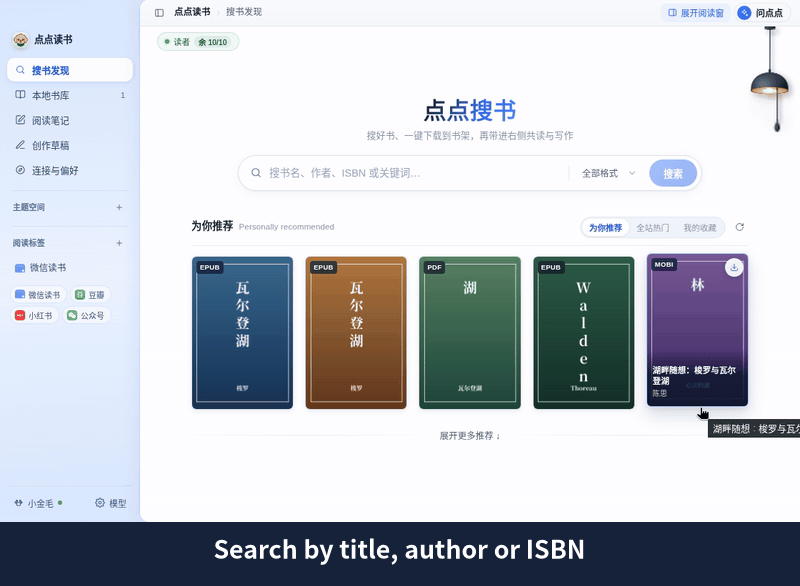
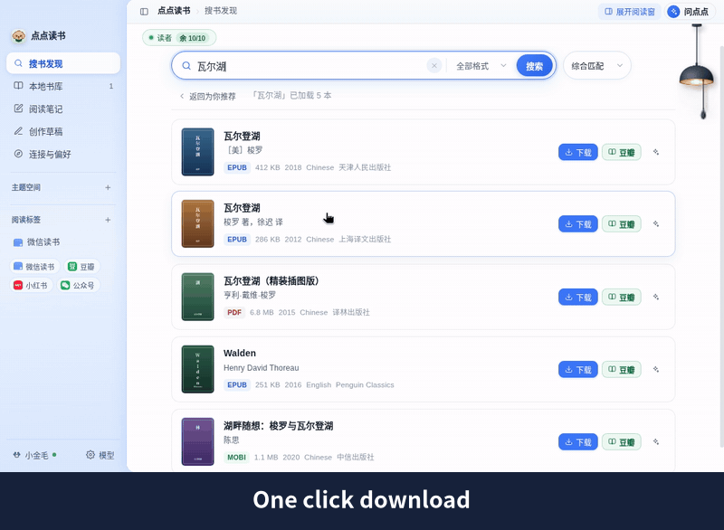
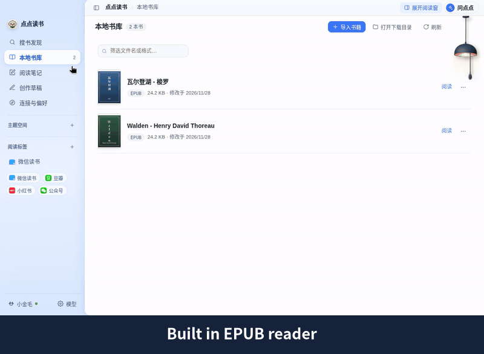
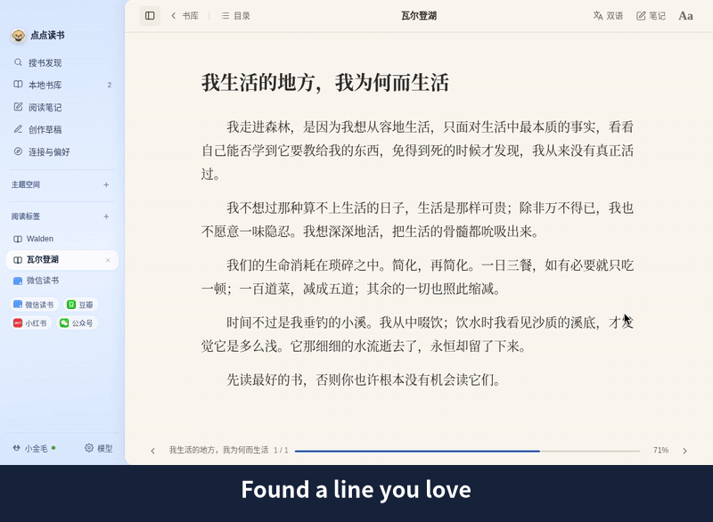
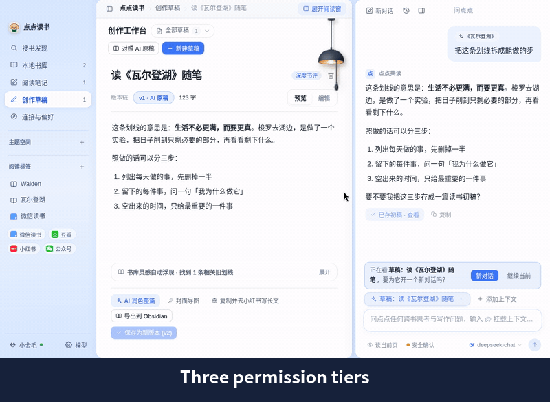
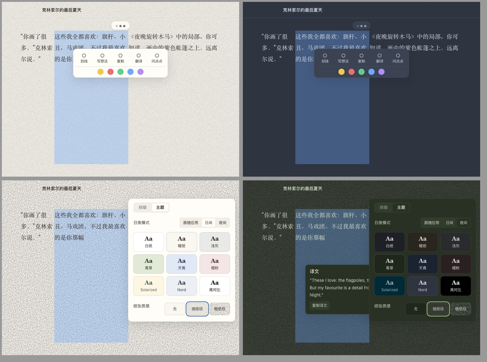
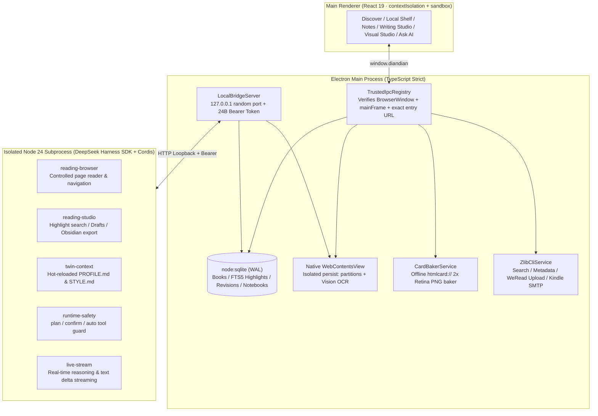

<div align="center">
  
  <h1>diandianreading · 点点读书</h1>
  <p><strong>A personal desktop studio for reading, writing and publishing.</strong></p>
  <p>Bring book discovery, dual-engine co-reading, an AI reading companion, FTS5 highlight synthesis, anti-cliché writing, Xiaohongshu 3D book visuals, and Obsidian knowledge export onto one calm desk.</p>
  <p>
    <a href="./README.md">简体中文</a> · <strong>English</strong> · <a href="./SECURITY.md">Security Policy</a>
  </p>
</div>

---

<p align="center">
  
</p>

## Why diandianreading?

For most serious readers, turning a book into lasting insight or published writing means juggling half a dozen disconnected tools: hunting down EPUBs, pushing files to WeRead or Kindle, pasting passages into a chat window, fighting generic AI-sounding prose, manually designing social cards, and copying notes over to Obsidian.



---

## Features

<table>
  <tr>
    <td align="center" width="50%">
      <br />
      Search by title, author or ISBN
    </td>
    <td align="center" width="50%">
      <br />
      Send to WeRead or Kindle
    </td>
  </tr>
  <tr>
    <td align="center" width="50%">
      <br />
      Bilingual reading
    </td>
    <td align="center" width="50%">
      <br />
      Highlights, notes, and Obsidian export
    </td>
  </tr>
  <tr>
    <td align="center" width="50%">
      <br />
      AI reading companion
    </td>
    <td align="center" width="50%">
      <br />
      Xiaohongshu image studio
    </td>
  </tr>
  <tr>
    <td align="center" width="50%">
      <br />
      Three permission tiers: read-only, confirm, fully automatic
    </td>
    <td align="center" width="50%">
      <br />
      Desktop golden retriever
    </td>
  </tr>
</table>

### 1. Find and download books
- The book-source component ships with the installer; nothing else to install.
- Log in to Z-Library once in the built-in browser on the right and the session syncs automatically. Then search by title, author or ISBN, filter by format and sort order, browse your recommended, popular and saved lists, and see how many downloads you have left today.
- Open the Douban rating and reviews for any book in the right-hand browser with one click.

### 2. Send books to WeRead or Kindle
- Send downloaded EPUB / PDF / MOBI / AZW3 / TXT files to your WeRead shelf in one click. WeRead's web version has no upload API, so the first upload shows a QR code; scan it with WeChat and the book you were sending uploads right after.
- Or email books to your Kindle; the SMTP authorization code is encrypted with the system keychain.

### 3. Two ways to read, with Chinese–English translation
- **Built-in browser on the right**: read WeRead's web version directly, with shortcuts to Douban, Xiaohongshu and the WeChat Official Accounts dashboard; each account keeps its cookies separate. Select text to save it as a note, ask 问点点 about it, or drop it into a draft.
- **Local EPUB reader**: read books without uploading them anywhere, with fonts, size, line spacing, one- or two-column pages, table of contents and footnotes. Translate paragraph by paragraph between Chinese and English (the source language is detected; DeepL or your configured model does the work, and translations are cached locally).
- **Reading comfort**: select text to highlight it (5 colors), add a note, copy, translate or ask 问点点; switch between day and night modes, 9 color themes (white paper, warm paper, Solarized, Nord and more) and paper textures at any time.

<p align="center"></p>

### 4. AI reading companion 问点点
- Reads the page you have open on the right; image-rendered pages such as WeRead's web reader are first read on your Mac with macOS's built-in text recognition.
- Searches your past highlights and thoughts to compare and explain ideas across books. Common requests are one click away, e.g. "compare with books I've read", "write a Xiaohongshu post in my voice", "add evidence to this draft and remove the AI tone".
- Put several books, web pages and drafts into one topic notebook and 问点点 uses the whole set as context.
- Three permission levels: read-only planning, confirm before acting, fully automatic.

### 5. From reading notes to Xiaohongshu and WeChat posts
- Send a single highlight to a draft, or let the AI read all of a book's highlights and thoughts and draft a review.
- The writing studio keeps the AI's original and every revision you make, ready to compare. When you save a revision it suggests writing habits drawn from your edits; the ones you accept go into `STYLE.md`, and the AI follows them from then on.
- When the piece is done, generate 3:4 Xiaohongshu images (1080×1440, four layouts, five color themes, real book covers matched automatically), or copy it as rich text with headings, quotes and lists and paste it into Xiaohongshu's long-post editor or the WeChat Official Accounts dashboard, both available in the right-hand browser. The library can also produce a monthly reading poster.

### 6. One-click Obsidian export for a personal reading knowledge base
- Highlights and thoughts live in a local SQLite database with Chinese and English full-text search. Kindle `My Clippings.txt` files and WeRead highlights can be imported too, without duplicates.
- After choosing an Obsidian vault, export a book's notes or a draft as Markdown in one click. Renames and moves inside Obsidian are tracked; if you edited the same note by hand in Obsidian, a `.diandian-conflict.md` copy is written instead of overwriting your changes.
- The desktop golden retriever brings back one old highlight a day, and `⌘⇧D` captures whatever sentence is on your clipboard.

### 7. Built on DeepSeek Harness, compatible with Harness plugins
- The AI companion runs on [DeepSeek Harness](https://github.com/deepseek-ai/deepseek-harness), with DeepSeek or any OpenAI-compatible model.
- diandianreading's own AI capabilities are native Harness plugins (five under `plugins/`). Third-party or your own Harness plugins load the same way: add them and register each with one line in `electron/agent/supervisor.ts`. The safety guard only blocks the tools on its list, so a new plugin's tools work out of the box. Under `pnpm dev`, editing a plugin only restarts the AI engine in the background.
- For safety, Harness's built-in shell, workflow, skill loading and plugin manager are turned off. Plugins that depend on them need those restrictions lifted in `electron/agent/overlay.ts` and `plugins/runtime-safety/tool-policy.json` first (see [SECURITY.md](./SECURITY.md) for why). If a new plugin has tools that write, add them to `planDenied` in `tool-policy.json` so read-only mode actually blocks them.

---

## Installation & Quick Start

### Option 1: Standalone Installer (Recommended)
Choose an installer on the [download page](https://diandianreading.com/#download) or in [GitHub Releases](https://github.com/Youhai020616/diandianreading/releases).

| System | Installation |
| --- | --- |
| macOS (Apple Silicon or Intel) | Check your chip in About This Mac, open the matching DMG and drag 点点读书 to Applications. |
| Windows x64 | Run the downloaded `.exe` installer. |
| Linux x64 | Mark the AppImage as executable in its file properties, then open it. |

The Mac app is not yet signed or notarized by Apple, so macOS blocks the first launch: try to open it once, then click **Open Anyway** in **System Settings → Privacy & Security**. Alternatively run `xattr -dr com.apple.quarantine "/Applications/点点读书.app"` in Terminal before opening it.
> Everything required at runtime—including the ebook router binary and an isolated Node.js runtime—is bundled inside the app. No Homebrew, Node.js, or terminal setup is required. Add your DeepSeek or OpenAI-compatible API key under **Model Settings** in the bottom-left corner to start co-reading.

### Option 2: Run from Source (Developers)
Prerequisites: **Node.js ≥ 24** and **pnpm**.

```bash
git clone https://github.com/Youhai020616/diandianreading.git
cd diandianreading
pnpm install

# Launch development mode (automatically fetches the pinned zlib binary into vendor/ on first run)
pnpm dev

# Start silently in the background without stealing window focus:
DIANDIAN_START_HIDDEN=1 pnpm dev
```

`pnpm dev` hot-reloads every layer without pulling the window to the foreground:

| Changed Files | Reload Behavior |
| :--- | :--- |
| `src/**` (React UI & CSS) | Instant Vite HMR in place |
| `plugins/**`, `electron/agent/sdkBridge.mjs` | Restarts only the background AI Harness child process |
| `electron/**/*.ts` (Main process & IPC) | Incremental `tsc --watch` build + hidden Electron restart (appears when you switch back) |

Verify and package:

```bash
# Full check before committing
pnpm typecheck && pnpm test && pnpm build

# Run the matching command on the target OS and CPU. Output: release/<version>/
pnpm dist:mac    # Apple Silicon or Intel
pnpm dist:win    # Windows x64
pnpm dist:linux  # Linux x64
```

### Keyboard Shortcuts

| Shortcut | Action |
| :--- | :--- |
| `⌘B` / `Ctrl+B` | Toggle far-left navigation rail |
| `⌘⇧B` / `Ctrl+Shift+B` | Toggle left workspace (focus reading mode) |
| `⌘\` / `Ctrl+\` | Toggle right-hand reading browser |
| `⌘L` / `Ctrl+L` | Toggle right-hand **Ask Diandian** AI co-reading drawer |
| `⌘,` / `Ctrl+,` | Open **Connections & Preferences** |
| `⌘⇧D` / `Ctrl+Shift+D` | Summon the Golden Retriever pet with current clipboard quote |
| Pull-Cord Lamp | Pull the ceiling lamp cord to switch between Cloud-Blue Day and Dark Night themes |

---

## Architecture & Cordis Plugins

diandianreading v2 enforces strict **process-level isolation** across the Electron UI renderer, embedded third-party web pages, the offline card baker, and the DeepSeek Harness agent subprocess.



### Five Custom Cordis Plugins (`plugins/`)
1. **`reading-browser`**: Gives the agent read-only access to the active tab's text/OCR snapshot and selection plus controlled URL navigation—never exposing cookies or credentials.
2. **`reading-studio`**: Exposes domain tools for searching local highlights, saving quotes, appending immutable AI draft revisions, exporting to Obsidian, and checking book-router status.
3. **`twin-context`**: Hot-injects your `PROFILE.md` and anti-cliché `STYLE.md` into the agent context while keeping the system prompt prefix stable for KV-cache hits.
4. **`runtime-safety`**: Enforces `plan` (read-only), `confirm` (guarded), and `auto` execution modes via `ctx.tools.guard`; disables arbitrary `bash / write / edit / workflow` tools at both the overlay and guard layers, and confines file reads via `read-scope.mjs` (`plugins/runtime-safety/tool-policy.json`).
5. **`live-stream`**: Streams root-session `reasoning-delta` and `text-delta` frames over the loopback bridge for low-latency live rendering.

---

## Security & Privacy

See **[SECURITY.md](./SECURITY.md)** for the full threat model and security boundaries:

- **Zero-trust IPC**: All windows run with `contextIsolation: true`, `nodeIntegration: false`, and `sandbox: true`; every `ipcMain` handler is registered through `TrustedIpcRegistry` and validates both `senderFrame === mainFrame` and exact app entry URL matching.
- **Keychain-backed secrets**: LLM API keys, DeepL keys, and Kindle SMTP passwords are encrypted via Electron `safeStorage` (`0700` dir / `0600` atomic file writes) and never enter logs, overlay YAML files, or renderer state.
- **Sandboxed EPUB & card rendering**: EPUB chapters render inside scriptless sandboxed iframes with strict decompression caps (`epubLimits.ts`); share cards and posters render inside a network-blocked `htmlcard://` partition.

---

## License

diandianreading is open source under the [MIT License](./LICENSE). Third-party components bundled with the app (Electron, DeepSeek Harness, foliate-js, heartleo/zlib and others) keep their own open-source licenses; see their LICENSE files and [`public/licenses/`](./public/licenses/).
