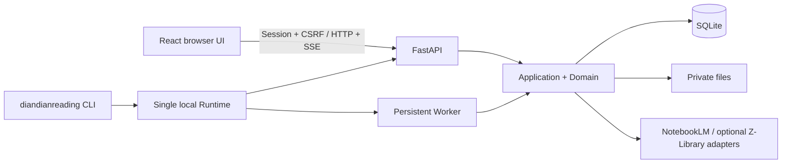

# diandianreading

[](https://github.com/Youhai020616/diandianreading/actions/workflows/ci.yml)

**个人优先、local-first 的 AI 阅读、知识沉淀与内容创作工作台。**

`diandianreading` 把资料导入、连续阅读、划线笔记、NotebookLM 问答、内容修订和 Obsidian 导出放进一个本地 Web 工作区。Python Runtime、React UI、SQLite、持久 Worker 与 Provider Adapter 由一个进程管理，核心数据默认保存在用户自己的设备上。

> **状态：Alpha。** 核心离线链路和 installed-wheel E2E 已实现；真实浏览器、NotebookLM 与 Obsidian 验收仍需维护者完成。项目尚未发布到 PyPI，公开 Stable 发布受 License 决策阻塞。

## 已实现能力

- **本地资料导入**：处理用户有权使用的 Markdown、EPUB 与 PDF，并通过持久 Job 跟踪进度和恢复。
- **阅读与标注**：React 阅读器支持 Markdown/PDF、章节与进度、划线、笔记、软删除和再锚定。
- **带来源的 AI 对话**：通过隔离的 NotebookLM Profile 支持整书、选区和笔记范围问答，并把可定位引用跳回正文。
- **知识与创作工作台**：把回答保存为 KnowledgeNote，生成版本化内容草稿，区分 AI 原稿与人工修订。
- **Obsidian 出口**：按稳定 ID 增量导出，识别重命名；发现用户手改时生成冲突文件而不是静默覆盖。
- **可选 Z-Library Adapter**：保留但默认关闭；每次获取都要求显式权利声明，不提供公共下载服务。
- **本地安全边界**：只绑定 `127.0.0.1:3000`，并保留 Install Token、Browser Session、CSRF、Host/Origin、一次性 Bootstrap Nonce 与资源限额。

尚未实现：P6 社交平台发布、公共云、多租户账号、跨设备同步和原生桌面安装包。详见 [Roadmap](diandianreading-ROADMAP.md)。

## 快速开始

### 当前：从源码运行

要求：

- Python 3.11–3.14；
- [uv](https://docs.astral.sh/uv/)；
- 首次源码构建 Web UI 时需要 Node/pnpm；仓库已经提交 production assets，普通 Python Runtime 不需要 Node。

```bash
git clone https://github.com/Youhai020616/diandianreading.git
cd diandianreading
uv sync --locked --all-groups
uv run diandianreading web
```

服务 readiness 通过后会打开 `http://localhost:3000`。若 3000 端口被占用，命令会拒绝启动，不会切换随机端口、附着未知服务或终止占用进程。

### 目标发行入口

项目发布到包索引后，规范入口为：

```bash
uvx diandianreading web
```

持久安装方式：

```bash
uv tool install diandianreading
diandianreading web
```

这些公开索引命令在 PyPI 发行前不可用；当前请使用源码方式，或从受信任构建产物以 `uvx --from <wheel>` 验证。

## NotebookLM 设置

Python wheel 包含 Playwright 支持，但**不包含也不会在安装时静默下载 Chromium**。首次交互登录前显式执行：

```bash
uv run diandianreading setup notebooklm
uv run diandian auth login notebooklm
```

`setup` 会说明版本、下载来源类别和目标目录，经确认后把固定 Chromium revision 原子安装到私有 App Home。安装中断不会发布半成品。

检查本地运行条件：

```bash
uv run diandianreading doctor
uv run diandianreading doctor --json
```

## 常用命令

全局 `--home` 必须放在子命令之前；默认 App Home 是 `~/.diandianreading/`。

| 命令 | 用途 |
| --- | --- |
| `diandianreading web` | 启动 FastAPI、React UI、Worker 与本地存储，并打开浏览器。 |
| `diandianreading web --no-open` | 启动服务但不自动打开浏览器。 |
| `diandianreading setup notebooklm` | 显式安装并验证 App Home 管理的 Chromium。 |
| `diandianreading doctor [--json]` | 被动检查 App Home、数据库、静态资源、端口、Token、Provider Profile 和浏览器状态。 |
| `diandianreading open` | 使用私有 Install Token 为已运行实例签发一次性 Nonce，并安全打开新浏览器会话。 |
| `diandian auth status` | 查看隔离 Provider Profile 的脱敏状态。 |
| `diandian auth login notebooklm` | 打开受管浏览器执行 NotebookLM 交互登录。 |
| `diandian import <path> --rights-basis owned_copy --rights-confirmed` | 提交一个有明确权利声明的本地导入 Job。 |
| `diandian jobs list` | 列出持久 Job。 |
| `diandian jobs retry <job-id>` | 重试允许恢复的 Job。 |

`diandian` 是兼容 CLI；新的启动、setup、doctor 与 open 文档统一使用 `diandianreading`。

## 数据与配置

```text
~/.diandianreading/
├── state/app.sqlite3
├── objects/
├── credentials/
├── browsers/
├── staging/
└── uploads/
```

| 配置 | 默认值 | 说明 |
| --- | --- | --- |
| `DIANDIAN_HOME` | `~/.diandianreading` | 覆盖稳定 App Home。也可使用全局 `--home <path>`。 |
| `DIANDIAN_ZLIBRARY_ENABLED` | `false` | 显式启用可选 Z-Library Adapter；接受 `true/false` 等布尔值。 |

工具环境升级或重建不会自动删除 App Home。备份、恢复、升级与卸载边界见 [安装与数据运维](docs/operations/install-upgrade-backup.md)。

## 架构



代码采用 Python 模块化单体：

```text
interfaces → application → domain
infrastructure → application ports
worker → application use cases
```

主要目录：

```text
apps/web/                         React + TypeScript + Vite UI
src/diandianreading/domain/       领域模型与不变量
src/diandianreading/application/  Ports 与 Use Cases
src/diandianreading/infrastructure/ SQLite、文件、Provider、浏览器 Runtime
src/diandianreading/interfaces/   CLI、FastAPI、序列化与同源静态资源
tests/                            unit、contract、integration、offline/process E2E
docs/                             ADR、实施计划、API 与验收文档
```

详细设计见 [架构索引](docs/architecture/README.md) 与 [ADR-0009](docs/architecture/adr/0009-local-web-tool-distribution.md)。

## 安全与隐私

- 服务固定监听回环地址；`/healthz` 不是身份凭据。
- Browser Session 通过短时单次 URL Fragment Nonce 建立，Fragment 会被 UI 消费并移除。
- Credential、Token、SQLite 与用户文档位于私有 App Home，不进入 wheel、普通日志或 stdout。
- Provider 是显式边界：启用 NotebookLM 后，用户选择的来源和查询会发送到该第三方；local-first 不等于所有功能永不联网。
- Obsidian 导出只写入用户显式配置的 Vault，并拒绝路径逃逸；检测到手工修改时不覆盖。
- NotebookLM 依赖非官方接口，真实兼容性可能随第三方变化；Fake/contract E2E 不等同于 live compatibility。

安全模型见 [ADR-0005](docs/architecture/adr/0005-local-api-security.md)。私密漏洞请按 [SECURITY.md](SECURITY.md) 处理，不要在公开 issue 中粘贴 Credential、Token、Cookie、书籍正文或 App Home 内容。

## 开发

```bash
# Python 全量质量门
uv run --frozen ruff format --check .
uv run --frozen ruff check .
uv run --frozen mypy src/diandianreading
uv run --frozen pytest -q

# React
cd apps/web
pnpm install --frozen-lockfile
pnpm test
pnpm build
```

Python 测试覆盖率门槛为 90%。CI 还会构建 wheel，在隔离环境启动真实 Uvicorn，验证 readiness、静态资源、安全 reopen 与 SIGTERM。

发布构建与本地 `uvx --from <wheel>` 验证见 [发布流程](docs/development/release-process.md)。

## 文档

- [文档总索引](docs/README.md)
- [产品 PRD](diandianreading-PRD.md)
- [Roadmap](diandianreading-ROADMAP.md)
- [Local Web 分发计划](docs/architecture/local-web-distribution-plan.md)
- [API 参考](docs/api.md)
- [维护者手动验收清单](docs/development/manual-acceptance-checklist.md)
- [Changelog](CHANGELOG.md)

## 参与贡献

提交前请运行 Python 与 Web 全量质量门。仓库采用线性历史与 Conventional Commit 风格（例如 `feat(scope): subject`）；migration 编号与 checksum 不得改写。涉及安全、Credential、迁移或 Provider 权利边界的变更应同时提供负向测试和文档更新。

## License

当前 `pyproject.toml` 标记为 **Proprietary**，仓库未提供开源 License 授权。公开 PyPI Stable 发布将在维护者明确 License 后进行；在此之前不要把源码可见误解为获得复制、修改或再分发许可。
