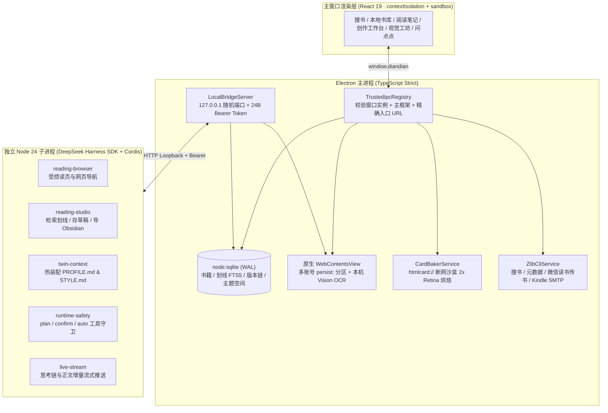

<div align="center">
  
  <h1>点点读书 · diandianreading</h1>
  <p><strong>本地优先的个人共读与表达桌面工作台</strong></p>
  <p>把「找书 · 双引擎沉浸共读 · 划线碰撞 · 去 AI 味写作 · 小红书视觉出图 · Obsidian 知识沉淀」收进同一张书桌。</p>
  <p>
    <strong>简体中文</strong> · <a href="./README.en.md">English</a> · <a href="./SECURITY.md">安全策略 (SECURITY)</a>
  </p>
</div>

---

<!-- 截图展示位：将实机截图放入 docs/screenshots/ 后取消下方注释即可展示 -->
<!--
<p align="center">
  
</p>
-->

## 为什么做点点读书？

大多数深度读者的日常被切碎在六七个彼此割裂的工具里：去书源网站找书、想办法传进微信读书或 Kindle、一边看书一边把段落复制进聊天窗口问 AI、忍受满屏套话的「AI 腔」总结、手动去排版工具做小红书配图，最后还要再整理一份塞进 Obsidian。

**点点读书（diandianreading v2）** 用一套 **Local-First（本地优先）** 的桌面工作台把整条链路彻底打通——所有阅读笔记、划线索引、个人画像（`PROFILE.md` / `STYLE.md`）与版本历史全部保存在你本机的 SQLite 与本地目录中，不绑定云端账号，不劫持你的数据资产。


---

## 核心体验

### 1. 搜书发现与零门槛传书路由
- **开箱即用的书源连接**：安装包已内置 `heartleo/zlib` 引擎，无需手动安装任何命令行工具。在右侧网页登录一次账号，即可自动跟随 SingleLogin 镜像跳转并**零点击同步登录态**，呈现你的专属推荐书墙与热门书单。
- **豆瓣书评联动与元数据修整**：搜书结果支持一键按 ISBN 在右侧打开豆瓣评分与长评；本地电子书支持在线匹配豆瓣 / 微信读书 / Open Library / Google Books 补全书名、作者、ISBN 与内嵌高清封面。
- **无感传入微信读书书架 & Kindle 推送**：下载或导入的 `EPUB / PDF / MOBI / AZW3 / TXT` 支持一键传入微信读书书架（首次传书或授权过期时自动弹出微信扫码窗，**手机一扫完立即自动续传原书**），也支持通过加密保存的邮箱配置一键推送至 Kindle。

### 2. 右侧原生网页 + 本地双语 EPUB 双阅读引擎
- **多账号隔离内置阅读浏览器**：右侧基于 Electron 原生 `WebContentsView` 构建（告别 iframe 跨域受限），按账号使用独立 `persist:` 分区隔离 Cookie，内置微信读书、豆瓣读书、小红书创作服务平台、微信公众号后台快捷入口与划词浮条（一键存笔记 / 问点点 / 写草稿）。
- **本机离线 Vision OCR 读页**：面对微信读书网页版等 `<canvas>` 渲染页面，自动调用 macOS 原生视觉引擎在**本机内存**完成版面识别与段落还原，让「问点点」精准读懂你眼前这一屏，绝不爬取第三方盗版站点。
- **高品质本地双语 EPUB 阅读器**：基于 [foliate-js](https://github.com/johnfactotum/foliate-js)（交互参考 [Readest](https://github.com/readest/readest)），支持宋体 / 黑体 / 楷体切换、字号行距调节、单双栏分页、目录与脚注弹窗、拉绳台灯夜读切换，以及**逐段中英双语对照翻译**（支持个人 DeepL API Key 或已配置的兼容大模型，译文自动本地缓存供离线重读）。

### 3. 本地知识库、跨书碰撞与「小金毛」桌宠
- **毫秒级中文全文检索**：基于 Node 24 原生 `node:sqlite` + **FTS5 Trigram 索引**，无需分词词典即可对中英文划线与批注实现毫秒级子串检索；支持一键导入 Kindle `My Clippings.txt` 与同步微信读书划线笔记（SHA-256 指纹自动去重），点击本地阅读划线可一键**回到原文精确位置**。
- **主题空间（Notebooks）与跨书碰撞**：按研究母题把多本书籍、网页参考与草稿收进同一个主题空间，让 AI 基于整组关联素材做结构化综述与矛盾观点碰撞。
- **桌面陪伴小金毛**：常驻桌面的轻量金毛犬窗口，支持全局快捷键 `⌘⇧D` 随时摘录剪贴板金句，每天轻推一条沉睡在书库里的旧划线，帮知识重新浮出水面。

### 4. 像你本人动笔的创作工作台
- **不可变版本链（Immutable Revisions）**：从对话一键存为初稿（自动剥离 AI 寒暄与过渡废话）后，`v1 AI 原稿` 与你的每一次 `人工修订` 均以不可变版本节点分层留存，随时开启「对照 AI 原稿」双栏审阅，绝不覆盖你的手写文字。
- **写作时旧划线自动浮现**：在你敲字改稿的同时，底部通过 FTS5 实时浮现书库里与当前段落呼应的旧书摘，一键插入引用。
- **从改稿差异自动进化 `STYLE.md`**：每次保存人工修订后，工作台会自动对比「AI 初稿 vs 你的改稿」，提炼出你的真实表达习惯（例如删掉连接词、偏好短句、用亲历开篇），经你确认后无损写入 `STYLE.md`，下一轮对话与润色立即遵循。

### 5. 小红书 3:4 视觉工坊与 Obsidian 资产沉淀
- **小红书封面与视觉配图工坊**：自动从当前草稿提炼核心框架并匹配真实书封，内置四套告别「死板流程图」的 `1080×1440`（原生 3:4）高清版式与五套纸感配色：
  - **书封首图**：微倾 3D 立体精装书封（真实封面或烫金布面书封）+ 手绘笔刷大字报标题 + 焦点金句；
  - **认知反差卡**：「✕ 多数人的直觉误区」vs「✦ 书里的底层真相」高收藏率对撞结构；
  - **视觉笔记**：手绘双圈核心命题 + 和纸胶带四宫格手账导图；
  - **杂志书摘**：*单读 / Kinfolk* 纸本排印风无框长图；
  - 同时支持**金句单卡**、**多页图文套卡拆分批量导出**、**月度阅读海报**，以及一键复制富文本直达小红书「写长文」套用官方排版。
- **无损单向导出至 Obsidian**：通过 frontmatter `diandian_id` 跟踪笔记库中的文件改名与目录移动；若检测到你在 Obsidian 中手工改过同一篇笔记，自动生成 `.diandian-conflict.md` 冲突副本而**绝不静默覆盖**，并支持 `obsidian://open` 一键唤起定位。

<!-- 预留功能动图或分栏截图位 -->
<!--
| 搜书与双栏沉浸共读 | 创作工作台与小红书 3D 书封工坊 |
| :---: | :---: |
|  |  |
-->

---

## 下载安装与快速开始

### 方式一：安装包开箱即用（推荐普通用户）
前往 [GitHub Releases](https://github.com/Youhai020616/diandianreading/releases) 下载对应系统的安装包（如 macOS Apple Silicon 的 `点点读书-<version>-mac-arm64.dmg`），拖入「应用程序」即可直接运行。
> 安装包已完整内置电子书路由组件与独立 Node 运行时，**无需**安装 Homebrew、Node.js、Python 或任何命令行依赖。首次打开后在左下角「模型」填入你的 DeepSeek 或任意 OpenAI 兼容 API Key 即可开始共读。

### 方式二：从源码启动（开发者）
环境要求：**Node.js ≥ 24**、**pnpm**。

```bash
git clone https://github.com/Youhai020616/diandianreading.git
cd diandianreading
pnpm install

# 启动开发模式（首次会自动拉取平台对应的内置 zlib 二进制至 vendor/）
pnpm dev

# 若希望后台静默启动且不抢占当前桌面焦点：
DIANDIAN_START_HIDDEN=1 pnpm dev
```

`pnpm dev` 已内置全链路无打扰热重载，开发时无需手动杀进程重启：

| 修改范围 | 热更新行为 |
| :--- | :--- |
| `src/**`（React 界面与样式） | Vite HMR 原地热更新，保留当前窗口状态 |
| `plugins/**`、`electron/agent/sdkBridge.mjs` | 仅在后台热重启 AI Harness 子进程，主窗口不动 |
| `electron/**/*.ts`（主进程与 IPC） | `tsc --watch` 增量编译零错误后，在后台静默重启 Electron（切回应用时自动显现） |

### 常用快捷键

| 快捷键 | 功能 |
| :--- | :--- |
| `⌘B` / `Ctrl+B` | 收起 / 展开最左侧导航栏 |
| `⌘⇧B` / `Ctrl+Shift+B` | 收起 / 展开左侧工作台（进入纯享宽屏阅读模式） |
| `⌘\` / `Ctrl+\` | 收起 / 展开右侧阅读浏览器 |
| `⌘L` / `Ctrl+L` | 唤起 / 收起右侧「问点点」AI 共读抽屉 |
| `⌘,` / `Ctrl+,` | 打开「连接与偏好」设置页 |
| `⌘⇧D` / `Ctrl+Shift+D` | 全局召唤「小金毛」快速摘录当前剪贴板文字 |
| 顶部拉绳吊灯 | 轻拉切换「云蓝白昼」与「暗黑夜读」主题（带钨丝灯物理音效与光晕） |

---

## 系统架构与插件设计

点点读书 v2 采用**进程级隔离**的 Electron + DeepSeek Harness SDK 架构：UI 渲染层、内嵌第三方网页、离线卡片烘焙器与 AI Agent 运行时各自处于严格受限的独立沙盒或子进程中。



### 五个定制 Cordis 插件（`plugins/`）
1. **`reading-browser`**（`plugins/reading-browser`）：让 AI 按需读取右侧活跃标签页的正文快照、划词选区与标签列表，并支持受控跳转（绝不接触或暴露任何 Cookie 与密码）。
2. **`reading-studio`**（`plugins/reading-studio`）：提供本地书库检索、保存高光笔记、向创作工作台写入不可变 AI 初稿/修订版、触发单向 Obsidian 导出与查询书源连接状态等受控领域工具。
3. **`twin-context`**（`plugins/twin-context`）：在每轮对话前热挂载用户的个人画像 `PROFILE.md` 与去 AI 味写作准则 `STYLE.md`，文件改动后下一轮即时生效且保持系统提示前缀稳定以命中 KV 缓存。
4. **`runtime-safety`**（`plugins/runtime-safety`）：基于 `ctx.tools.guard` 实现 `plan`（只读规划）、`confirm`（安全确认）、`auto`（全自动工作流）三档实时守卫；在 Overlay 层与守卫层双重禁用任意底层 `bash / write / edit / workflow` 工具，并通过 `read-scope.mjs` 将文件读取严格锁死在受控工作目录内。权限清单唯一真源维护在 `plugins/runtime-safety/tool-policy.json`。
5. **`live-stream`**（`plugins/live-stream`）：拦截根会话的 `reasoning-delta` 与 `text-delta` 帧实时回推给工作台，驱动深度思考折叠链与低延迟流式排版。

---

## 安全与隐私边界

完整威胁模型与剩余风险说明请参阅 **[SECURITY.md](./SECURITY.md)**，核心设计原则如下：

- **渲染层与 IPC 零信任校验**：全部窗口强制开启 `contextIsolation: true`、`nodeIntegration: false`、`sandbox: true`；所有 `ipcMain` 通道均经 `TrustedIpcRegistry` 校验发送方主框架与精确入口地址，内嵌第三方网页无法触达 `window.diandian`。
- **密钥系统钥匙串加密**：大模型 API Key、DeepL 翻译密钥与 Kindle SMTP 授权码均经 Electron `safeStorage`（系统钥匙串）加密落盘（目录 `0700` / 文件 `0600` 原子写），仅在拉起子进程或发信瞬间于内存解密，绝不写入日志、Overlay 配置或渲染层状态。
- **电子书与卡片离线沙盒**：本地 EPUB 章节在无脚本沙盒 iframe 中渲染，强制剥离脚本/表单并设有防压缩炸弹解压上限（`epubLimits.ts`）；卡片与海报在独立 `htmlcard://` 沙盒分区离屏烘焙，拦截一切外网请求。
- **单向非破坏性导出**：Obsidian 导出拒绝符号链接越界，遇到外部手工编辑自动分流为 `.diandian-conflict.md` 冲突副本，永不覆盖用户手稿。

---

## 构建安装包与本地校验

### 打包独立安装包
```bash
pnpm dist:mac   # 输出至 release/<version>/点点读书-<version>-mac-arm64.dmg
```

构建流水线（`scripts/before-build.mjs` → `fetch-binaries.mjs` → `stage-runtime.mjs`）会自动完成自包含运行时装配与 SHA-256 强校验：

| 打包资源目录 | 封装内容 | 校验与裁剪机制 |
| :--- | :--- | :--- |
| `resources/zlib/` | `heartleo/zlib` CLI v0.0.16 | 官方 Release 拉取，SHA-256 固定在 `scripts/fetch-binaries.mjs` |
| `resources/node/` | Node.js v24.22.3 独立运行时 | 专供 DeepSeek Harness 子进程使用，完全不依赖用户机器环境 |
| `resources/node_modules/` | 扁平化裁剪后的生产依赖 | 基于同一份 `pnpm-lock.yaml` 安装后按 `scripts/stage-runtime.mjs` 剔除冗余组件 |

> 注：当前默认生成当前宿主机架构的安装包；在配置 Apple Developer 签名与公证（Notarization）前，分发到其他 Mac 首次打开需在「系统设置 → 隐私与安全性」中点击「仍要打开」。

### 全量工程校验
提交改动前请确保类型检查、IPC 契约测试、单元测试与生产构建全部通过：

```bash
pnpm typecheck && pnpm test && pnpm build
```

---

## 致谢与第三方声明

- 本地 EPUB 排版引擎基于 [foliate-js](https://github.com/johnfactotum/foliate-js)，阅读器交互设计参考了 [Readest](https://github.com/readest/readest)（详见 [阅读引擎许可声明](./public/licenses/epub-reader.txt)）。
- 可选电子书检索、元数据修整与书架传输能力由内置的 [heartleo/zlib](https://github.com/heartleo/zlib)（MIT）驱动。
- 共读 Agent 运行时基于 `@deepseek-ai/dsh`（DeepSeek Harness SDK）与 Cordis 插件体系构建。
