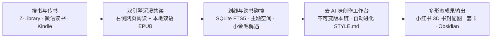
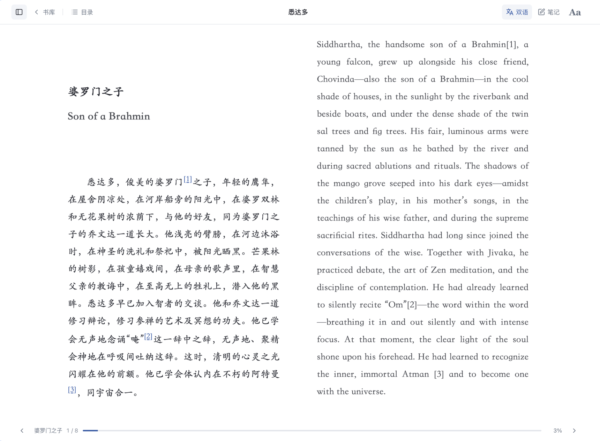
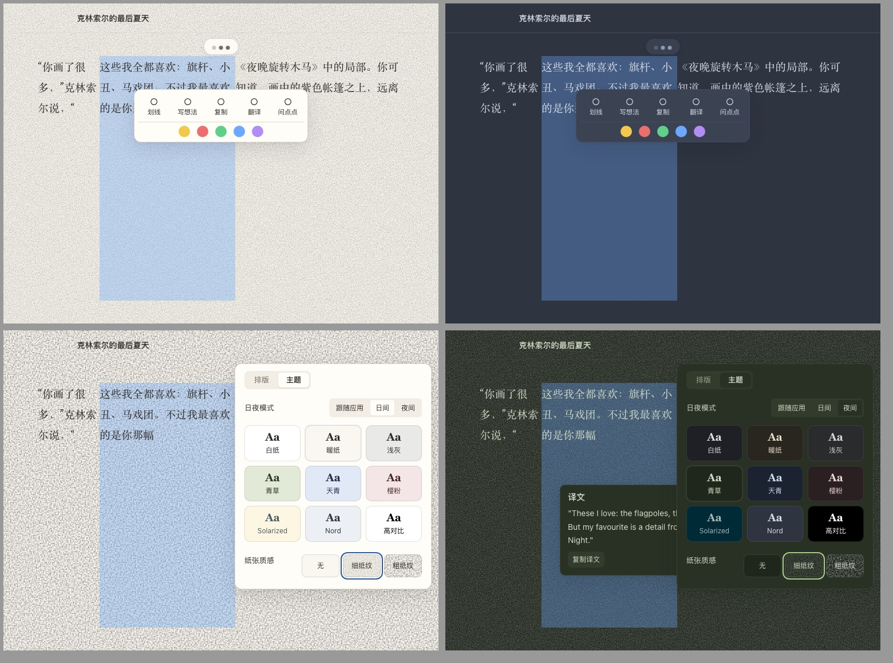
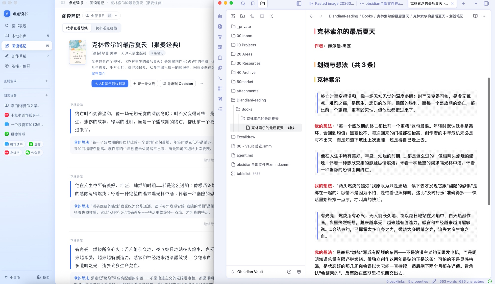
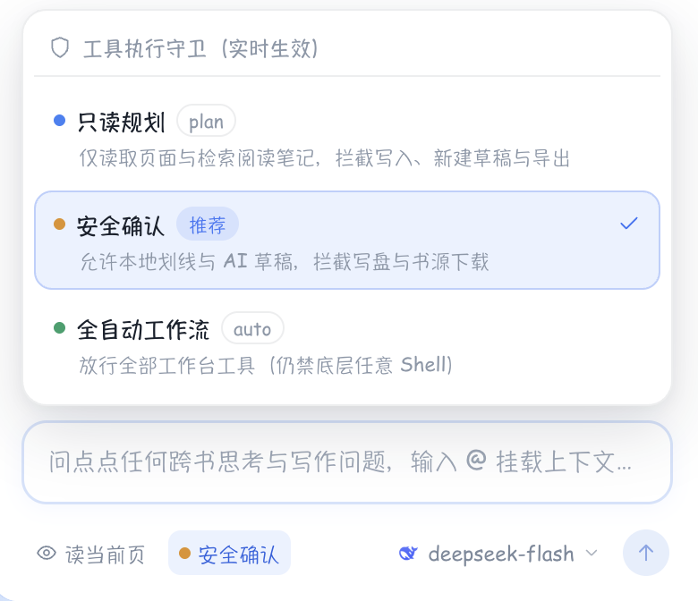
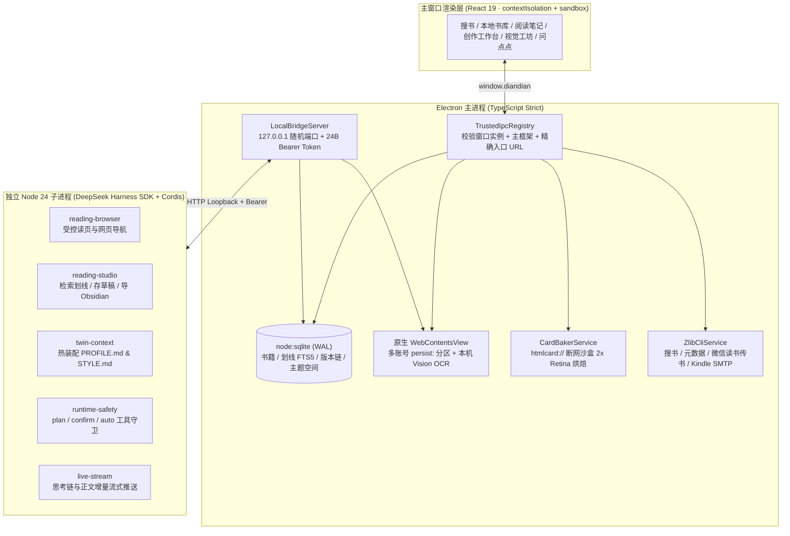

<div align="center">
  
  <h1>点点读书 · diandianreading</h1>
  <p><strong>个人读书创作发布工作台</strong></p>
  <p>把「找书 · 双引擎沉浸共读 · AI 伴读 · 划线碰撞 · 去 AI 味写作 · 小红书视觉出图 · Obsidian 知识沉淀」收进同一张书桌。</p>
  <p>
    <strong>简体中文</strong> · <a href="./README.en.md">English</a> · <a href="./SECURITY.md">安全策略 (SECURITY)</a>
  </p>
</div>

---

<p align="center">
  
</p>

## 为什么做点点读书？

大多数深度读者的日常被切碎在六七个彼此割裂的工具里：去书源网站找书、想办法传进微信读书或 Kindle、一边看书一边把段落复制进聊天窗口问 AI、忍受满屏套话的「AI 腔」总结、手动去排版工具做小红书配图，最后还要再整理一份塞进 Obsidian。



---

## 主要功能

### 1. 搜书与下载
- 安装包已内置书源组件，不用另装命令行工具。
- 在右侧内置浏览器登录一次 Z-Library，登录状态会自动同步过来；之后可按书名、作者、ISBN 搜索，按格式和排序筛选，浏览推荐、热门和收藏书单，并随时看到当天剩余的下载次数。
- 书籍详情页可一键在右侧打开豆瓣评分和书评。

<p align="center"></p>

### 2. 一键传到微信读书或 Kindle
- 下载好的 EPUB / PDF / MOBI / AZW3 / TXT 可一键传进微信读书书架。网页版微信读书没有传书接口，第一次传书时会弹出二维码，用微信扫一下即可开通，扫完自动接着上传刚才那本书。
- 也可以通过邮件推送到 Kindle，邮箱授权码用系统钥匙串加密保存。

<p align="center"></p>

### 3. 两种阅读方式，内置中英互译
- **右侧内置浏览器**：直接读微信读书网页版，也内置豆瓣、小红书、公众号后台等入口，不同账号的 Cookie 互相隔离。选中文字可一键存为笔记、发给问点点或写进草稿。
- **本地 EPUB 阅读器**：不传微信读书也能在应用里读，支持字体、字号、行距、单双栏、目录和脚注；可逐段中英互译（自动识别原文语言，用 DeepL 或你配置的大模型翻译，译文缓存在本地）。
- **阅读体验**：选中文字可以划线（5 种颜色）、写想法、复制、翻译或发给问点点；日夜模式、9 套配色（白纸、暖纸、Solarized、Nord 等）和纸张质感可以随时切换。

<p align="center"></p>

<p align="center"></p>

### 4. AI 伴读「问点点」
- 能读你右侧正在看的页面；微信读书网页版这类图片式渲染的页面，会先在本机用 macOS 自带的文字识别读出这一屏。
- 能检索你书库里的旧划线和想法，做跨书对照和讲解；常用动作一键发起，如「和我读过的书碰一碰」「按我的口吻写小红书长文」「给当前草稿加论据 & 去 AI 味」。
- 可以把几本书、网页和草稿放进同一个主题空间，问点点会把整组材料当作上下文。
- 权限分三档：只读规划、安全确认、全自动。

<p align="center"></p>

### 5. 从读书笔记到小红书、公众号
- 阅读笔记里的单条划线可一键写入草稿，也可以让 AI 读完一本书的全部划线和想法，起草一篇书评初稿。
- 创作工作台保留 AI 原稿和你的每一次修改，随时可以对照；保存修改后，会从你的改动里提炼写作习惯，经你确认后写进 `STYLE.md`，之后 AI 按你的口吻来写。
- 定稿后可生成小红书 3:4 配图（1080×1440，4 种版式、5 套配色，自动匹配真实书封），或复制带标题、引用、列表格式的富文本，在右侧内置浏览器打开的小红书「写长文」或公众号后台粘贴发布。书库还能生成月度阅读海报。

<p align="center"></p>

### 6. 一键导出到 Obsidian，搭建个人读书知识库
- 划线和想法存在本机 SQLite，支持中英文全文检索；Kindle 的 `My Clippings.txt` 和微信读书的划线也能导入进来，自动去重。
- 选好 Obsidian 笔记库后，一本书的笔记或一篇草稿可一键导出为 Markdown。在 Obsidian 里改名、移动目录都能跟踪到；如果你在 Obsidian 里手动改过同一篇，会另存一份 `.diandian-conflict.md`，不会覆盖你的修改。
- 桌面上的小金毛每天推一条旧划线给你，`⌘⇧D` 可随手摘录剪贴板里的句子。

<p align="center"></p>

<p align="center"></p>

### 7. 基于 DeepSeek Harness，兼容 Harness 插件生态
- AI 助手运行在 [DeepSeek Harness](https://github.com/deepseek-ai/deepseek-harness) 上，模型可接 DeepSeek 或任意 OpenAI 兼容接口。
- 点点读书自己的 AI 能力都是 Harness 原生插件（`plugins/` 下 5 个）。第三方或自己写的 Harness 插件，放进来后在 `electron/agent/supervisor.ts` 登记一行即可加载；安全守卫只拦截名单里的工具，新插件的工具默认可用。`pnpm dev` 下改插件只会在后台重启 AI 引擎。
- 为了安全，默认关闭了 Harness 自带的 shell、workflow、技能加载和插件管理器。依赖这些能力的插件，需先在 `electron/agent/overlay.ts` 和 `plugins/runtime-safety/tool-policy.json` 中解除限制（原因见 [SECURITY.md](./SECURITY.md)）。新插件带写入类工具时，建议加进 `tool-policy.json` 的 `planDenied`，只读模式下才会被拦住。

<p align="center"></p>

---

## 下载安装与快速开始

### 方式一：安装包开箱即用（推荐普通用户）
前往 [GitHub Releases](https://github.com/Youhai020616/diandianreading/releases) 下载安装包（目前只提供 macOS Apple Silicon 版：`diandianreading-<version>-mac-arm64.dmg`），打开后把「点点读书」拖入「应用程序」。

安装包还没有经过 Apple 签名和公证，第一次打开会被系统拦截：先打开一次，再到「系统设置 → 隐私与安全性」点「仍要打开」。也可以在终端执行 `xattr -dr com.apple.quarantine "/Applications/点点读书.app"` 后再打开。
> 安装包已完整内置电子书路由组件与独立 Node 运行时，**无需**安装 Homebrew、Node.js、Python 或任何命令行依赖。首次打开后在左下角「模型」填入你的 DeepSeek 或任意 OpenAI 兼容 API Key 即可开始共读。

### 方式二：从源码启动（开发者）
环境要求：**Node.js ≥ 24**、**pnpm**。

```bash
git clone https://github.com/Youhai020616/diandianreading.git
cd diandianreading
pnpm install

# 启动开发模式（首次会自动拉取平台对应的内置 zlib 二进制至 vendor/）
pnpm dev

# 若希望后台静默启动且不抢占当前桌面焦点：
DIANDIAN_START_HIDDEN=1 pnpm dev
```

`pnpm dev` 已内置全链路无打扰热重载，开发时无需手动杀进程重启：

| 修改范围 | 热更新行为 |
| :--- | :--- |
| `src/**`（React 界面与样式） | Vite HMR 原地热更新，保留当前窗口状态 |
| `plugins/**`、`electron/agent/sdkBridge.mjs` | 仅在后台热重启 AI Harness 子进程，主窗口不动 |
| `electron/**/*.ts`（主进程与 IPC） | `tsc --watch` 增量编译零错误后，在后台静默重启 Electron（切回应用时自动显现） |

打包与校验：

```bash
# 提交前的全量校验
pnpm typecheck && pnpm test && pnpm build

# 打包 macOS（Apple Silicon）安装包，输出到 release/<version>/
pnpm dist:mac
```

### 常用快捷键

| 快捷键 | 功能 |
| :--- | :--- |
| `⌘B` / `Ctrl+B` | 收起 / 展开最左侧导航栏 |
| `⌘⇧B` / `Ctrl+Shift+B` | 收起 / 展开左侧工作台（进入纯享宽屏阅读模式） |
| `⌘\` / `Ctrl+\` | 收起 / 展开右侧阅读浏览器 |
| `⌘L` / `Ctrl+L` | 唤起 / 收起右侧「问点点」AI 共读抽屉 |
| `⌘,` / `Ctrl+,` | 打开「连接与偏好」设置页 |
| `⌘⇧D` / `Ctrl+Shift+D` | 全局召唤「小金毛」快速摘录当前剪贴板文字 |
| 顶部拉绳吊灯 | 轻拉切换「云蓝白昼」与「暗黑夜读」主题（带钨丝灯物理音效与光晕） |

---

## 系统架构与插件设计

点点读书 v2 采用**进程级隔离**的 Electron + DeepSeek Harness SDK 架构：UI 渲染层、内嵌第三方网页、离线卡片烘焙器与 AI Agent 运行时各自处于严格受限的独立沙盒或子进程中。



### 五个定制 Cordis 插件（`plugins/`）
1. **`reading-browser`**（`plugins/reading-browser`）：让 AI 按需读取右侧活跃标签页的正文快照、划词选区与标签列表，并支持受控跳转（绝不接触或暴露任何 Cookie 与密码）。
2. **`reading-studio`**（`plugins/reading-studio`）：提供本地书库检索、保存高光笔记、向创作工作台写入不可变 AI 初稿/修订版、触发单向 Obsidian 导出与查询书源连接状态等受控领域工具。
3. **`twin-context`**（`plugins/twin-context`）：在每轮对话前热挂载用户的个人画像 `PROFILE.md` 与去 AI 味写作准则 `STYLE.md`，文件改动后下一轮即时生效且保持系统提示前缀稳定以命中 KV 缓存。
4. **`runtime-safety`**（`plugins/runtime-safety`）：基于 `ctx.tools.guard` 实现 `plan`（只读规划）、`confirm`（安全确认）、`auto`（全自动工作流）三档实时守卫；在 Overlay 层与守卫层双重禁用任意底层 `bash / write / edit / workflow` 工具，并通过 `read-scope.mjs` 将文件读取严格锁死在受控工作目录内。权限清单唯一真源维护在 `plugins/runtime-safety/tool-policy.json`。
5. **`live-stream`**（`plugins/live-stream`）：拦截根会话的 `reasoning-delta` 与 `text-delta` 帧实时回推给工作台，驱动深度思考折叠链与低延迟流式排版。

---

## 安全与隐私边界

完整威胁模型与剩余风险说明请参阅 **[SECURITY.md](./SECURITY.md)**，核心设计原则如下：

- **渲染层与 IPC 零信任校验**：全部窗口强制开启 `contextIsolation: true`、`nodeIntegration: false`、`sandbox: true`；所有 `ipcMain` 通道均经 `TrustedIpcRegistry` 校验发送方主框架与精确入口地址，内嵌第三方网页无法触达 `window.diandian`。
- **密钥系统钥匙串加密**：大模型 API Key、DeepL 翻译密钥与 Kindle SMTP 授权码均经 Electron `safeStorage`（系统钥匙串）加密落盘（目录 `0700` / 文件 `0600` 原子写），仅在拉起子进程或发信瞬间于内存解密，绝不写入日志、Overlay 配置或渲染层状态。
- **电子书与卡片离线沙盒**：本地 EPUB 章节在无脚本沙盒 iframe 中渲染，强制剥离脚本/表单并设有防压缩炸弹解压上限（`epubLimits.ts`）；卡片与海报在独立 `htmlcard://` 沙盒分区离屏烘焙，拦截一切外网请求。
- **单向非破坏性导出**：Obsidian 导出拒绝符号链接越界，遇到外部手工编辑自动分流为 `.diandian-conflict.md` 冲突副本，永不覆盖用户手稿。
