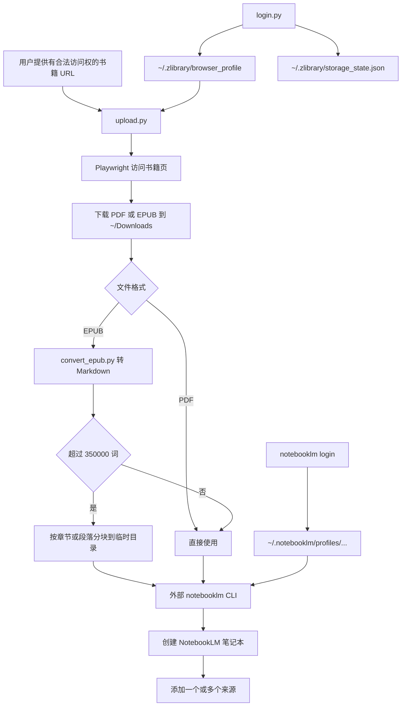

# Z-Library → NotebookLM API 参考

> 基于当前工作区源码整理。
>
> `notebooklm-py`: `0.8.0rc1`；`zlibrary-to-notebooklm`: `1.0.0`（来自 `package.json`）。
>
> 最后核对：2026-08-03。

## 1. 文档范围与结论

本仓库包含一个主产品和两个来源/依赖项目：

| 项目 | 定位 | 主要接口 |
| --- | --- | --- |
| `src/diandianreading` | local-first 主产品；组合导入、Job、Provider、Web/API 与 whole-book Chat | `diandian` CLI、FastAPI local API、Worker、SQLite |
| [`notebooklm-py`](https://github.com/teng-lin/notebooklm-py) | 非官方 NotebookLM Python SDK 与自动化工具；主产品固定依赖其 PyPI 发布包，vendored 副本已移除（见 [移除记录](development/removed-vendored-sources.md)） | Python async API、CLI、MCP Server、实验性 REST Server |
| [`zlibrary-to-notebooklm`](https://github.com/zstmfhy/zlibrary-to-notebooklm) | Legacy Z-Library 下载并转交 NotebookLM 的脚本；仅作迁移依据，vendored 副本已移除 | `login.py`、`upload.py`、`convert_epub.py` |

最重要的集成结论：

1. `zlibrary-to-notebooklm` **没有包含** `notebooklm-py` 源码，也未在 `requirements.txt` 中声明它。
2. `zlibrary-to-notebooklm` 通过 `subprocess` 调用 PATH 中的外部 `notebooklm` CLI。
3. 两边认证完全独立：
   - Z-Library 会话：`~/.zlibrary/`
   - Google NotebookLM 会话：`~/.notebooklm/`
4. 创建 NotebookLM 笔记本和上传来源前，必须先完成 NotebookLM 登录；仅登录 Z-Library 不够。
5. `notebooklm-py` 使用 Google 未公开 RPC，不是 Google 官方 SDK；Google 可随时修改后端协议。
6. Phase 5 主产品已移除 Legacy 脚本到外部 `notebooklm` CLI 的生产耦合，改为公开 Python SDK Adapter、独立 Session Manager、持久 Job/Chat 和安全本地 Web/API；真实 Provider 浏览器兼容性仍未由自动化验证。



## 2. 快速使用契约

本节所有 Z-Library 地址使用 `.invalid` 合成占位符，不代表可访问站点，也不应直接执行。真实 Origin 必须由用户在合法访问前提下显式配置，并接受集成计划中的网络策略。

### 2.1 必需的两次登录

```bash
notebooklm login
notebooklm auth check --test --json

git clone https://github.com/zstmfhy/zlibrary-to-notebooklm
cd zlibrary-to-notebooklm
python scripts/login.py --url "https://zlibrary.invalid/"
```

NotebookLM 网络认证验证成功时，`notebooklm auth check --test --json` 应同时满足：

```json
{
  "status": "ok",
  "checks": {
    "token_fetch": true
  }
}
```

### 2.2 执行完整流程

```bash
cd zlibrary-to-notebooklm
python scripts/upload.py "https://zlibrary.invalid/book/<synthetic-book-id>"
```

脚本当前只读取第一个位置参数作为书籍 URL，没有 `argparse` 选项，也没有原生批量参数。

---

# Part I：`notebooklm-py`

## 3. 安装、入口与可选依赖

### 3.1 基础要求

- Python `>=3.10`
- 基础依赖：`httpx`、`click`、`rich`、`filelock`
- 包名：`notebooklm-py`
- 导入名：`notebooklm`

### 3.2 命令入口

| 命令 | Python 入口 | 用途 |
| --- | --- | --- |
| `notebooklm` | `notebooklm.notebooklm_cli:main` | 主 CLI |
| `notebooklm-mcp` | `notebooklm.mcp.__main__:main` | MCP Server |
| `notebooklm-server` | `notebooklm.server.__main__:main` | 单租户 REST Server |

### 3.3 Extras

| Extra | 依赖/能力 | 备注 |
| --- | --- | --- |
| `browser` | Playwright | `notebooklm login` 的浏览器登录 |
| `cookies` | rookiepy | 从本机浏览器导入 Cookie；Python 3.13+ 可能无法安装 |
| `markdown` | markdownify | 来源全文转 Markdown |
| `headless` | gpsoauth | master token 无头认证 |
| `mcp` | FastMCP | MCP Server，实验性 |
| `server` | FastAPI、Uvicorn、python-multipart | REST Server，实验性 |
| `impersonate` | curl-cffi | 实验性 TLS 指纹模拟传输 |
| `dev` | pytest、mypy、ruff 等 | 开发与测试 |
| `all` | browser、dev、headless、markdown、mcp、server | 明确不包含 `cookies` 和 `impersonate` |

常见安装方式：

```bash
uv tool install "notebooklm-py[browser]"
```

作为 Python 库使用时：

```bash
pip install notebooklm-py
```

## 4. 认证、Profile 与配置

### 4.1 默认目录结构

```text
~/.notebooklm/
├── config.json
├── active_profile
└── profiles/
    ├── default/
    │   ├── storage_state.json
    │   ├── context.json
    │   ├── browser_profile/
    │   └── master_token.json      # 仅 headless/master-token 流程
    └── <profile>/
        └── ...
```

敏感级别：

- `storage_state.json`：Google 会话 Cookie，必须视为账号凭据。
- `master_token.json`：长期、全账号级凭据，风险高于普通 Cookie；只建议用于专用账号。
- 两者都不得提交 Git、写入日志或粘贴到公开 Issue。

### 4.2 `from_storage()` 认证优先级

由高到低：

1. `NotebookLMClient.from_storage(path=...)` 的显式路径
2. `NOTEBOOKLM_AUTH_JSON`
3. `from_storage(profile="...")`
4. `NOTEBOOKLM_PROFILE`
5. `~/.notebooklm/active_profile` 或全局配置中的默认 Profile
6. `~/.notebooklm/profiles/default/storage_state.json`
7. 旧版 `~/.notebooklm/storage_state.json`

### 4.3 主要环境变量

#### 核心客户端与 CLI

| 变量 | 用途 | 默认值 |
| --- | --- | --- |
| `NOTEBOOKLM_HOME` | 配置根目录 | `~/.notebooklm` |
| `NOTEBOOKLM_PROFILE` | 当前 Profile | `default` |
| `NOTEBOOKLM_AUTH_JSON` | 内联认证 JSON，适合 CI secret | 无 |
| `NOTEBOOKLM_NOTEBOOK` | CLI 默认 Notebook ID | 无 |
| `NOTEBOOKLM_HL` | 生成内容的默认语言 | `en` |
| `NOTEBOOKLM_BASE_URL` | NotebookLM 基础 URL | 个人版 NotebookLM URL |
| `NOTEBOOKLM_TRANSPORT` | `httpx` 或 `curl_cffi` | `httpx` |
| `NOTEBOOKLM_LOG_LEVEL` | 日志级别 | `WARNING` |
| `NOTEBOOKLM_DEBUG_RPC` | RPC 调试日志 | 关闭 |
| `NOTEBOOKLM_RPC_OVERRIDES` | RPC 名称到 method ID 的 JSON 覆盖 | 无 |
| `NOTEBOOKLM_REFRESH_CMD` | 认证过期时执行的外部刷新命令 | 无 |
| `NOTEBOOKLM_QUIET_DEPRECATIONS` | 抑制项目弃用警告 | 关闭 |

CLI 中 Notebook 选择顺序：

```text
-n/--notebook > NOTEBOOKLM_NOTEBOOK > notebooklm use 保存的 context > 报错
```

#### MCP Server

| 变量 | 用途 | 默认值 |
| --- | --- | --- |
| `NOTEBOOKLM_MCP_TRANSPORT` | `stdio` 或 `http` | `stdio` |
| `NOTEBOOKLM_MCP_HOST` | HTTP 绑定地址 | `127.0.0.1` |
| `NOTEBOOKLM_MCP_PORT` | HTTP 端口 | `9420` |
| `NOTEBOOKLM_MCP_TOKEN` | HTTP Bearer Token | 无 |
| `NOTEBOOKLM_MCP_ALLOW_EXTERNAL_BIND` | 允许非回环地址绑定，值必须为 `1` | `0` |
| `NOTEBOOKLM_MCP_STRICT_IDS` | 仅接受完整规范 ID | `0` |
| `NOTEBOOKLM_MCP_PUBLIC_URL` | 远程上传/下载签名 URL 的公开 Origin | 无 |
| `NOTEBOOKLM_MCP_OAUTH_PASSWORD` | 自托管 OAuth 密码 | 无 |
| `NOTEBOOKLM_MCP_OAUTH_BASE_URL` | 自托管 OAuth 的 HTTPS Origin | 无 |

#### REST Server

| 变量 | 用途 | 默认值 |
| --- | --- | --- |
| `NOTEBOOKLM_SERVER_TOKEN` | 所有 `/v1` 请求的 Bearer Token | 必填 |
| `NOTEBOOKLM_SERVER_TOKEN_FILE` | 从文件读取 Bearer Token | 无 |
| `NOTEBOOKLM_SERVER_HOST` | 绑定地址 | `127.0.0.1` |
| `NOTEBOOKLM_SERVER_PORT` | 端口 | `8000` |
| `NOTEBOOKLM_SERVER_ALLOW_EXTERNAL_BIND` | 允许非回环地址绑定，值必须为 `1` | `0` |
| `NOTEBOOKLM_SERVER_*_CONCURRENCY` | 各类 REST 操作的并发上限 | 按操作为 `2` 或 `4` |

完整变量清单见 [`configuration.md`](https://github.com/teng-lin/notebooklm-py/blob/main/docs/configuration.md)。

## 5. `notebooklm` CLI API

### 5.1 全局语法

```text
notebooklm [-p PROFILE] [--storage PATH] [--version] [-v|--quiet] <command> [OPTIONS] [ARGS]
```

| 选项 | 作用 |
| --- | --- |
| `-p, --profile NAME` | 选择认证 Profile |
| `--storage PATH` | 覆盖 `storage_state.json` 路径 |
| `-v`, `-vv` | INFO / DEBUG 日志 |
| `--quiet` | 仅保留错误和结构化 JSON；不能与 `-v` 同用 |
| `--version` | 输出版本 |

标准退出码：

| 退出码 | 含义 |
| --- | --- |
| `0` | 成功 |
| `1` | 用户输入或应用级错误 |
| `2` | CLI 用法、系统或意外错误 |
| `130` | SIGINT / Ctrl-C |

`source stale --exit-on-stale` 与 `source wait` 有专门的判定型退出语义，自动化时应查阅上游 [`cli-exit-codes.md`](https://github.com/teng-lin/notebooklm-py/blob/main/docs/cli-exit-codes.md)。

### 5.2 命令清单

| 领域 | 命令/子命令 |
| --- | --- |
| 登录与认证 | `login`；`auth check`、`inspect`、`import-cookies`、`refresh`、`logout` |
| Profile | `profile list`、`create`、`switch`、`delete`、`rename` |
| 当前上下文 | `use`、`status`、`clear`、`completion`、`doctor` |
| Notebook | `list`、`create`、`delete`、`rename`、`summary`、`metadata` |
| Chat | `ask`、`suggest-prompts`、`configure`、`history` |
| Source | `source list`、`add`、`add-drive`、`add-research`、`get`、`fulltext`、`guide`、`stale`、`wait`、`clean`、`rename`、`refresh`、`delete`、`delete-by-title` |
| Label | `label list`、`sources`、`generate`、`create`、`rename`、`emoji`、`add`、`remove`、`delete` |
| Research | `research status`、`wait`、`cancel` |
| 生成 | `generate audio`、`video`、`cinematic-video`、`slide-deck`、`revise-slide`、`quiz`、`flashcards`、`infographic`、`data-table`、`mind-map`、`report` |
| Artifact | `artifact list`、`get`、`get-prompt`、`rename`、`delete`、`export`、`poll`、`wait`、`retry`、`suggestions` |
| 下载 | `download audio`、`video`、`cinematic-video`、`slide-deck`、`infographic`、`report`、`mind-map`、`data-table`、`quiz`、`flashcards` |
| Note | `note list`、`create`、`get`、`save`、`rename`、`delete` |
| 分享 | `share status`、`public`、`view-level`、`add`、`update`、`remove` |
| 语言 | `language list`、`get`、`set` |
| Agent/Skill/MCP | `agent show`、`skill install/status/uninstall/show/package`、`mcp install` |

详细参数见 [`cli-reference.md`](https://github.com/teng-lin/notebooklm-py/blob/main/docs/cli-reference.md)。

### 5.3 常用 CLI 契约

```bash
notebooklm create "My Notebook" --json
notebooklm use <notebook-id>
notebooklm source add "/absolute/path/book.pdf" --json
notebooklm source wait <source-id> --json
notebooklm ask "总结核心观点" --json
```

当前 `zlibrary-to-notebooklm` 依赖以下 JSON 字段：

```json
{
  "notebook": {
    "id": "<notebook-id>"
  }
}
```

```json
{
  "source": {
    "id": "<source-id>"
  }
}
```

即：

- `notebooklm create '<title>' --json` → `data["notebook"]["id"]`
- `notebooklm source add '<path>' --json` → `data["source"]["id"]`

## 6. Python async API

### 6.1 最小示例

```python
import asyncio
from pathlib import Path

from notebooklm import NotebookLMClient


async def main(credential_path: Path, document_path: Path) -> None:
    async with NotebookLMClient.from_storage(path=str(credential_path)) as client:
        notebook = await client.notebooks.create("My Research")
        source = await client.sources.add_file(
            notebook.id,
            document_path,
            wait=True,
        )
        result = await client.chat.ask(
            notebook.id,
            "请总结核心观点",
            source_ids=[source.id],
        )
        print(result.answer)


# 合成路径仅展示调用形状；产品代码必须由 Infrastructure Resolver/FileStore
# 提供已规范化、受管根目录内且通过无符号链接/所有权检查的绝对路径。
resolved_credential_path = Path("/absolute/private/credentials/storage_state.json")
resolved_document_path = Path("/absolute/private/documents/<synthetic-asset-id>.pdf")
asyncio.run(main(resolved_credential_path, resolved_document_path))
```

在 `diandianreading` 中，`CredentialRef` 只有 `provider/profile`，`DocumentAsset`/`DocumentPart` 只有 `StorageKey`；上面两个物理路径都只能在 Infrastructure 内解析，不能来自 HTTP 请求或业务数据库。

并发模型：

- 同一事件循环中可通过 `asyncio.gather()` 并发调用。
- `NotebookLMClient` **不是线程安全的**，也不能跨事件循环共享。
- 推荐始终使用 `async with NotebookLMClient.from_storage(path=<resolved-path>)`；产品 Adapter 显式传入 Infrastructure 已解析的凭据路径，不依赖隐式 Profile/环境变量优先级。
- 直接 `await NotebookLMClient.from_storage(path=<resolved-path>)` 是兼容旧写法，已弃用，计划在 v1.0 移除。

### 6.2 `NotebookLMClient`

主要属性：

```python
client.notebooks   # NotebooksAPI
client.sources     # SourcesAPI
client.artifacts   # ArtifactsAPI
client.chat        # ChatAPI
client.research    # ResearchAPI
client.notes       # NotesAPI
client.mind_maps   # MindMapsAPI
client.settings    # SettingsAPI
client.sharing     # SharingAPI
client.labels      # LabelsAPI
client.auth        # AuthTokens
client.is_connected
```

主要方法：

```python
NotebookLMClient.from_storage(
    path: str | None = None,
    timeout: float = 30.0,
    profile: str | None = None,
    keepalive: float | None = None,
    keepalive_min_interval: float = 60.0,
    rate_limit_max_retries: int = 3,
    server_error_max_retries: int = 3,
    limits: ConnectionLimits | None = None,
    max_concurrent_uploads: int | None = 4,
    max_concurrent_rpcs: int | None = 16,
    upload_timeout: httpx.Timeout | None = None,
    on_rpc_event: Callable[[RpcTelemetryEvent], object] | None = None,
    chat_timeout: float | None = 180.0,
    chat_response_max_bytes: int | None = ...,
)

await client.refresh_auth(allow_headless=False) -> AuthTokens
await client.get_account_email(live_fallback=True) -> str | None
client.get_account_authuser() -> int
client.metrics_snapshot() -> ClientMetricsSnapshot
await client.drain(timeout=None) -> None
await client.close(drain=True, drain_timeout=None) -> None
await client.rpc_call(method, params, allow_null=False, *, disable_internal_retries=False) -> Any
```

`rpc_call()` 是高级能力。除文档明确列出的 `RPCMethod`/`resolve_rpc_id` 外，不应依赖 `notebooklm.rpc.*` 的内部编码细节。

### 6.3 `NotebooksAPI`

```python
await client.notebooks.list() -> list[Notebook]
await client.notebooks.create(title) -> Notebook
await client.notebooks.get(notebook_id) -> Notebook
await client.notebooks.get_or_none(notebook_id) -> Notebook | None
await client.notebooks.delete(notebook_id) -> None
await client.notebooks.rename(notebook_id, new_title) -> Notebook
await client.notebooks.get_summary(notebook_id) -> str
await client.notebooks.get_description(notebook_id) -> NotebookDescription
await client.notebooks.get_metadata(notebook_id) -> NotebookMetadata
await client.notebooks.suggest_prompts(
    notebook_id,
    *,
    source_ids=None,
    mode=4,
    query=None,
) -> list[PromptSuggestion]
client.notebooks.get_share_url(notebook_id, artifact_id=None) -> str
await client.notebooks.remove_from_recent(notebook_id) -> None
await client.notebooks.get_raw(notebook_id) -> Any
```

补充辅助方法：`get_source_ids(notebook_id) -> list[str]`。它存在于当前源码，但业务调用通常直接使用 `client.sources.list()`。

### 6.4 `SourcesAPI`

```python
await client.sources.list(notebook_id, *, strict=False) -> list[Source]
await client.sources.get(notebook_id, source_id) -> Source
await client.sources.get_or_none(notebook_id, source_id) -> Source | None

await client.sources.add_url(
    notebook_id,
    url,
    *,
    wait=False,
    wait_timeout=120.0,
    title=None,
) -> Source

await client.sources.add_text(
    notebook_id,
    title,
    content,
    *,
    wait=False,
    wait_timeout=120.0,
    idempotent=False,
) -> Source
# idempotent=True 不是“开启安全重试”，而是调用前立即拒绝并抛出
# NonIdempotentRetryError；不会发出 ADD_SOURCE RPC。

await client.sources.add_file(
    notebook_id,
    file_path,
    mime_type=None,
    *,
    wait=False,
    wait_timeout=120.0,
    title=None,
    on_progress=None,
) -> Source

await client.sources.add_drive(
    notebook_id,
    file_id,
    title,
    mime_type="application/vnd.google-apps.document",
    *,
    wait=False,
    wait_timeout=120.0,
) -> Source

await client.sources.add_drive_file(
    notebook_id,
    document_id,
    *,
    title=None,
    wait=False,
    wait_timeout=120.0,
) -> Source

await client.sources.rename(
    notebook_id,
    source_id,
    new_title,
    *,
    return_object=True,
) -> Source | None
await client.sources.refresh(notebook_id, source_id) -> None
await client.sources.check_freshness(notebook_id, source_id) -> bool
await client.sources.delete(notebook_id, source_id) -> None
await client.sources.get_guide(notebook_id, source_id) -> SourceGuide
await client.sources.get_fulltext(
    notebook_id,
    source_id,
    *,
    output_format="text",
) -> SourceFulltext
```

等待接口：

```python
await client.sources.wait_until_ready(
    notebook_id,
    source_id,
    timeout=120.0,
    initial_interval=1.0,
    max_interval=10.0,
    backoff_factor=1.5,
) -> Source

await client.sources.wait_until_registered(
    notebook_id,
    source_id,
    timeout=30.0,
    initial_interval=0.5,
    max_interval=5.0,
    backoff_factor=1.5,
) -> Source

await client.sources.wait_for_sources(
    notebook_id,
    source_ids,
    timeout=120.0,
    **kwargs,
) -> list[Source]

await client.sources.wait_all_until_ready(...) -> list[SourceWaitResult]
```

两个 Drive 方法不可互换：

- `add_drive(notebook_id, file_id, title, mime_type, ...)` 通过 Drive 引用导入 Google Docs/Slides/Sheets，也支持 Drive PDF；它不会先把文件下载到本地再走普通上传。
- `add_drive_file(notebook_id, document_id, ...)` 接收原始 Drive File ID 或 Share URL，在 SDK 端下载后委托 `add_file()` 上传，面向 EPUB/DOCX/TXT/Markdown/RTF/ODT/CSV/TSV/PDF；原生 Docs/Slides/Sheets 不可下载，会提示改用 `add_drive()`。
- PDF 两条路径都支持，但语义不同：前者保留 Drive 引用导入，后者执行下载再上传。

### 6.5 `ArtifactsAPI`

#### 查询与管理

```python
await client.artifacts.list(notebook_id, artifact_type=None) -> list[Artifact]
await client.artifacts.get(notebook_id, artifact_id) -> Artifact
await client.artifacts.get_or_none(notebook_id, artifact_id) -> Artifact | None
await client.artifacts.get_prompt(notebook_id, artifact_id) -> str | None
await client.artifacts.rename(
    notebook_id,
    artifact_id,
    new_title,
    *,
    return_object=True,
) -> Artifact | None
await client.artifacts.delete(notebook_id, artifact_id) -> None
await client.artifacts.poll_status(notebook_id, task_id) -> GenerationStatus
await client.artifacts.wait_for_completion(
    notebook_id,
    task_id,
    initial_interval=2.0,
    max_interval=10.0,
    timeout=300.0,
    max_not_found=5,
    min_not_found_window=10.0,
    on_status_change=None,
) -> GenerationStatus
await client.artifacts.retry_failed(notebook_id, artifact_id) -> GenerationStatus
```

类型过滤快捷方法：

```text
list_audio        list_video          list_reports
list_quizzes      list_flashcards     list_infographics
list_slide_decks  list_data_tables
```

#### 生成

所有生成方法返回 `GenerationStatus`，唯独 note-backed Mind Map 便捷接口返回 `MindMapResult`：

```python
await client.artifacts.generate_audio(
    notebook_id,
    source_ids=None,
    language="en",
    instructions=None,
    audio_format=None,
    audio_length=None,
) -> GenerationStatus

await client.artifacts.generate_video(
    notebook_id,
    source_ids=None,
    language="en",
    instructions=None,
    video_format=None,
    video_style=None,
    style_prompt=None,
) -> GenerationStatus

await client.artifacts.generate_cinematic_video(
    notebook_id,
    source_ids=None,
    language="en",
    instructions=None,
) -> GenerationStatus

await client.artifacts.generate_report(
    notebook_id,
    report_format=ReportFormat.BRIEFING_DOC,
    source_ids=None,
    language="en",
    custom_prompt=None,
    extra_instructions=None,
) -> GenerationStatus

await client.artifacts.generate_study_guide(...) -> GenerationStatus
await client.artifacts.generate_quiz(...) -> GenerationStatus
await client.artifacts.generate_flashcards(...) -> GenerationStatus
await client.artifacts.generate_infographic(...) -> GenerationStatus
await client.artifacts.generate_slide_deck(...) -> GenerationStatus
await client.artifacts.generate_data_table(...) -> GenerationStatus
await client.artifacts.generate_mind_map(...) -> MindMapResult
await client.artifacts.revise_slide(
    notebook_id,
    artifact_id,
    slide_index,
    prompt,
) -> GenerationStatus
await client.artifacts.suggest_reports(notebook_id) -> list[ReportSuggestion]
```

#### 下载与导出

```text
download_audio(...)       -> str
download_video(...)       -> str
download_infographic(...) -> str
download_slide_deck(..., output_format="pdf") -> str
download_report(...)      -> str
download_mind_map(...)    -> str
download_data_table(...)  -> str
download_quiz(..., output_format="json") -> str
download_flashcards(..., output_format="json") -> str
```

```python
await client.artifacts.export_report(
    notebook_id,
    artifact_id,
    title="Export",
    export_type=ExportType.DOCS,
) -> Any

await client.artifacts.export_data_table(
    notebook_id,
    artifact_id,
    title="Export",
) -> Any

await client.artifacts.export(
    notebook_id,
    artifact_id=None,
    title="Export",
    export_type=ExportType.DOCS,
    *,
    content=None,
) -> Any
```

### 6.6 `ChatAPI`

```python
await client.chat.ask(
    notebook_id,
    question,
    source_ids=None,
    conversation_id=None,
) -> AskResult

await client.chat.configure(
    notebook_id,
    goal=None,
    response_length=None,
    custom_prompt=None,
) -> None

await client.chat.set_mode(notebook_id, mode) -> None
await client.chat.get_settings(notebook_id) -> ChatSettings
await client.chat.get_history(
    notebook_id,
    limit=100,
    conversation_id=None,
) -> list[tuple[str, str]]
await client.chat.get_conversation_id(notebook_id) -> str | None
await client.chat.delete_conversation(notebook_id, conversation_id) -> None
await client.chat.save_answer_as_note(
    notebook_id,
    ask_result,
    *,
    title=None,
) -> Note
```

注意：

- `conversation_id=None` 会继续 Notebook 当前最近会话，不代表强制新建。
- `delete_conversation()` 是不可恢复的破坏性操作。
- `configure()` 写入完整配置；如果需要“只更新一个字段并保留其他字段”，CLI/MCP 的配置适配器会先读取再合并。
- 当前实现还有会话缓存诊断方法，如 `get_cached_turns()`、`clear_cache()`、`cache_size()`；它们不属于主要业务流程。

### 6.7 `ResearchAPI`

```python
await client.research.start(
    notebook_id,
    query,
    source="web",
    mode="fast",
) -> ResearchStart

await client.research.poll(
    notebook_id,
    task_id=None,
) -> ResearchTask

await client.research.wait_for_completion(
    notebook_id,
    task_id=None,
    *,
    timeout=1800,
    initial_interval=5,
) -> ResearchTask

await client.research.import_sources(
    notebook_id,
    task_id,
    sources,
) -> list[dict[str, str]]

await client.research.import_sources_with_verification(
    notebook_id,
    task_id,
    sources,
    *,
    max_elapsed=1800,
    initial_delay=5,
    backoff_factor=2,
    max_delay=60,
    allow_duplicate=False,
) -> list[dict[str, str]]

await client.research.cancel(notebook_id, run_id) -> None
```

`deep` 模式的标识符容易混淆：后续 poll/cancel/import 应使用可轮询的 `report_id`；REST 适配器因此明确返回统一的 `poll_id`。

辅助函数：

```python
ResearchAPI.extract_report_urls(report) -> set[str]
ResearchAPI.select_cited_sources(sources, report) -> CitedSourceSelection
```

### 6.8 `MindMapsAPI`

```python
await client.mind_maps.list(notebook_id) -> list[MindMap]
await client.mind_maps.list_note_backed(notebook_id) -> list[MindMap]
await client.mind_maps.get(notebook_id, mind_map_id) -> MindMap
await client.mind_maps.get_or_none(notebook_id, mind_map_id) -> MindMap | None
await client.mind_maps.generate(
    notebook_id,
    source_ids=None,
    *,
    kind: MindMapKind,
    language="en",
    instructions=None,
    wait=True,
) -> MindMap
await client.mind_maps.rename(
    notebook_id,
    mind_map_id,
    new_title,
    *,
    kind=None,
    return_object=True,
) -> MindMap | None
await client.mind_maps.delete(
    notebook_id,
    mind_map_id,
    *,
    kind=None,
) -> None
await client.mind_maps.get_tree(
    notebook_id,
    mind_map_id,
    *,
    kind=None,
) -> dict | None
```

NotebookLM 存在两类 Mind Map：

- `MindMapKind.NOTE_BACKED`：JSON 树保存在 Note 中。
- `MindMapKind.INTERACTIVE`：Studio Artifact，和网页端当前创建方式一致。

### 6.9 `NotesAPI`

```python
await client.notes.list(notebook_id) -> list[Note]
await client.notes.get(notebook_id, note_id) -> Note
await client.notes.get_or_none(notebook_id, note_id) -> Note | None
await client.notes.create(
    notebook_id,
    title="New Note",
    content="",
) -> Note
await client.notes.update(
    notebook_id,
    note_id,
    content,
    title,
) -> None
await client.notes.delete(notebook_id, note_id) -> None
await client.notes.list_mind_maps(notebook_id) -> list[Any]
await client.notes.delete_mind_map(notebook_id, mind_map_id) -> None
```

保存带引用锚点的问答应使用 `client.chat.save_answer_as_note()`，而不是普通 `notes.create()`。

### 6.10 `SettingsAPI`

```python
await client.settings.get_output_language() -> str | None
await client.settings.set_output_language(language) -> str | None
await client.settings.get_account_limits() -> AccountLimits
await client.settings.get_user_settings() -> UserSettings
```

语言是账号级全局设置，会影响所有 Notebook。

### 6.11 `SharingAPI`

```python
await client.sharing.get_status(notebook_id) -> ShareStatus
await client.sharing.set_public(notebook_id, public) -> ShareStatus
await client.sharing.set_view_level(notebook_id, level) -> ShareStatus
await client.sharing.add_user(
    notebook_id,
    email,
    permission=SharePermission.VIEWER,
    notify=True,
    welcome_message="",
) -> ShareStatus
await client.sharing.update_user(
    notebook_id,
    email,
    permission,
) -> ShareStatus
await client.sharing.remove_user(notebook_id, email) -> ShareStatus
```

公开分享、授权用户和提升权限都属于安全敏感操作。

### 6.12 `LabelsAPI`

```python
await client.labels.list(notebook_id) -> list[Label]
await client.labels.get(notebook_id, label_id) -> Label
await client.labels.get_or_none(notebook_id, label_id) -> Label | None
await client.labels.sources(notebook_id, label_id) -> list[Source]
await client.labels.generate(
    notebook_id,
    *,
    scope="unlabeled",
) -> list[Label]
await client.labels.create(notebook_id, name, emoji="") -> Label
await client.labels.update(
    notebook_id,
    label_id,
    *,
    name=None,
    emoji=None,
    return_object=True,
) -> Label | None
await client.labels.rename(...) -> Label | None
await client.labels.set_emoji(...) -> Label | None
await client.labels.add_sources(...) -> Label | None
await client.labels.remove_sources(...) -> Label | None
await client.labels.delete(notebook_id, label_ids) -> None
```

`generate(scope="all")` 会清空并重建全部 Label，ID 也会变化；它是破坏性操作。删除 Label 不会删除来源。

### 6.13 公共类型、枚举与异常

主要公共数据类型：

```text
Notebook, NotebookDescription, NotebookMetadata, SuggestedTopic
Source, SourceFulltext, SourceGuide, SourceSummary
Artifact, GenerationState, GenerationStatus, ReportSuggestion
MindMap, MindMapKind, MindMapResult
Note, Label
AskResult, ChatReference, ConversationTurn, ChatMode, PromptSuggestion
ResearchStart, ResearchTask, ResearchStatus, ResearchSource
ShareStatus, SharedUser
AccountLimits, UserSettings, ConnectionLimits
ClientMetricsSnapshot, RpcTelemetryEvent
```

主要枚举：

```text
SourceType, SourceStatus, ArtifactType
AudioFormat, AudioLength
VideoFormat, VideoStyle
QuizQuantity, QuizDifficulty
InfographicOrientation, InfographicDetail, InfographicStyle
SlideDeckFormat, SlideDeckLength
ReportFormat, ExportType, DriveMimeType
ChatGoal, ChatResponseLength
ShareAccess, SharePermission, ShareViewLevel
```

异常根节点为 `NotebookLMError`。常用捕获层级：

```python
from notebooklm import (
    AuthError,
    NonIdempotentRetryError,
    NotFoundError,
    RateLimitError,
    RPCError,
    ValidationError,
    WaitTimeoutError,
)
```

- `NonIdempotentRetryError`：调用 `sources.add_text(..., idempotent=True)` 时在发出 RPC 前拒绝；它不是一次远程失败。
- `NotFoundError`：跨 Notebook/Source/Artifact/Note/MindMap/Label 的找不到错误。
- `WaitTimeoutError`：Source/Artifact/Research 等待超时的统一父类，同时兼容内置 `TimeoutError`。
- `RPCError`：Google RPC、解码和服务错误的主要父类。
- `UnknownRPCMethodError`：Google 返回结构漂移时抛出；当前只支持严格解码，不再静默返回空值。

### 6.14 操作幂等与重试矩阵

当前 SDK 用内部 `IDEMPOTENCY_REGISTRY` 对每个活跃 `RPCMethod` 分类；`PROBE_THEN_CREATE` 和 `NON_IDEMPOTENT_NO_RETRY` 会强制关闭传输层对 5xx/429/网络错误的 blind retry，`IDEMPOTENT_SET_OP` 保留有界内部重试，`AT_LEAST_ONCE_ACCEPTED` 允许重试但明确接受重复副作用。调用方显式 `disable_internal_retries=True` 时始终优先关闭内部重试。

下表记录主项目会用到的公开操作和关键相邻操作；完整逐 RPC 分类以当前源码 [`_idempotency_policy.py`](https://github.com/teng-lin/notebooklm-py/blob/main/src/notebooklm/_idempotency_policy.py) 与上游 [ADR-0005](https://github.com/teng-lin/notebooklm-py/blob/main/docs/adr/0005-idempotency-taxonomy.md) 为准。

| 公开操作/类别 | 当前 SDK 策略 | 失败后的正确调用方行为 |
| --- | --- | --- |
| `list/get/get_or_none`、状态 `poll/wait` 所依赖的读取 | `IDEMPOTENT_SET_OP`；读取重放不创建额外资源 | 可在总时长、并发和取消预算内重试；读取成功不替代业务 checkpoint |
| `notebooks.create(title)` | 实际执行 title + 调用前 baseline-diff probe；create 的 blind transport retry 被关闭 | 当前调用可由 SDK probe 后至多再次 create；跨进程仍须先查持久 Intent/baseline，不能仅因本地没有 ID 重建 |
| `sources.add_url(...)` / YouTube、`sources.add_drive(...)` | 实际执行 Source list probe；分别按 URL 或 Drive ID 标记匹配，blind transport retry 被关闭 | 唯一匹配可复用；零匹配仅在 probe 可靠时才重发；多匹配/Probe 失败必须上抛歧义 |
| `sources.add_file(...)` | Source registration 使用调用前 Source-ID baseline + 文件名匹配；多个新同名 Source 时拒绝猜测。后续为 resumable upload | 持久化整个逻辑上传 Intent；不能把“注册成功”当作“文件上传且 ready”。恢复时同时核对 Source 映射和处理状态 |
| `sources.add_drive_file(notebook_id, document_id, ...)` | 组合操作：先从 Drive 下载，再委托 `add_file()`；不是 native `add_drive` RPC | 按一个业务 Intent 记录输入，再按 Source 映射 reconciliation；不要用 `add_drive()`/`add_drive_file()`互相盲目回退 |
| `sources.add_text(..., idempotent=True)` | **在任何 RPC 前立即抛出 `NonIdempotentRetryError`**；该参数表示“拒绝无法保证幂等的调用”，不是开启幂等模式 | 若业务必须添加文本，`idempotent=False` 是实际调用方式；SDK 会关闭该写的内部 blind retry。调用方需预存 Intent，并用自身 correlation marker/记录解歧，未知结果不得自动重发 |
| `artifacts.generate_*()` / interactive Mind Map generation | Registry 为 `PROBE_THEN_CREATE`，因此关闭内部 blind retry；当前分类注释明确部分生成只有“可后续增加”的 list probe，并不保证公开方法已执行自动 probe | 超时/断连按结果未知处理，先 list/status reconciliation；找不到可靠唯一候选时阻塞人工处理，不重新触发昂贵生成 |
| `notes.create()`、Research start、raw Research import、Artifact export/revise/retry、Label create 等无可靠 dedupe/probe 的写 | `NON_IDEMPOTENT_NO_RETRY`；首次传输失败直接暴露 | 不做 Job 级 blind retry；依赖调用前 Intent、Provider 可观测状态和人工解歧。若无法证明未落地，保持 blocked |
| Rename/update/set-state 与已确认幂等的 Notebook/Source/Artifact/Note delete | `IDEMPOTENT_SET_OP`；重放收敛到同一状态 | 仍使用有界重试和 Intent（特别是删除审计）；不要把“幂等”解释为无限重试或忽略权限/协议错误 |
| `sources.refresh()` | `AT_LEAST_ONCE_ACCEPTED`；内部重试可能启动重复 refresh，SDK 记录限频警告 | 只有业务明确接受额外 fetch 成本时调用；Job 层不再叠加无界重试 |
| Sharing/ACL mutation | Registry 关闭 blind retry；当前策略说明状态 probe 可用，但 caller-side 自动 probe 仍是后续工作 | 失败后读取 `get_status()` 对账；邀请邮件等副作用无法唯一确认时，不自动再次发送 |

重要边界：

- SDK 的 probe/retry 只覆盖当前进程和当前调用能观察到的部分提交；它不是持久事务。
- `diandianreading` 在每个远程写之前提交 operation intent、唯一 correlation key、输入指纹和调用前 baseline；该 correlation key 只有在 Provider 明确支持时才能当作服务端 idempotency key。
- Worker 崩溃、Lease 过期、取消、超时或响应丢失后先 reconciliation；“`external_id` 为空”只说明本地未记录，不证明远程未执行。
- SDK 默认 `rate_limit_max_retries`/`server_error_max_retries` 是传输配置，不会把非幂等写自动变安全；最终行为还受上述 registry policy 覆盖。

## 7. MCP Server API

### 7.1 状态与启动

MCP 适配器是 **Experimental / Preview**，不受 Python API 的 semver 稳定性保证。

```bash
pip install "notebooklm-py[mcp]"
notebooklm login
notebooklm-mcp
```

启动参数：

| 参数 | 默认值 | 说明 |
| --- | --- | --- |
| `--profile` | 当前 Profile | 绑定一个 Google 账号 |
| `--transport` | `stdio` | `stdio` 或 `http` |
| `--host` | `127.0.0.1` | 非回环绑定默认拒绝 |
| `--port` | `9420` | HTTP 端口 |
| `--log-level` | `INFO` | 日志写 stderr |

### 7.2 33 个 MCP Tools

| 领域 | Tools |
| --- | --- |
| Notebook | `notebook_list`、`notebook_create`、`notebook_describe`、`notebook_rename`、`notebook_delete` |
| Source | `source_list`、`source_read`、`source_rename`、`source_delete`、`source_wait`、`source_add`、`source_add_drive_file` |
| Chat | `chat_ask`、`chat_configure`、`suggest_prompts` |
| Note | `note_save` |
| Studio | `studio_list`、`studio_generate`、`studio_status`、`studio_download`、`studio_rename`、`studio_retry`、`studio_delete` |
| Research | `research_start`、`research_status`、`research_cancel`、`research_import` |
| Sharing | `share_status`、`share_set_access`、`share_set_user`、`share_remove_user` |
| Server/File Transfer | `server_info`、`await_upload` |

关键契约：

- 名称、完整 ID 或唯一前缀通常都可解析；设置 `NOTEBOOKLM_MCP_STRICT_IDS=1` 后只接受完整 ID。
- 删除与移除权限工具要求 `confirm=true`。
- 扩大分享范围也要求确认。
- 长任务使用 `studio_generate → studio_status → studio_download`。
- Research 使用 `research_start → research_status → research_import`。
- 远程文件传输使用短期 HMAC 签名 URL；小文件可通过 `bytes_base64` 直接传递。
- HTTP 非回环绑定必须同时显式允许外部绑定并配置 Token。

完整参数说明见 [`mcp-guide.md`](https://github.com/teng-lin/notebooklm-py/blob/main/docs/mcp-guide.md)。

## 8. REST Server API

### 8.1 状态与安全模型

REST `/v1` 接口是 **Experimental**，路由、参数和响应结构可能在 minor 版本变化。

启动前必须提供 Bearer Token；服务拒绝无 Token 启动：

```bash
pip install "notebooklm-py[server]"
NOTEBOOKLM_SERVER_TOKEN="<strong-random-token>" notebooklm-server
```

请求头：

```http
Authorization: Bearer <strong-random-token>
```

安全约束：

- 默认只绑定 `127.0.0.1:8000`。
- 默认同时校验真实 Peer 地址和 `Host` 是否为回环地址，防止 DNS rebinding。
- 非回环绑定必须设置 `NOTEBOOKLM_SERVER_ALLOW_EXTERNAL_BIND=1`。
- `/docs`、`/redoc`、`/openapi.json` 被禁用，避免未认证暴露接口结构。
- `GET /healthz` 是唯一公开端点，只返回 `{"ok": true}`。
- 所有 `/v1` 路由都要求 Bearer Token。

以上是 vendored `notebooklm-py` 实验性 REST Server 的当前源码事实，不是 `diandianreading` 本地 API 的完整安全设计。主产品即使同样绑定回环，也必须执行每安装实例 Token/Session、Peer + Host、same-origin、Origin/CSRF、SSE/WS 认证、限制性 CORS、资源上限和禁用代理信任，见 [ADR-0005](architecture/adr/0005-local-api-security.md)。

### 8.2 路由清单

#### 服务状态

| Method | Path | 请求 | 作用 |
| --- | --- | --- | --- |
| `GET` | `/healthz` | 无认证 | Liveness |
| `GET` | `/v1/server/info` | `include_account=false` | 版本与本地认证状态 |

#### Notebook

| Method | Path | 请求 | 作用 |
| --- | --- | --- | --- |
| `GET` | `/v1/notebooks` | `limit?`, `offset?` | 列出 Notebook |
| `GET` | `/v1/notebooks/{notebook_id}` | - | 获取 Notebook |
| `POST` | `/v1/notebooks` | `{"title": "..."}` | 创建 Notebook，返回 `201` |
| `PATCH` | `/v1/notebooks/{notebook_id}` | `{"title": "..."}` | 重命名 |
| `GET` | `/v1/notebooks/{notebook_id}/suggested-prompts` | `surface?`, `source_ids?`, `query?` | 获取建议提示词 |
| `DELETE` | `/v1/notebooks/{notebook_id}` | - | 幂等删除，返回 `204` |

#### Source

基础路径：`/v1/notebooks/{notebook_id}/sources`

| Method | 后缀 | 请求 | 作用 |
| --- | --- | --- | --- |
| `GET` | `` | `limit?`, `offset?` | 列出来源 |
| `GET` | `/{source_id}` | - | 查询来源/处理状态 |
| `GET` | `/{source_id}/content` | `detail`, `output_format`, `max_chars`, `offset` | 全文或 AI 摘要 |
| `POST` | `/url` | `{"url": "...", "allow_internal": false}` | 添加 URL |
| `POST` | `/text` | `{"text": "...", "title": "..."}` | 添加文本 |
| `POST` | `/file` | multipart `file`、可选 `title` | 上传文件，最大 200 MiB |
| `POST` | `/drive` | `document_id`、`title?`、必填 `mime_type` | 添加 Drive 来源 |
| `POST` | `/batch` | `{"urls": [...], "allow_internal": false}` | 顺序批量添加 URL，逐项报告 |
| `POST` | `/wait` | `source_ids?`、`timeout`、`interval` | 等待来源完成并返回聚合桶 |
| `PATCH` | `/{source_id}` | `{"title": "..."}` | 重命名 |
| `DELETE` | `/{source_id}` | - | 幂等删除，返回 `204` |

`/file` 必须有 `Content-Length`；分块传输且无长度会返回 `411`。

#### Note 与 Chat

| Method | Path | 请求 | 作用 |
| --- | --- | --- | --- |
| `GET` | `/v1/notebooks/{notebook_id}/notes` | `limit?`, `offset?` | 列出文本 Note |
| `GET` | `/v1/notebooks/{notebook_id}/notes/{note_id}` | - | 获取 Note |
| `POST` | `/v1/notebooks/{notebook_id}/notes` | `title`, `content` | 创建 Note |
| `PUT` | `/v1/notebooks/{notebook_id}/notes/{note_id}` | 完整 `title` + `content` | 替换 Note |
| `DELETE` | `/v1/notebooks/{notebook_id}/notes/{note_id}` | - | 幂等删除 |
| `POST` | `/v1/notebooks/{notebook_id}/chat` | `question`, `conversation_id?` | 阻塞式问答，无 SSE |
| `POST` | `/v1/notebooks/{notebook_id}/chat/configure` | `chat_mode` 或 `goal`/`response_length` | 配置 Chat |

#### Artifact

基础路径：`/v1/notebooks/{notebook_id}/artifacts`

| Method | 后缀 | 请求 | 作用 |
| --- | --- | --- | --- |
| `GET` | `` | `limit?`, `offset?` | 列出 Artifact |
| `POST` | `` | `type` + 对应生成选项 | 异步启动生成，返回 `202` + `task_id` |
| `GET` | `/{task_id}` | - | 轮询任务 |
| `GET` | `/{artifact_id}/prompt` | - | 获取生成 Prompt |
| `PATCH` | `/{artifact_id}` | `{"title": "..."}` | 重命名 |
| `POST` | `/{artifact_id}/retry` | 无 Body | 重试失败任务 |
| `DELETE` | `/{artifact_id}` | - | 删除，返回 `204` |
| `POST` | `/download` | `type`, `output_format?` | 流式下载最新完成产物 |

可生成类型：

```text
audio, video, cinematic-video, slide-deck, quiz, flashcards,
infographic, data-table, mind-map, report
```

#### Research 与 Sharing

| Method | Path | 请求 | 作用 |
| --- | --- | --- | --- |
| `POST` | `/v1/notebooks/{notebook_id}/research` | `query`, `source`, `mode` | 启动 Research，返回 `poll_id` |
| `GET` | `/v1/notebooks/{notebook_id}/research/{run_id}` | - | 轮询 |
| `DELETE` | `/v1/notebooks/{notebook_id}/research/{run_id}` | - | 请求取消 |
| `POST` | `/v1/notebooks/{notebook_id}/research/{run_id}/import` | 无 Body | 导入已完成结果 |
| `GET` | `/v1/notebooks/{notebook_id}/share` | - | 分享状态 |
| `POST` | `/v1/notebooks/{notebook_id}/share/public` | `{"enable": true}` | 开关公开链接 |
| `POST` | `/v1/notebooks/{notebook_id}/share/view-level` | `{"level": "full|chat"}` | 设置查看级别 |
| `POST` | `/v1/notebooks/{notebook_id}/share/users` | email/permission/notify/message | 新增用户 |
| `PATCH` | `/v1/notebooks/{notebook_id}/share/users/{email}` | permission | 更新权限 |
| `DELETE` | `/v1/notebooks/{notebook_id}/share/users/{email}` | - | 移除用户 |

## 9. 稳定性边界

| 表面 | 稳定性 |
| --- | --- |
| `notebooklm.__all__` 中的 Python 类型、异常、枚举与 `NotebookLMClient` 主入口 | 项目承诺的公共表面；但当前仍为 `0.x` |
| `client.notebooks/sources/...` facade | 公共 Python API |
| `notebooklm._*.py`、`_app/`、`_runtime/` | 内部实现，可随时变化 |
| 大部分 `notebooklm.rpc.*` | 内部协议；只建议使用明确记录的 power-user 导出 |
| MCP Tools | 实验性，不受 semver 稳定保证 |
| REST `/v1` | 实验性，不受 semver 稳定保证 |
| Google 底层 RPC | 完全无官方稳定保证 |

因为版本是 `0.8.0rc1`：

- MINOR 版本可能在至少一个 MINOR 的弃用提示后移除旧 API。
- 应固定依赖版本，并及时升级 PATCH 以跟进 Google RPC method ID 变化。
- 生产代码必须捕获认证、限流、超时和解码漂移错误。

---

# Part II：`zlibrary-to-notebooklm`

## 10. API 性质

该项目目前是脚本集合，不是安装后可依赖的稳定 Python 包：

- 没有 `pyproject.toml`/`setup.py` 定义的 Python 发布入口。
- `package.json` 不是实际运行时实现，只是残留的 npm/Skill 元数据。
- Python 类和函数可被导入，但没有兼容性或 semver 测试保证。
- 推荐把其接口视为“脚本契约”，而不是稳定 SDK。

依赖：

```text
playwright >= 1.40.0
ebooklib >= 0.18
beautifulsoup4 >= 4.11.0
lxml >= 4.9.0
```

`notebooklm-py` 不在 `requirements.txt` 中，必须单独安装并确保 `notebooklm` 位于 PATH。

## 11. `scripts/login.py`

### 11.1 CLI

```text
python scripts/login.py [--url HTTPS_URL]
```

登录入口优先级：

```text
--url > ZLIBRARY_LOGIN_URL > 源码中的 Legacy 内置 Provider Origin
```

内置 Origin 的真实字面量不在本文复现；文档命令统一使用 `https://zlibrary.invalid/` 合成占位符。生产整合应移除隐式网络默认值，要求显式 Provider 配置并逐跳校验。

约束：

- 只接受包含有效 hostname 的 `https://` URL。
- 非 HTTPS 或空 URL 由 `argparse` 拒绝，退出码为 `2`。
- 浏览器访问或本地文件失败时返回退出码 `1`。
- 登录流程成功保存会话时返回退出码 `0`。

### 11.2 Python 接口

```python
DEFAULT_LOGIN_URL: str  # 源码含 Legacy 内置 Origin；本文有意脱敏
LOGIN_URL_ENV = "ZLIBRARY_LOGIN_URL"

https_url(value: str) -> str
parse_args(argv: list[str] | None = None) -> LoginArgs
zlibrary_login(login_url: str) -> bool
main(argv: list[str] | None = None) -> int
```

### 11.3 持久化行为

```text
~/.zlibrary/
├── storage_state.json    # chmod 0600
└── browser_profile/      # 持久 Chromium Profile
```

目录本身设置为 `0700`。浏览器以可见模式启动，用户手动登录后回终端按 Enter，脚本保存 storage state。

重要限制：按 Enter 只代表“用户确认”，代码不会检查页面上是否真的已登录。因此“成功保存文件”不等于“账号认证已验证”。

## 12. `scripts/convert_epub.py`

### 12.1 CLI

```text
python scripts/convert_epub.py <epub_file> [output_md]
```

- 缺少输入：退出 `1`
- 转换成功：退出 `0`
- 转换异常：退出 `1`
- 即使传入的输出名以 `.txt` 结尾，也会替换为 `.md`

### 12.2 Python 接口

```python
html_to_markdown(soup) -> str
epub_to_markdown(epub_path, output_path) -> bool
```

转换规则：

- 跳过 `script`、`style`、`nav`、`footer`、`svg`。
- 支持标题、段落、粗体、斜体、行内代码、链接、有序/无序列表、换行。
- 从 EPUB metadata 读取标题和作者，缺失时使用 `Unknown Title/Author`。
- 遍历 EPUB document items；单章转换后不足 100 个字符会被忽略。
- 章节之间插入 `---`。
- 单章异常只记录并跳过，不会使整个转换失败。

## 13. `scripts/upload.py`

### 13.1 CLI

```text
python scripts/upload.py <Z-Library URL>
```

主流程：

```text
download_from_zlibrary
  → convert_to_txt
  → upload_to_notebooklm
```

成功时进程正常结束；下载或上传失败时 `sys.exit(1)`。

### 13.2 `ZLibraryAutoUploader`

初始化路径：

```python
self.downloads_dir = Path.home() / "Downloads"
self.temp_dir = Path("/tmp")
self.config_dir = Path.home() / ".zlibrary"
self.config_file = self.config_dir / "config.json"
```

#### 凭据相关

```python
load_credentials() -> dict | None
async login_to_zlibrary(page) -> bool
```

这两个接口是旧的账号密码登录路径。当前 `main()` 不调用 `login_to_zlibrary()`，正式流程使用 `login.py` 创建的持久浏览器 Profile。

Legacy 风险：`load_credentials()` 直接 JSON 读取 `~/.zlibrary/config.json`，旧登录代码期望其中存在明文 `email`/`password`，并会把账号邮箱输出到终端；代码没有在读取时验证 owner、权限或符号链接。主项目不得把该文件迁入数据库或新凭据目录，也不得打印其内容。迁移只能检测并告警，要求用户交互式建立并验证新 Profile；之后经显式确认和无链接/所有权检查再 unlink 旧文件。普通删除不能保证 SSD、快照或备份中的历史副本已擦除，曾暴露时应轮换密码。详见 [ADR-0003](architecture/adr/0003-provider-credential-isolation.md)。

#### 下载

```python
async download_from_zlibrary(url: str)
```

实际成功返回：

```python
(Path("/path/to/book.pdf"), "pdf")
# 或
(Path("/path/to/book.epub"), "epub")
```

一般失败返回：

```python
(None, None)
```

当前类型注解写成 `Path | None`，与真实 tuple 契约不一致；未找到 `storage_state.json` 的分支还会只返回 `None`，而 `main()` 直接进行 tuple 解包。这是已知缺陷，详见第 16 节。

下载策略：

1. 启动 `~/.zlibrary/browser_profile/` 持久上下文。
2. 打开书籍 URL。
3. 新版页面优先查找 PDF，再查 EPUB。
4. 旧版页面优先触发 PDF 转换，再降级 EPUB。
5. 再降级查找 `/dl/`、下载文本或 Download 文本链接。
6. 点击后固定等待 20 秒。
7. 优先使用 Playwright download event 保存的路径。
8. 如事件未捕获，则查找 `~/Downloads` 中 120 秒内最新的 PDF/EPUB。

#### 词数与分块

```python
count_words(text: str) -> int
split_markdown_file(
    file_path: Path,
    max_words: int = 350000,
) -> list[Path]
```

计数定义：

```text
中文字符数 + 英文单词数
```

分块策略：

1. 先按 Markdown `#`、`##`、`###` 标题拆章节。
2. 单章超过阈值时，再按空行拆段落。
3. 输出 `<stem>_part1.md`、`<stem>_part2.md` 等。
4. 仅 EPUB 转出的 Markdown 会自动执行 350,000 词阈值检查。
5. PDF 不会做词数检测或分块。

#### 转换入口

```python
convert_to_txt(
    file_path: Path,
    file_format: str | None = None,
) -> Path | list[Path]
```

真实行为：

- PDF：直接返回原路径。
- EPUB：以子进程调用 `convert_epub.py`，输出 `/tmp/<stem>.md`；超过阈值则返回分块路径列表。
- 其他格式：不转换，直接返回原路径。
- 函数名叫 `convert_to_txt`，但 EPUB 实际转换为 Markdown，不是 TXT。
- EPUB 转换失败时会退回原始 EPUB 路径继续上传，而不是立即失败。

#### NotebookLM 上传入口

```python
upload_to_notebooklm(
    file_path: Path | list[Path],
    title: str | None = None,
) -> dict
```

单文件成功返回：

```json
{
  "success": true,
  "notebook_id": "<id>",
  "source_id": "<id>",
  "title": "<derived-or-explicit-title>"
}
```

分块返回：

```json
{
  "success": true,
  "notebook_id": "<id>",
  "source_ids": ["<id-1>", "<id-2>"],
  "title": "<derived-or-explicit-title>",
  "chunks": 2
}
```

失败返回：

```json
{
  "success": false,
  "error": "<message>"
}
```

分块模式只要至少一个分块上传成功，`success` 就是 `true`；调用方必须比较：

```python
len(result["source_ids"]) == result["chunks"]
```

才能确认所有分块都已上传。

标题推导规则：

- 默认使用文件 stem。
- 下划线替换为空格。
- 删除 `[...]` 与 `(...)` 内容。
- 合并多余空白。
- 超过 50 字符时截断并添加 `...`。

## 14. 两项目的集成契约

### 14.1 外部命令调用

`upload_to_notebooklm()` 当前按顺序执行：

```text
notebooklm create '<title>' --json
notebooklm use <notebook_id>
notebooklm source add '<file_path>' --json
```

分块模式对每个文件重复第三条命令。

### 14.2 必须满足的运行条件

| 条件 | 否则会发生什么 |
| --- | --- |
| PATH 中存在 `notebooklm` | 子进程返回 command not found |
| NotebookLM 已登录 | create/source add 认证失败 |
| `create --json` 包含 `notebook.id` | 返回“解析笔记本 ID 失败” |
| `source add --json` 包含 `source.id` | 返回“解析来源 ID 失败” |
| Z-Library `browser_profile` 仍有效 | 下载页可能未登录或找不到下载链接 |
| 下载文件可被 NotebookLM 接受 | `source add` 返回非零退出码 |

### 14.3 认证边界

```text
~/.zlibrary/storage_state.json
~/.zlibrary/browser_profile/
```

仅供 Z-Library Playwright 流程使用。

```text
~/.notebooklm/profiles/<profile>/storage_state.json
~/.notebooklm/profiles/<profile>/browser_profile/
```

仅供 NotebookLM 使用。两个目录不能互换，也不会相互同步。

### 14.4 `diandianreading` Phase 4 生产契约

上面的 14.1–14.3 描述 Legacy `zlibrary-to-notebooklm` 上游脚本事实（本仓库曾对其登录脚本做过修复，见 [移除记录](development/removed-vendored-sources.md)）。主项目不会调用其 `upload_to_notebooklm()`、外部 `notebooklm` CLI、`~/Downloads` 扫描或明文账号逻辑。Phase 4 已提供以下 Python 边界：

```python
from diandianreading.application.use_cases import (
    ZLIBRARY_RIGHTS_POLICY_VERSION,
    ZLibraryAcquisitionCommand,
    ZLibraryAcquisitionUseCase,
)
from diandianreading.domain import CredentialRef, RightsBasis

command = ZLibraryAcquisitionCommand(
    location="https://zlibrary.invalid/book/<synthetic-book-id>",
    credential=CredentialRef(provider="zlibrary", profile="personal"),
    rights_basis=RightsBasis.PUBLIC_DOMAIN,
    license_identifier="<reviewed-license-or-public-domain-identifier>",
    evidence_storage_key=None,
    attestation_version=ZLIBRARY_RIGHTS_POLICY_VERSION,
    rights_confirmed=True,  # 必须由当前书目逐项、不可预选地提交
    options={"title": "<display-title>"},
)
result = await use_case.execute(command)
```

`ZLibraryAcquisitionUseCase` 构造参数：

```python
ZLibraryAcquisitionUseCase(
    *,
    unit_of_work: UnitOfWorkFactory,
    acquirer: ZLibraryAcquisitionPort,
    enabled: bool = False,
    current_attestation_version: str = "zlibrary-rights-v1",
    id_factory: Callable[[], str] | None = None,
    clock: Callable[[], datetime] = utc_now,
)
```

关键返回：

```python
ZLibraryAcquisitionResult(
    acquired=AcquiredAsset(asset=DocumentAsset(...), temporary_key=None),
    rights_provenance=RightsProvenance(content_sha256="<final-sha256>", ...),
)
```

Infrastructure 入口：

| 类型 | 职责 |
| --- | --- |
| `ZLibraryAdapterConfig` | 默认关闭、精确 Host 与 finite download/archive limits |
| `ZLibraryNetworkPolicy` | URL/Redirect/子请求/DNS 公网与 pinning 策略 |
| `ZLibraryCredentialResolver` | `CredentialRef` → Provider 私有哈希 Profile |
| `ZLibrarySessionManager` | 交互登录、真实 marker health、logout |
| `PlaywrightZLibraryBrowser` | lazy Playwright、版本化 selector、`expect_download()`/cancel |
| `BoundedZLibraryDownloader` | 手动 Redirect、pinned TLS、Cookie scope 和流式硬上限 |
| `ZLibraryAcquirer` | Session + ticket + download + PDF/EPUB preflight + atomic publish |
| `ZLibraryLegacyProfileMigrator` | dry-run、no-read `config.json` 检测、验证后 atomic migration |

当前仅公开浏览器无关的诊断 E2E：

```bash
uv run diandian phase4-e2e \
  --database <new-db-path> \
  --object-root <new-object-root> \
  --credentials-root <new-credentials-root> \
  --workspace <new-workspace>
```

该命令只用 `.invalid` fixture 和 Fake 边界，不访问 Provider。`phase4-e2e` 仍是 Adapter 诊断命令，不是用户下载命令；正式 `diandian auth ...`、`diandian import ...`、HTTP API 和 Web UI 已由 Phase 5 提供。

完整安全与验证说明见 [Phase 4 Z-Library 可选 Adapter E2E](development/phase-4-e2e.md)。

### 14.5 `diandianreading` Phase 5 统一产品 API

Phase 5 将两个 Provider 能力组合到主应用，但不合并其凭据或让 Z-Library Adapter 调用 NotebookLM。默认应用目录为：

```text
~/.diandianreading/
├── state/app.sqlite3
├── objects/
├── credentials/
├── staging/
└── uploads/
```

可通过全局 `--home` 或 `DIANDIAN_HOME` 覆盖。`--home` 必须位于子命令之前：

```bash
diandian --home /private/app-home auth status
```

#### CLI

真实交互登录需要显式安装可选浏览器依赖；基础 wheel 和默认 CI 不安装浏览器：

```bash
uv sync --extra notebooklm-login --extra zlibrary
uv run playwright install chromium
```

```text
diandian auth login notebooklm [--profile default]
diandian auth login zlibrary [--profile default]
diandian auth status [--notebooklm-profile default] [--zlibrary-profile default]
diandian auth logout notebooklm [--profile default]
diandian auth logout zlibrary [--profile default]

diandian import <local-path> \
  --rights-basis owned_copy \
  --rights-confirmed

diandian import <zlibrary-url> \
  --provider zlibrary \
  --enable-zlibrary \
  --title <display-title> \
  --rights-basis owned_copy \
  --rights-confirmed

diandian jobs list [--status <status>] [--limit 50]
diandian jobs retry <job-id>
diandian worker [--once] [--poll-interval 1.0] [--enable-zlibrary]
diandian serve [--no-open] [--enable-zlibrary]
```

规则：

- NotebookLM 与 Z-Library 登录、状态和登出使用独立 Provider Session Manager 与物理凭据命名空间。
- Z-Library 默认关闭；只可通过当前命令的 `--enable-zlibrary` 或 `DIANDIAN_ZLIBRARY_ENABLED=true` 显式开启。
- CLI/UI 当前只开放 `owned_copy`、`public_domain`、`open_license`。后两者必须提供 `--license-identifier`；`licensed`/`explicit_permission` 需要单独 Evidence `StorageKey`，当前入口不会伪造或跳过该证据。
- 每个导入必须显式 `--rights-confirmed`；Z-Library 还必须显式 `--title`。
- `diandian worker --once` 每类最多领取一个工作项（最多一个 Import Job 加一个 ChatRun）；两类都无任务时安全返回 `handled=false`。
- `diandian serve` 只绑定 `127.0.0.1:3000`，浏览器打开 `http://localhost:3000`；若端口已占用会拒绝启动第二实例。

#### HTTP 与静态入口

```text
GET    /healthz
GET    /
GET    /static/app.css
GET    /static/app.js

POST   /api/session/bootstrap
GET    /api/session
POST   /api/session/logout
GET    /api/auth/status

POST   /api/imports
GET    /api/jobs
GET    /api/jobs/{job_id}
POST   /api/jobs/{job_id}/retry
GET    /api/jobs/{job_id}/events

GET    /api/books
GET    /api/books/{book_id}/conversation
PUT    /api/books/{book_id}/conversation

GET    /api/conversations/{conversation_id}/messages
POST   /api/conversations/{conversation_id}/messages

GET    /api/chat-runs/{run_id}
POST   /api/chat-runs/{run_id}/cancel
POST   /api/chat-runs/{run_id}/retry
GET    /api/chat-runs/{run_id}/events
```

`/healthz` 是唯一无需认证的最小 liveness。其余 API 支持以下边界：

- CLI/自动化：`Authorization: Bearer <install-token>`，且请求不能同时携带浏览器 Cookie。
- Web UI：HttpOnly Session Cookie；读请求需精确同源证据，状态变更还需与 Session 绑定的 `X-CSRF-Token`。
- Job/Chat SSE：只接受浏览器 Session，不接受 URL Token 或 Bearer；连接/重连重新检查 Session，并支持 `Last-Event-ID` durable replay。
- Browser Launcher 只把短时、单次 Bootstrap Nonce 放在 URL Fragment；长期 Install Token 不进入 URL、HTML、Bundle、`localStorage` 或 `sessionStorage`。
- 固定 canonical Origin 为 `http://localhost:3000`；请求必须来自允许的回环 TCP Peer 和 Host。Forwarded Headers、跨 Origin、CORS Preflight、重复安全 Header 与 Cookie/Bearer 混搭 fail closed。
- API docs/OpenAPI、CORS 和 WebSocket 均关闭；Uvicorn 使用 `proxy_headers=False`、`access_log=False`、`server_header=False`、`ws="none"`。

本地上传使用 raw body，不接受客户端物理路径：

```http
POST /api/imports
Content-Type: application/octet-stream
X-Diandian-Provider: local
X-Diandian-Filename: book.md
X-Diandian-Rights-Basis: owned_copy
X-Diandian-Rights-Confirmed: true
X-Diandian-NotebookLM-Profile: default
X-CSRF-Token: <session-csrf>
```

API 先按 `Content-Length` 预检，再按流式硬上限读取；用户文件名必须是安全 basename 且与识别类型一致。随机 upload 临时名、应用 Home 和物理路径不会进入 durable payload；请求结束后临时文件清理。

Z-Library 提交使用受限 JSON 命令：

```json
{
  "provider": "zlibrary",
  "location": "https://z-library.sk/book/<reviewed-id>",
  "zlibrary_profile": "default",
  "notebooklm_profile": "default",
  "rights_basis": "owned_copy",
  "license_identifier": null,
  "rights_confirmed": true,
  "attestation_version": "zlibrary-rights-v1",
  "title": "Display title",
  "author": null
}
```

`POST /api/imports` 只 canonicalize 并持久化 command/rights，不在请求生命周期内访问 Z-Library。Worker 后续执行受网络、下载、Archive、Session 与 Rights gate 约束的 acquisition，再交给独立 NotebookLM Adapter。

#### Phase 5 Chat 范围

当前 Chat 只实现 whole-book：

```json
{
  "client_message_id": "client-generated-id",
  "question": "What is the central argument?",
  "query_scope": {"type": "book"}
}
```

`Idempotency-Key` 必须与 `client_message_id` 一致。提交先持久化成对 Message 和 queued ChatRun，再返回 `202`；同一规范请求重放返回原资源，不同内容返回冲突，同一 Conversation 的第二个非终态请求返回 busy。Worker 保存 `effective_scope`、完整回答和本地引用；响应不暴露 Provider Conversation/Source ID。

`chapters`、`notes`、`selection`、保存为 Note、生成内容、Conversation archive/delete/reset 仍为 Proposed，当前不得描述为可用 API。SSE 只推送持久状态与资源可用通知，不提供逐 Token Streaming。

离线全链路命令：

```bash
diandian phase5-e2e \
  --app-home <new-private-home> \
  --workspace <new-disjoint-workspace>
```

该命令验证 wheel 内 schema v6 与静态资源、Session/CSRF、raw local import、durable Job、Worker、ready Book、whole-book Chat、local citation、Job/Chat SSE 和跨 Origin 拒绝；不启动真实浏览器，也不访问真实 Provider。详见 [Phase 5 统一产品 E2E](development/phase-5-e2e.md)。

## 15. E2E 证据记录规范（脱敏）

真实 Provider 测试不得把可访问的 Z-Library URL、远程返回文件名、Notebook/Source UUID、账号或物理路径写入文档和 CI Artifact。记录统一采用合成占位符：

```text
Rights fixture: <official-public-or-authorized-fixture>
Provider locator: https://zlibrary.invalid/book/<synthetic-book-id>
Display filename: <synthetic-document>.pdf
Storage key: documents/<synthetic-asset-id>/original
Notebook ID: <notebook-id>
Source ID: <source-id>
Source status: ready
```

可接受的 E2E 证据还必须包含：fixture 的 `RightsProvenance`、依赖版本/commit、Job ID、operation correlation key、各 Step 状态、Source ready 判定和引用到本地 `DocumentPart` 的验证结果。真实 ID 只保存在权限受限的本地数据库中，公开输出使用同一次运行内稳定的脱敏别名。

本文不把某次未随仓库保存完整 provenance、日志和可复现 fixture 的本地手工运行当作持续 CI 保证。真实 Provider 只能按[集成计划的受信任 Live-provider E2E 规则](architecture/integration-plan.md)运行；域名、页面结构和 Google RPC 仍可能变化。

## 16. 文档声明、实际实现与已知缺陷

### 16.1 声明与实现差异

| 文档/描述中的能力 | 当前源码事实 |
| --- | --- |
| “一次登录，永久使用” | Cookie/Profile 会过期；没有永久性保证 |
| “自动验证登录成功” | `login.py` 在用户按 Enter 后直接保存，没有页面登录态校验 |
| “下载失败自动重试 3 次” | 只出现在 `SKILL.md` 文本中，`upload.py` 没有三次重试循环 |
| “原生批量处理” | README 示例只是 shell `for` 循环；脚本一次只接收一个 URL |
| “MOBI/AZW3/其他格式自动转换” | 只有 EPUB 有转换实现；其他格式原样交给 NotebookLM |
| “实时进度可视化” | 只有阶段日志和固定等待，没有下载百分比或真实转换进度 |
| “自动搜索书籍” | 没有搜索 API 或搜索 CLI |
| “完整自动清理” | 下载文件、`/tmp` Markdown 和分块文件不会自动清理 |

### 16.2 代码级风险与缺陷

1. **会话文件检查与实际加载不一致**

   `upload.py` 只检查 `~/.zlibrary/storage_state.json` 是否存在，但启动浏览器时没有把该文件作为 `storage_state` 载入，而是依赖 `browser_profile/`。因此：
   - JSON 存在但 Profile 丢失时，检查会误判为可用。
   - Profile 可用但 JSON 丢失时，流程会拒绝启动。

2. **下载返回类型不一致**

   `download_from_zlibrary()` 标注为 `Path | None`，大部分分支实际返回 tuple；缺少会话文件时只返回 `None`，而 `main()` 直接执行：

   ```python
   downloaded_file, file_format = await uploader.download_from_zlibrary(url)
   ```

   该分支可能触发 `TypeError`，而不是输出预期的下载失败信息。

3. **`shell=True` 与字符串拼接**

   文件路径和标题被拼接到 shell 命令。包含单引号或恶意 shell 字符的文件名/标题可能造成命令失败或注入风险。更安全的实现应使用 argv list 且 `shell=False`。

4. **固定等待下载 20 秒**

   慢下载可能被误判失败；快下载仍被迫等待。应等待 Playwright download completion，而不是固定 sleep。

5. **分块部分失败仍算成功**

   只要一个分块成功，顶层 `success` 即为 `true`，可能产生内容不完整的 Notebook。

6. **`notebooklm use` 结果未检查**

   子进程返回码被忽略；后续上传依赖当前上下文，失败时错误会延后出现。

7. **宽泛 `except:`**

   多处 JSON 解析和页面逻辑吞掉具体异常，降低可诊断性。

8. **EPUB 转换失败后继续上传原 EPUB**

   失败没有阻断主流程，最终错误可能出现在 NotebookLM 上传阶段。

9. **分块算法仍可能超限**

   如果单个段落本身超过 `max_words`，当前算法不会继续按句子或字符拆分。

10. **临时和下载文件不清理**

    `/tmp/<stem>.md`、`*_partN.md` 与 `~/Downloads` 原文件会持续保留。

11. **`package.json` 入口失效**

    它引用不存在的 `src/uploader.py`、`bin/login.py` 和 `bin/upload.py`；真实脚本位于 `scripts/`。

12. **安装文档中的 NotebookLM CLI 命令没有源码依据**

    `INSTALL.md` 和 `docs/TROUBLESHOOTING.md` 建议：

    ```text
    npm install -g @google-notebooklm/cli
    ```

    当前集成使用的是 Python 包 `notebooklm-py` 提供的 `notebooklm` 命令；仓库中没有找到该 npm 包是正确依赖的依据。

13. **Legacy 明文账号文件**

    `~/.zlibrary/config.json` 由旧 `load_credentials()` 直接读取，旧登录路径期望 `email/password` 并输出邮箱；没有 owner、mode 或 no-symlink 检查。当前 `main()` 不调用该登录路径不等于残留文件没有风险。

14. **URL/Redirect/子请求边界不足**

    `login.py::https_url()` 只验证控制字符、HTTPS、hostname 和 URL userinfo。当前脚本中没有找到逐跳 Redirect、DNS 地址类别、Playwright 子请求或 DNS-rebinding 防护；因此“通过 `https_url()`”不能视为 SSRF/恶意导航防护。

15. **下载信任远程文件名且缺少硬上限**

    当前 download handler 直接把 `download.suggested_filename` 拼到 `~/Downloads` 并输出物理路径，回退逻辑扫描该目录；源码中没有找到流式字节硬上限、MIME/魔数一致性、私有随机 staging 名或 SHA-256 发布检查。

16. **Archive/Parser 缺少资源与路径策略**

    `convert_epub.py` 通过 `ebooklib` 遍历 document item 并用 BeautifulSoup 解析；源码中没有找到 Entry 数、总解压大小、压缩比、嵌套、路径/链接类型、Parser CPU/内存/网络或输出上限。目标实现不能直接继承这一缺口。

## 17. 安全、合规与运维建议

现有脚本事实与主项目目标控制必须区分：前者适合迁移参考，不自动满足后者。

1. 只处理用户拥有副本、获得许可、公共领域、开放许可或明确授权的资料。Z-Library Adapter 默认关闭，并在调用前强制保存不可预选的 `RightsProvenance`；缺失政策版本、权利依据或逐项确认时拒绝，不把用户声明包装成法律验证。
2. 不实现或使用绕过站点反自动化、访问控制、验证码、付费限制或 DRM 的逻辑，也不公开通用下载 API。
3. URL、每次 Redirect、Playwright 子请求和 DNS 结果都执行 Provider allowlist 与非公网地址拒绝；下载执行流式大小/时长、MIME/魔数、随机私有 staging、哈希和原子发布；EPUB/Archive/Parser 执行防穿越、解压炸弹、链接类型、无网络和资源上限。完整目标契约见[集成计划 §16](architecture/integration-plan.md)。
4. 不提交或放入普通备份：
   - `~/.zlibrary/storage_state.json`
   - `~/.zlibrary/browser_profile/`
   - `~/.zlibrary/config.json`
   - `~/.notebooklm/**/storage_state.json`
   - `~/.notebooklm/**/master_token.json`
5. `CredentialRef` 只保存 provider/profile；物理路径由 Infrastructure Resolver 限制在私有根目录。数据库/WAL/SHM、文档、Job、备份和凭据遵守 `0700/0600`、当前用户所有权、原子发布与 no-symlink 规则。
6. `~/.zlibrary/config.json` 只检测/告警，不迁移其中的邮箱/密码；交互式新登录验证后再显式清理，曾暴露时轮换密码。
7. 每个远程写在调用前保存 durable intent/correlation key/input fingerprint；超时、取消、进程终止和 Lease 过期后先 reconciliation，不按空外部 ID blind recreation。
8. NotebookLM MCP/REST 如单独运行应使用专用 Google 账号和强 Token；`diandianreading` 自身本地 API 还必须执行 [ADR-0005](architecture/adr/0005-local-api-security.md)，回环绑定不是授权。
9. 自动化调用检查每一步退出码、结构化返回和外部状态。对来源上传调用 `source wait`/`wait_until_ready()`；Source ID 已创建不等于处理完成。
10. 将 `notebooklm-py` 固定到已验证版本；Google RPC 变化时优先升级已验证 PATCH，协议漂移不无限重试。
11. 默认/Fork PR CI 不接触真实账号。Live-provider E2E 只在受信任维护者批准的 protected environment 中使用授权 fixture、专用 Profile、受限并发和脱敏输出；当前文档不声称现有 Workflow 已实现该门禁。

## 18. 源码依据

### `notebooklm-py`

- [`pyproject.toml`](https://github.com/teng-lin/notebooklm-py/blob/main/pyproject.toml)
- [`src/notebooklm/client.py`](https://github.com/teng-lin/notebooklm-py/blob/main/src/notebooklm/client.py)
- [`src/notebooklm/__init__.py`](https://github.com/teng-lin/notebooklm-py/blob/main/src/notebooklm/__init__.py)
- [`src/notebooklm/_idempotency.py`](https://github.com/teng-lin/notebooklm-py/blob/main/src/notebooklm/_idempotency.py)
- [`src/notebooklm/_idempotency_policy.py`](https://github.com/teng-lin/notebooklm-py/blob/main/src/notebooklm/_idempotency_policy.py)
- [`src/notebooklm/_sources.py`](https://github.com/teng-lin/notebooklm-py/blob/main/src/notebooklm/_sources.py)
- [`docs/adr/0005-idempotency-taxonomy.md`](https://github.com/teng-lin/notebooklm-py/blob/main/docs/adr/0005-idempotency-taxonomy.md)
- [`docs/python-api.md`](https://github.com/teng-lin/notebooklm-py/blob/main/docs/python-api.md)
- [`docs/cli-reference.md`](https://github.com/teng-lin/notebooklm-py/blob/main/docs/cli-reference.md)
- [`docs/mcp-guide.md`](https://github.com/teng-lin/notebooklm-py/blob/main/docs/mcp-guide.md)
- [`docs/configuration.md`](https://github.com/teng-lin/notebooklm-py/blob/main/docs/configuration.md)
- [`docs/stability.md`](https://github.com/teng-lin/notebooklm-py/blob/main/docs/stability.md)
- [`src/notebooklm/server/`](https://github.com/teng-lin/notebooklm-py/blob/main/src/notebooklm/server/)

### `zlibrary-to-notebooklm`

- [`scripts/login.py`](https://github.com/zstmfhy/zlibrary-to-notebooklm/blob/main/scripts/login.py)
- [`scripts/upload.py`](https://github.com/zstmfhy/zlibrary-to-notebooklm/blob/main/scripts/upload.py)
- [`scripts/convert_epub.py`](https://github.com/zstmfhy/zlibrary-to-notebooklm/blob/main/scripts/convert_epub.py)
- [`README.zh-CN.md`](https://github.com/zstmfhy/zlibrary-to-notebooklm/blob/main/README.zh-CN.md)
- [`SKILL.md`](https://github.com/zstmfhy/zlibrary-to-notebooklm/blob/main/SKILL.md)
- [`requirements.txt`](https://github.com/zstmfhy/zlibrary-to-notebooklm/blob/main/requirements.txt)
- [`package.json`](https://github.com/zstmfhy/zlibrary-to-notebooklm/blob/main/package.json)
