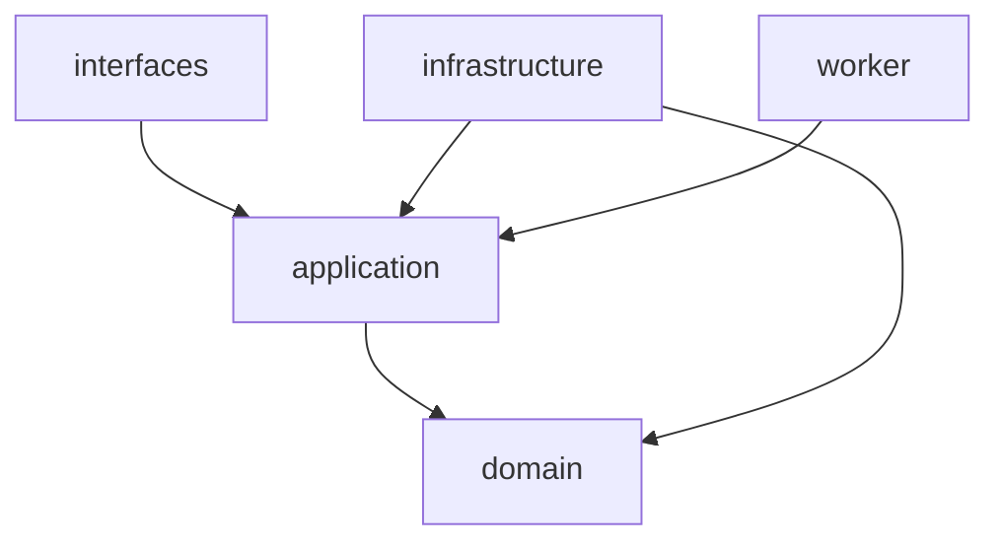

# 架构文档

> 状态：Active
>
> 最后更新：2026-08-04

本目录记录 `diandianreading` 的目标架构与架构决策。已通过实现、故障注入、构建与 CI 验证的决策应标记为 `Accepted`；其余仍保持 `Proposed`，不得用规划状态替代验证证据。

## 核心文档

- [两项目集成计划](integration-plan.md)
- [Tauri 2 桌面应用实施计划](desktop-application-plan.md)
- [阅读器与标注实施计划](reader-annotation-plan.md)
- [AI 对话功能设计](../features/ai-chat.md)
- [完整 API 参考](../api.md)

## ADR 索引

| ADR | 状态 | 决策 |
| --- | --- | --- |
| [ADR-0001](adr/0001-local-first-modular-monolith.md) | Proposed | 使用 local-first Python 模块化单体作为首个运行架构 |
| [ADR-0002](adr/0002-notebooklm-public-python-api.md) | Proposed | 通过 `NotebookLMClient` 公开 Python API 集成 NotebookLM |
| [ADR-0003](adr/0003-provider-credential-isolation.md) | Proposed | Provider 凭据物理隔离，业务数据库只保存引用 |
| [ADR-0004](adr/0004-durable-import-saga.md) | Accepted | 资料导入使用可恢复的持久化 Saga/Job 状态机 |
| [ADR-0005](adr/0005-local-api-security.md) | Proposed | 回环 API 仍执行每安装实例认证与浏览器安全边界 |
| [ADR-0006](adr/0006-desktop-first-tauri-python-sidecar.md) | Proposed | 桌面优先采用 Tauri 2 壳、React/Vite UI 与 Python Sidecar |
| [ADR-0007](adr/0007-reader-annotation-anchor-model.md) | Proposed | 阅读器以派生 Markdown 为正文源,标注采用本地可再锚定位置模型 |
| [ADR-0008](adr/0008-content-and-obsidian-export-model.md) | Proposed | 内容资产以本地版本化草稿为事实源,Obsidian 导出按稳定 ID 增量对账 |

新增 ADR 时从 [模板](adr/0000-template.md) 开始。

## 编译时依赖方向

下图箭头表示**编译时/导入时依赖**：箭头起点可以 import/依赖终点，不表示一次请求在运行时按该方向传递数据。

运行时调用流应在图前明确标记为“runtime call/data flow”；Adapter 在运行时被 Use Case 调用，不改变其在编译时依赖 Application Port 的方向。

规则：

- `domain` 不导入 FastAPI、Playwright、NotebookLM、SQLite 或前端框架。
- `application` 定义用例和 Ports，不依赖具体 Provider。
- `infrastructure` 实现 Ports，负责文件、数据库、浏览器和第三方接口。
- `interfaces` 只解析输入、调用用例并渲染输出。
- `notebooklm-py` 是受控依赖，不承载 `diandianreading` 产品逻辑。

## ADR 生命周期

1. `Proposed`：方案已写清楚，但尚未通过实现验证。
2. `Accepted`：实现已落地，测试与构建通过，决策成为约束。
3. `Superseded`：新 ADR 替代旧决策；旧文档保留历史，不删除编号。
4. `Rejected`：评审后不采用，但保留拒绝原因。

编号只增不减，不复用。文件使用 `NNNN-lowercase-kebab-case.md`。

## 当前架构假设

以下是假设，不是已经完成的功能：

- 第一版为单用户、local-first、desktop-first 工作台；目标桌面壳是 Tauri 2，完整计划见 [桌面应用实施计划](desktop-application-plan.md)。
- CLI 与浏览器模式保留为开发、自动化和桌面故障恢复入口；桌面、浏览器不建立两套业务核心。
- 对外只暴露 `localhost:3000`；Worker 不监听独立端口。回环不等于授权，本地 API 约束见 [ADR-0005](adr/0005-local-api-security.md)。
- React/TypeScript/Vite 是目标 UI，Tauri/Rust 负责桌面生命周期；它们均不承载 Python Domain/Application 业务逻辑。
- Python 负责后端、文档处理、持久 Worker 和第三方集成，并在桌面模式打包为受控 Sidecar。
- SQLite 和本地文件存储作为第一阶段基础设施。
- NotebookLM、Z-Library、Obsidian 和发布平台都通过 Adapter 接入。
- 任何第三方失败都不能破坏本地书籍、标注、笔记或草稿。

如果产品从单用户本地工具转为多租户云服务，必须重新评审 ADR-0001、ADR-0003、ADR-0004、ADR-0005 和 ADR-0006。
