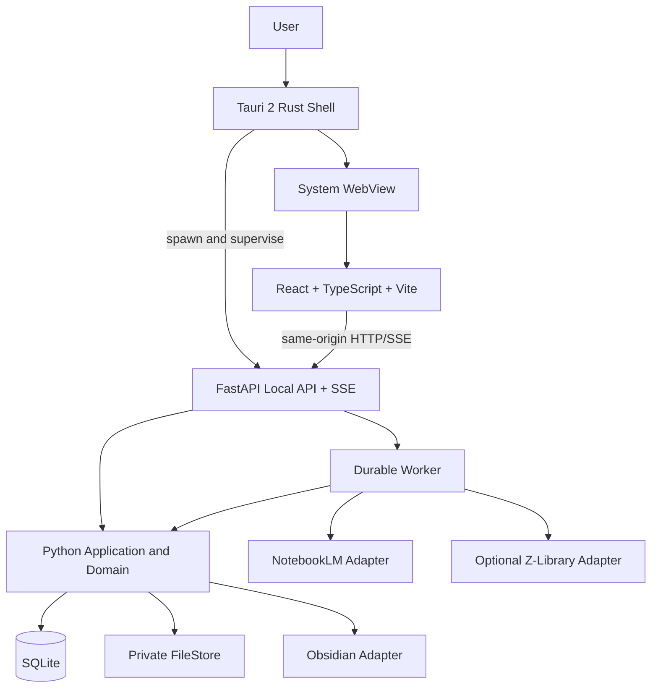
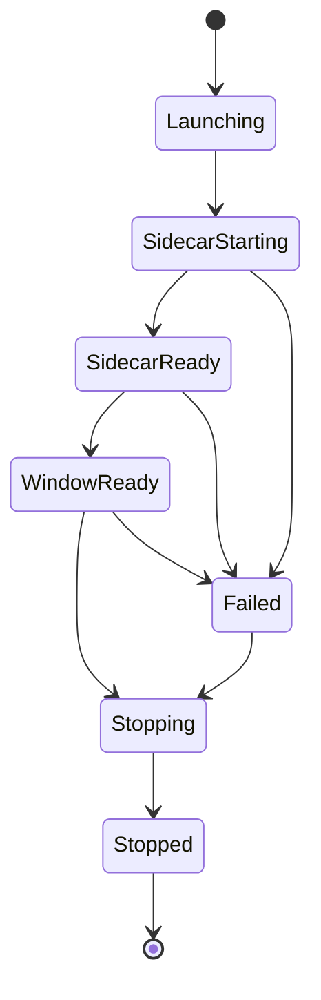

# Tauri 2 桌面应用实施计划 / Desktop Application Plan

> 状态：Deprecated / Historical
>
> 历史目标：把已完成的 local-first Python 产品演进为可安装、可升级、可恢复的桌面应用
>
> 终止说明：2026-08-14 起由 [ADR-0009](adr/0009-local-web-tool-distribution.md) 与 [本地 Web 工具分发实施计划](local-web-distribution-plan.md) 替代；D1/D2 证据保留，但 D4–D6 不再实施
>
> 最后更新：2026-08-14

## 1. 决策摘要 / Decision Summary

`diandianreading` 长期采用以下产品与工程形态：

```text
Desktop-first product
+ React / TypeScript / Vite UI
+ Tauri 2 / Rust native shell
+ packaged Python sidecar
+ SQLite / private local files / durable worker
+ NotebookLM / optional Z-Library / Obsidian adapters
```

这不是把当前 Python 项目重写成 Rust，也不是新增一套 Next.js Backend。Phase 0–5 已交付的 Domain、Application、Infrastructure、Worker、FastAPI、SQLite、Provider Adapter 与恢复协议继续作为唯一业务核心。Tauri 是安装、窗口、进程生命周期、权限与更新边界；React/Vite 是可替换 UI；Python Sidecar 继续拥有业务状态和第三方集成。

桌面方向的正式架构约束记录在 [ADR-0006](adr/0006-desktop-first-tauri-python-sidecar.md)。在 packaged-app、真实 Provider、签名、公证、更新和恢复完成前，本文描述的是目标和验收标准，不代表功能已经交付。

## 2. 为什么是桌面优先 / Why Desktop-first

产品的主要价值依赖：

- 用户拥有的本地 PDF、EPUB 与 Markdown；
- SQLite、本地索引、私有对象、标注、笔记与内容草稿；
- NotebookLM、Z-Library 和发布平台的本机浏览器 Session；
- 长时间、可中断、可恢复的导入、生成与发布任务；
- Obsidian Vault 和本机文件导出；
- 离线时仍能阅读、标注、检索和编辑本地内容；
- 普通用户不需要理解 Python、`uv`、虚拟环境和后台服务。

Next.js 的 SSR、SEO、Server Components 与公共 Web 部署不是个人 MVP 的关键能力。纯浏览器模式适合作为开发和恢复入口，但不能提供完整安装、启动、单实例、退出和升级体验。桌面壳与 Web UI 的组合最符合这些约束。

## 3. 目标与非目标 / Goals and Non-goals

### 3.1 目标

- 用户通过标准 macOS 安装包安装并启动应用。
- 应用只有一个主窗口和一个受控 Python Sidecar；关闭后不遗留孤儿 Worker。
- 桌面、CLI 和浏览器模式共享同一业务代码、Schema 和 App Home。
- React/Vite UI 覆盖连接、导入、Job、书库、阅读、标注、Chat、创作、导出与发布的长期演进。
- Sidecar 不依赖用户预装 Python、Node 或开发工具。
- Provider Credential 不进入 Rust、前端、普通日志、更新服务或遥测。
- 安装、升级、迁移、回滚和恢复都有明确状态与可验证路径。
- macOS 正式构建完成签名、公证、Gatekeeper 和签名更新校验。

### 3.2 非目标

- 不把 NotebookLM、Playwright、Document Preparation 或持久 Worker 重写为 Rust。
- 不在桌面 MVP 引入 Next.js Server、云端多租户 Backend 或公共注册。
- 不在首个桌面版本用 Tauri IPC 重写全部 HTTP/SSE API。
- 不把 Provider 页面加载进拥有本地能力的主 WebView。
- 不承诺首个阶段同时支持 macOS、Windows、Linux、iOS 和 Android。
- 不因桌面文件选择器而绕过现有权利确认、文件类型、大小、Archive、Parser 或路径安全规则。
- 不以 Fake E2E 代替真实 Provider、系统签名和全新机器安装验证。

## 4. 当前基线 / Current Baseline

Phase 5 当前已经提供：

```text
diandian auth login/status/logout
diandian import
diandian jobs list/retry
diandian worker
diandian serve
http://localhost:3000
SQLite schema v6
FastAPI + Session/CSRF + SSE
embedded durable Worker
whole-book Chat + local citations
```

当前尚未提供：

- React/Vite 前端工程；
- Tauri/Rust 源码与 Capability；
- Python standalone Sidecar Artifact；
- Playwright Chromium 桌面 Provisioning；
- 单实例桌面 Launcher 与父子控制协议；
- macOS `.app`/`.dmg` 签名、公证与 Updater；
- Windows Bundle；
- packaged desktop E2E。

## 5. 目标运行架构 / Target Runtime Architecture

下图表示 runtime call/data flow，不表示编译时依赖方向：



### 5.1 编译时边界

```text
apps/web                React/Vite UI
apps/desktop/src-tauri  Tauri/Rust shell
src/diandianreading     Python product core
packaging/sidecar       reproducible Python sidecar build
```

强制规则：

- React 不读取 SQLite、Credential 或对象物理路径。
- Rust 不承载 Book/Job/Chat/Provider 业务规则，也不直接迁移数据库。
- Python 不依赖 Tauri；同一个 Python Runtime 必须可由 CLI、浏览器模式和桌面 Sidecar 启动。
- Tauri 与 React 只能依赖稳定的 Launcher/HTTP/SSE 契约，不能导入 Python 内部实现。
- 前端构建 Artifact 必须进入 Python package/Sidecar，保证 Browser 与 Desktop 使用同一 UI；不维护第二份桌面页面。

## 6. 目标仓库结构 / Target Repository Layout

该结构是阶段性目标，不表示目录已经存在：

```text
diandianreading/
├── apps/
│   ├── web/
│   │   ├── src/
│   │   ├── package.json
│   │   ├── tsconfig.json
│   │   └── vite.config.ts
│   └── desktop/
│       ├── package.json
│       └── src-tauri/
│           ├── Cargo.toml
│           ├── tauri.conf.json
│           ├── capabilities/
│           └── src/
├── packaging/
│   └── sidecar/
│       ├── build configuration
│       ├── browser manifest
│       └── release manifest schema
├── src/diandianreading/
├── tests/
│   ├── python/
│   ├── web/
│   └── desktop/
└── docs/
```

是否采用 npm、pnpm 或其他 Node package manager，在 D2 前通过 lockfile、CI 和供应链评审决定；不能同时维护多个前端 lockfile。Rust 与 Node 版本必须固定到仓库可审计配置。

## 7. 三种运行模式 / Supported Runtime Modes

### 7.1 Source development

```text
React build/watch
+ uv run diandian serve
+ http://localhost:3000
```

- 对外只使用 `localhost:3000`。
- 严格单端口基线使用 Vite build/watch 输出静态 Artifact，由 FastAPI 提供；不默认启动第二个可访问的开发 Origin。
- 如未来引入 HMR 代理，必须维持浏览器只访问规范 Origin，并重新验证 Host/Origin/CSRF/CSP/SSE，不得临时开放宽泛 CORS。

### 7.2 CLI/browser recovery

```text
diandian auth ...
diandian import ...
diandian serve
```

- 用于诊断、自动化、开发和桌面故障恢复。
- 与桌面 App 不能同时成为同一 App Home 的主 Runtime。
- 桌面安装包升级失败时，只有明确兼容的 CLI 版本可以打开数据。

### 7.3 Packaged desktop

```text
Diandian.app
→ acquire single-instance ownership
→ spawn bundled Python sidecar
→ receive authenticated ready control frame
→ open http://localhost:3000/#bootstrap=<single-use-secret>
→ run until graceful shutdown
```

正式桌面运行不搜索系统 Python、Node、`uv` 或开发机 Playwright Cache。

## 8. Launcher 与 Sidecar 控制协议 / Control Protocol

### 8.1 状态机



### 8.2 控制通道

桌面 Sidecar 模式新增版本化、长度受限的父子控制协议。示意事件：

```json
{
  "protocol": "diandian-desktop-v1",
  "event": "ready",
  "origin": "http://localhost:3000",
  "bootstrap": "<redacted-single-use-secret>"
}
```

该示例只定义字段语义，不是已实现 API。实现时必须满足：

- stdout 只传控制帧，不能混入普通日志；
- Tauri 不记录完整帧，特别是 `bootstrap`；
- stderr 只输出类型化、脱敏诊断；
- 单帧和累计字节有上限，未知协议/字段/顺序 fail closed；
- Secret 不进入参数、环境变量、文件、URL Query、Crash Report 或 Telemetry；
- Fragment Secret 只在内存中存在并单次消费；
- `/healthz` 只证明 liveness，不证明 Child 身份；
- Tauri 只管理本次创建且通过控制通道证明身份的 Child。

### 8.3 单实例与端口

固定端口策略继续使用 `localhost:3000`：

1. Tauri 首先取得应用单实例所有权。
2. 已有同实例时只聚焦已有窗口，不启动第二个 Sidecar。
3. 如果端口被未知进程占用，显示诊断并退出；不随机换端口，不杀进程，不因返回正确 `/healthz` 就附着。
4. 如果 Tauri 崩溃而 Child 短时存活，恢复流程必须通过安装实例身份、父子控制证据和 Session 轮换判断；在证据完成前一律不附着。
5. CLI `serve` 保留现有端口占用拒绝行为。

## 9. WebView 与 Tauri Capability / Security Boundary

### 9.1 初始 Capability

主 WebView 加载 `http://localhost:3000`，从 Tauri 视角属于远程 Origin。初始版本：

- 不给该 Origin 配置 Tauri Command Capability；
- 不暴露通用 Shell Plugin；
- 不允许任意 `args`、任意 Sidecar、任意文件系统路径或通配 URL；
- 不在主 WebView 打开 Provider、帮助站点、Markdown 外链或任意远程内容；
- Rust 内部只启动 Bundle 中声明的固定 Sidecar；
- 业务请求继续走 ADR-0005 的 Session/CSRF/Origin/Host/Peer 控制。

若确需 Native Dialog/Notification/Updater UI，优先由 Rust 窗口生命周期触发；必须从 WebView 调用时，建立最小独立 Command、精确 Capability、输入 Schema、用户手势要求和拒绝测试。

### 9.2 CSP 与渲染

- 不使用远程 CDN、inline script、`eval` 或不受控 HTML。
- PDF.js/epub.js Worker、字体、Blob/Object URL 需求必须显式进入 CSP 设计和测试，不能使用 `*` 临时放开。
- 书籍正文、Markdown、Citation、Provider 文本和文件 metadata 都是不可信内容；渲染前转义/消毒。
- 外部链接经过 Scheme allowlist 后交给系统浏览器，不在主窗口导航。

### 9.3 Provider 登录

- NotebookLM/Z-Library 登录继续由独立 Provider Session Manager 与受控 Playwright Browser 完成。
- Provider 页面不获得 Tauri IPC，也不与主 WebView 共享 Storage/Cookie/Profile。
- 登录 Browser、下载 Browser 和普通主 UI 使用不同 Context/数据目录。
- 桌面壳只展示安全状态，不读取或转发 Cookie、账号、验证码和 Provider 内部 ID。

## 10. Python 与 Playwright 分发 / Packaging

### 10.1 Sidecar Builder Gate

D1 必须用同一套场景比较候选 Builder，至少记录：

| 维度 | 必须测量 |
| --- | --- |
| 可重复构建 | 干净 CI 是否能生成相同依赖集合和 Manifest |
| Artifact 大小 | Sidecar、Python stdlib、依赖和调试符号拆分 |
| 冷启动 | Sidecar 到 ready control frame 的时间 |
| 动态导入 | NotebookLM、Playwright、FastAPI/Uvicorn 资源是否完整 |
| Package resources | migrations、静态 UI、证书/metadata 是否存在 |
| 签名 | Bundle 后是否可稳定 codesign/notarize |
| 错误诊断 | 缺失资源、迁移失败和 Provider 失败是否类型化 |
| 安全 | 不从 CWD/PATH/用户可写插件目录加载代码 |

没有证据前不在 ADR 中宣称 PyInstaller 或 Nuitka 已选定。

### 10.2 Playwright Provisioning Gate

候选方案：

1. Chromium 随 App 分发；
2. 首次运行从固定官方来源下载并校验版本、哈希和签名；
3. 企业/高级用户显式选择受支持的系统浏览器 Channel。

必须比较：安装包体积、首次登录时间、离线行为、更新兼容、代码签名、下载来源、代理环境、清理和 Provider 兼容性。无论选择哪种方案，都不能依赖开发机 `~/Library/Caches` 或用户已执行 `playwright install`。

## 11. 数据目录、迁移与备份 / Data Lifecycle

### 11.1 第一阶段

- 保持 `~/.diandianreading/` 为规范 App Home，避免桌面壳首次启动静默搬迁。
- Bundle、Sidecar、前端 Artifact 都是只读程序资源；用户数据不写入 `.app` Bundle。
- Tauri 不直接打开 App Home；路径权限、owner/type、no-symlink、原子发布继续由 Python Infrastructure 执行。

### 11.2 平台目录演进

Windows 支持前必须引入平台路径抽象，定义：

- app data；
- cache；
- logs；
- temporary staging；
- backups；
- credentials；
- downloaded browser runtime。

从 Legacy Home 迁移时必须提供 dry-run、容量检查、原子/可恢复 copy、哈希验证、显式切换和旧目录保留期。不能在一次 rename 失败后自动创建空库。

### 11.3 更新与 Schema

- Shell、Sidecar、HTTP API、Control Protocol、Schema 和 Frontend Build 各自有兼容版本，并进入 Release Manifest。
- 更新前检查磁盘空间和 Schema 路径；破坏性迁移先做私有原子备份。
- 至少保留“当前版本”和“上一个兼容版本”的恢复证据；不能承诺旧版读取任意新 Schema。
- 更新/回滚不自动删除 Provider 远程资源；远程副作用继续由 Intent/reconciliation 管理。

## 12. 发布、签名与更新 / Release Engineering

### 12.1 Release Channels

```text
dev       local unsigned build
internal  CI artifact for maintainers
beta      signed/notarized limited release
stable    signed/notarized supported release
```

不同 Channel 使用不同应用标识、更新端点和数据兼容策略。Dev/测试构建不能覆盖 Stable App 或默认打开 Stable 数据目录。

### 12.2 macOS

正式发布必须完成：

- Apple Developer ID Application signing；
- Hardened Runtime/Entitlement 最小化；
- Notarization 与 stapling；
- `codesign --verify`、`spctl`/Gatekeeper 验证；
- Apple Silicon Artifact；
- Intel/Universal 是否进入首发由真实设备与 CI 成本决定；
- 安装、覆盖升级、移动 App、首次打开、退出、卸载和保留用户数据测试。

最低 macOS 版本目前没有足够证据，必须由 Tauri/WebView、Python、Playwright 和测试设备共同决定，不能在文档中猜测。

### 12.3 Updater

Tauri Updater 只有满足以下条件才启用：

- 更新 Artifact 使用离线保护的私钥签名；
- App 内固定公钥；
- TLS 且不允许无效证书/Host；
- 平台、架构、版本和 Channel 精确匹配；
- 下载大小、超时和磁盘空间受限；
- 签名验证失败绝不安装；
- 更新中断、App Bundle 替换失败、Sidecar 不匹配和 Schema 回滚有演练；
- 私钥只存在于受保护 CI Environment，不进入 Cache、日志或 Artifact。

### 12.4 Supply chain

每个 Release 生成：

- Python lock/依赖清单；
- Node lock/依赖清单；
- Cargo lock/依赖清单；
- SBOM；
- License 清单；
- Artifact SHA-256；
- 签名/公证结果；
- Release Manifest；
- Secret 和敏感路径扫描结果。

## 13. 可观测性与隐私 / Observability

- 默认不上传遥测、书名、问题、回答、路径、Provider ID 或 Credential 信息。
- 本地日志采用大小和保留期上限，字段脱敏；Control Frame 不进入日志。
- UI 提供用户可主动导出的诊断包，生成前展示内容范围；默认排除 Credential、Cookie、书籍正文、数据库、物理绝对路径和 Provider 内部 ID。
- Crash Reporter、Telemetry 或远程错误监控在启用前需要独立隐私设计和 opt-in。
- Sidecar readiness、启动耗时、Job 状态和错误码可以本地观测，但不能用详细 Provider 响应换取调试便利。

## 14. 实施阶段 / Delivery Phases

每个阶段单独分支、PR、direct review、local build、CI；后续阶段只能在前一阶段退出标准通过后开始。真实 Provider 和浏览器测试由受控手工验收完成，不能放入不受信任 PR CI。

### D0：方向与文档冻结

交付：

- ADR-0006；
- 本实施计划；
- PRD/Roadmap/文档索引一致更新；
- 明确已实现、Proposed 和未决问题。

退出标准：

- Markdown 链接有效；
- 没有把 Tauri/React/Sidecar 描述为已实现；
- 与 ADR-0001/0003/0005 和 Phase 5 行为不冲突；
- 本地 build 与既有测试不因文档改动失败；
- PR CI 绿色。

### D1：Python Sidecar 与 Playwright 可行性

交付：

- 版本化 `desktop-sidecar` 启动模式；
- 父子控制协议与负向解析测试；
- 至少两个 Python Builder 的记录性比较或明确淘汰证据；
- target-triple Sidecar Artifact；
- migrations/static assets/package resources 验证；
- Playwright Provisioning 决策记录。

退出标准：

- 干净 macOS Runner 无系统 Python 依赖地启动 Sidecar；
- Phase 0–5 offline E2E 在 Sidecar Artifact 上通过；
- 缺失浏览器、错误 Manifest、端口占用和损坏资源 fail closed；
- 构建临时文件全部清理，正式 Artifact 可复现追踪。

### D2：Tauri 壳与生命周期

交付：

- `apps/desktop/src-tauri`；
- 单实例、固定 Sidecar、readiness/bootstrap、窗口和退出状态机；
- 当前静态 UI 在 Tauri WebView 中运行；
- 最小 Capability 与远程导航拒绝；
- 未签名内部 `.app`。

退出标准：

- 冷启动、重复启动、Sidecar/Tauri 崩溃和退出无孤儿进程；
- 无关进程占用 `3000` 时不附着、不杀进程；
- WebView 无任意 Tauri Command/Shell；
- 打包 App 完成 local import、Job、Chat、Citation offline E2E。

### D3：React/Vite 产品 UI

交付：

- React + TypeScript + Vite 工程；
- Connections、Imports、Jobs、Library、whole-book Chat 与 Citation 功能等价迁移；
- API Client、错误模型、SSE 重连和可访问性基础；
- 构建结果进入 Python Wheel、Sidecar 和 Tauri App；
- 删除被替代的原生 UI 代码，不长期双写。

退出标准：

- Browser 和 Desktop 使用同一 Build；
- Phase 5 HTTP/SSE 契约没有隐式变化；
- 键盘、焦点、错误恢复、窄窗口和高 DPI 人工验收；
- TypeScript lint/type/unit、Python E2E 与 packaged E2E 通过。

### D4：桌面安全、数据与恢复

交付：

- App Home/平台路径与 Legacy migration 策略；
- Capability/CSP/导航/文件选择器威胁测试；
- Sidecar 身份、关闭、重启和 Lease 恢复；
- 诊断包、备份、迁移和 CLI fallback；
- Playwright 浏览器稳定 Provisioning。

退出标准：

- ADR-0006 Threat Model 的关键滥用路径有自动化或可重复人工证据；
- 中断更新/迁移不会丢失数据或误删远程资源；
- 全新 macOS 用户账户安装后可完成真实 NotebookLM 登录；
- 可选 Z-Library 仍默认关闭并保持权利来源约束。

### D5：macOS Desktop Alpha

交付：

- 签名、公证的 macOS Beta Artifact；
- Release Manifest、SBOM、Checksums 和 Changelog；
- 安装、升级、卸载、数据保留和恢复文档；
- 小规模、受控的真实用户测试。

退出标准：

- Gatekeeper 验证通过；
- 无开发工具的全新机器完成核心闭环；
- 真实 Provider 登录、导入、Chat、引用、退出和重启通过；
- 阻塞性数据丢失、安全或孤儿进程问题为 0。

### D6：Updater、Windows 与 Stable Gate

交付：

- 签名 Updater 与 Channel；
- 更新中断/错误签名/回滚演练；
- Windows Sidecar、WebView2、目录权限、安装包和签名；
- 稳定支持矩阵与生命周期政策。

退出标准：

- macOS 签名更新和上一兼容版本恢复通过；
- Windows 全新机器完成同等核心 E2E；
- 只有达到支持标准的平台进入 Stable 下载页；
- ADR-0006 Validation 全部完成后状态改为 `Accepted`。

## 15. 测试矩阵 / Test Matrix

| 层级 | 默认 CI | 受保护 CI | 手工验收 |
| --- | --- | --- | --- |
| Python unit/contract | 是 | 是 | 否 |
| React unit/type/a11y static checks | D3 起 | 是 | 键盘/视觉 |
| Rust unit/clippy/fmt | D2 起 | 是 | 否 |
| Source-tree Phase E2E | 是 | 是 | 否 |
| Installed-wheel E2E | 是 | 是 | 否 |
| Sidecar Artifact E2E | D1 起 | 是 | 否 |
| Tauri packaged offline E2E | D2 起 | 是 | 启动/窗口 |
| 签名/公证验证 | 否 | D5 起 | 全新机器 |
| Updater/rollback | 否 | D6 起 | 真实升级 |
| NotebookLM live | 否 | 受保护且人工批准 | 是 |
| Z-Library live | 否 | 默认不运行 | 合法资料、显式启用 |

默认 PR CI 不持有 Provider、Apple、Updater 或发布 Secret。Fork/不受信任代码不能通过修改 Workflow 读取受保护 Environment。

## 16. Definition of Done

桌面 v1 只有同时满足以下条件才算完成：

- 普通用户通过签名安装包启动，不安装 Python/Node/Rust/`uv`；
- 单实例和 Sidecar 生命周期稳定，无孤儿 Worker；
- 本地数据、凭据、备份和迁移满足 ADR-0001/0003/0005/0006；
- React UI 与 Browser/CLI fallback 共享同一 Python 业务核心；
- PDF/EPUB/Markdown 导入、阅读、标注、AI、引用、Obsidian 和至少目标发布流程满足产品 Roadmap；
- 真实 NotebookLM 登录和核心问答通过；
- Z-Library 保持默认关闭、显式权利确认与安全下载边界；
- 安装、更新、失败恢复、卸载和用户数据保留行为有文档和测试；
- macOS Artifact 签名、公证、Updater 签名、SBOM 和 Release Manifest 完整；
- 未完成或实验性平台/Provider 明确标记，不用 Fake E2E 包装成生产兼容性结论。

## 17. 仍需证据决定的问题 / Open Evidence Gates

以下问题不能凭偏好提前定论：

1. Python Sidecar 最终使用 PyInstaller、Nuitka 或其他 Builder。
2. Playwright Chromium 随包分发、首启受验证下载或受支持系统 Channel。
3. macOS 最低版本、Intel/Universal 首发范围。
4. Windows 首发版本、安装器与签名证书策略。
5. 是否在 D3/D4 引入少量 Native Dialog/Notification Tauri Command。
6. 何时从 `~/.diandianreading` 迁移到平台标准 App Data 目录。
7. 稳定 Updater 的托管位置、Channel 保留期和紧急吊销流程。
8. Installer/Sidecar/Chromium 的体积、冷启动和磁盘预算。

每项都必须产生可复现构建或测试证据，并在需要时新增 ADR。

## 18. 官方依据 / Primary References

- [Tauri Sidecar](https://v2.tauri.app/develop/sidecar/)
- [Tauri Security](https://v2.tauri.app/security/)
- [Tauri Capabilities](https://v2.tauri.app/security/capabilities/)
- [Tauri macOS Code Signing](https://v2.tauri.app/distribute/sign/macos/)
- [Tauri Updater](https://v2.tauri.app/plugin/updater/)
- [ADR-0006](adr/0006-desktop-first-tauri-python-sidecar.md)
- [ADR-0001](adr/0001-local-first-modular-monolith.md)
- [ADR-0003](adr/0003-provider-credential-isolation.md)
- [ADR-0005](adr/0005-local-api-security.md)
