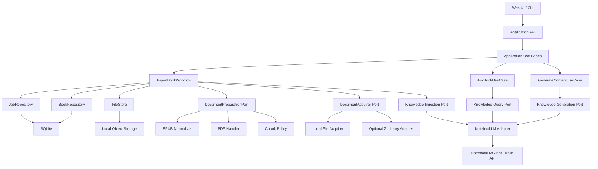
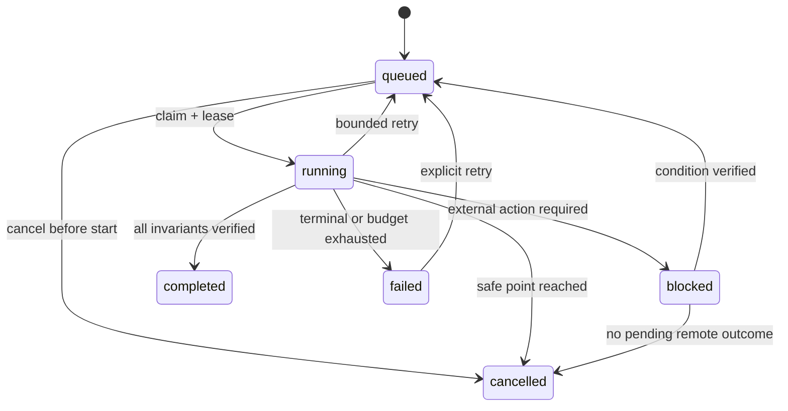

# `notebooklm-py` 与 `zlibrary-to-notebooklm` 集成计划

> 状态：Active
>
> 目标阶段：Roadmap P2-P4
>
> 最后更新：2026-08-03

## 1. 目的

本计划定义如何把两个现有项目整合进 `diandianreading`，同时保留各自适合复用的能力并移除当前脆弱耦合。

目标不是把两个源码目录机械拼接，而是建立一个主业务应用：

- `diandianreading` 拥有书籍、文档、任务、引用和内容资产。
- `notebooklm-py` 作为受控 SDK 依赖提供 NotebookLM 能力。
- `zlibrary-to-notebooklm` 中有价值的下载和文档处理逻辑被拆解到主应用。
- Z-Library 仅作为默认关闭的可选资料获取 Adapter，不作为公共书城或下载服务。

相关文档：

- [产品 PRD](../../diandianreading-PRD.md)
- [产品 Roadmap](../../diandianreading-ROADMAP.md)
- [现有 API 参考](../api.md)
- [AI 对话功能设计](../features/ai-chat.md)
- [ADR-0005：本地 API 安全](adr/0005-local-api-security.md)

## 2. 已确认的现状

| 项目 | 可复用能力 | 当前问题 |
| --- | --- | --- |
| `notebooklm-py` | Typed async client、Notebook/Source/Chat/Artifact API、认证、重试、等待、进度、完整测试 | Google RPC 非官方；MCP/REST 实验性；内部模块不可作为稳定依赖 |
| `zlibrary-to-notebooklm` | Playwright 登录与下载思路、EPUB 转 Markdown、词数统计、章节分块 | 单类职责过多、`shell=True`、返回类型不稳定、会话检查错位、无持久任务、测试不足 |
| 根项目 | PRD、Roadmap、静态高保真原型、API 梳理 | 没有根 `pyproject.toml`、应用包、数据库、Worker 或真实 UI 后端 |

源码依据：

- [`notebooklm-py` 架构](../../source/notebooklm-py/docs/architecture.md)
- [`NotebookLMClient`](../../source/notebooklm-py/src/notebooklm/client.py)
- [Z-Library 上传脚本](../../source/zlibrary-to-notebooklm/scripts/upload.py)
- [Z-Library 登录脚本](../../source/zlibrary-to-notebooklm/scripts/login.py)
- [EPUB 转换脚本](../../source/zlibrary-to-notebooklm/scripts/convert_epub.py)

## 3. 决策摘要

| 主题 | 目标决策 |
| --- | --- |
| 仓库形态 | 单仓库、模块化单体，不合并成单一大包 |
| 主后端 | Python，local-first |
| NotebookLM | 直接调用公开 `NotebookLMClient` API |
| `notebooklm-py` 源码 | 生产固定 `notebooklm-py==0.8.0rc1` 外部依赖；`source/` 仅作只读依据，只有出现已验证且上游未发布的必要补丁时才引入受控 Fork |
| Z-Library | 拆为可选 `DocumentAcquirer` 实现 |
| 本地资料 | 默认入口；Z-Library 不是核心供应链 |
| 数据 | SQLite + 私有本地对象存储起步；业务层只保存 `StorageKey` |
| 长任务 | 正交 Job/Step + 持久远程 Intent + Lease Worker，不依赖 HTTP 请求生命周期 |
| 凭据 | Provider 物理隔离；`CredentialRef` 只有 provider/profile |
| 引用 | NotebookLM Source ID 必须映射回本地 `DocumentPart` |
| 端口 | 对外统一 `localhost:3000`，但回环不作为授权 |

决策记录：

- [ADR-0001：local-first 模块化单体](adr/0001-local-first-modular-monolith.md)
- [ADR-0002：NotebookLM 公开 Python API](adr/0002-notebooklm-public-python-api.md)
- [ADR-0003：Provider 凭据隔离](adr/0003-provider-credential-isolation.md)
- [ADR-0004：持久化导入 Saga](adr/0004-durable-import-saga.md)
- [ADR-0005：本地 API 安全](adr/0005-local-api-security.md)

## 4. 目标架构

下图是 **runtime call/data flow**：箭头表示一次运行中的调用或数据流向，不表示 Python import 方向。



### 4.1 分层规则

下列箭头表示**编译时/导入时允许依赖**，箭头起点可以依赖终点；它与上面的 runtime flow 是两个不同视角：

```text
interfaces → application → domain
infrastructure → application ports
worker → application use cases
```

运行时 Use Case 会调用注入的 Port 实现；编译时则由 Infrastructure Adapter 依赖 Application 定义的 Port，Application 不反向 import Adapter。

禁止：

- `domain` 导入 Playwright、NotebookLM、FastAPI 或 SQLite。
- 主应用导入 `notebooklm._app`、`notebooklm._runtime` 或其他下划线内部模块。
- Z-Library Adapter 直接创建 NotebookLM Notebook。
- UI 直接调用 `notebooklm` CLI。
- Job 通过进程内字典保存唯一状态。

## 5. 需要抽象的边界

### 5.1 `DocumentAcquirer`

```python
class DocumentAcquirer(Protocol):
    async def acquire(
        self,
        request: AcquisitionRequest,
        progress: ProgressSink,
    ) -> AcquiredAsset:
        ...
```

首批实现：

- `LocalFileAcquirer`：默认、核心路径。
- `ZLibraryAcquirer`：可选、默认关闭、仅处理用户有合法访问权的内容。

Adapter 输出 `AcquiredAsset` 后即结束职责，不负责格式转换、分块或 NotebookLM 上传。

### 5.2 文档资产与逻辑存储键

```python
@dataclass(frozen=True)
class StorageKey:
    value: str


@dataclass(frozen=True)
class DocumentAsset:
    id: str
    storage_key: StorageKey
    display_filename: str
    mime_type: str
    size_bytes: int
    sha256: str
    title: str | None
    author: str | None
    origin: SourceOrigin
    origin_locator: str | None
    rights_provenance_id: str
    derived_from_asset_id: str | None = None


@dataclass(frozen=True)
class DocumentPart:
    id: str
    asset_id: str
    sequence: int
    storage_key: StorageKey
    mime_type: str
    word_count: int
    sha256: str
    chapter_refs: tuple[str, ...]
    size_bytes: int


@dataclass(frozen=True)
class PreparationManifest:
    root_asset_id: str
    storage_key: StorageKey
    sha256: str
```

`StorageKey` 是应用生成的不透明逻辑键，不是绝对/相对路径，也不接受 URL、上传文件名或 Archive Entry 名。`display_filename` 只用于展示，不能参与物理路径拼接。`DocumentPart` 是 NotebookLM Source 与本地原文之间的映射单位；分块不能只返回 `list[Path]`。

Phase 0 定义最小 `DocumentAsset`/`DocumentPart`/`StorageKey` 契约，使 Fake Preparation 与 Fake Knowledge Adapter 能持久化链路；Phase 1 在保持标识与存储键语义的前提下实现真实 metadata、转换、分块和 manifest。

### 5.3 `DocumentPreparationPort`

```python
class DocumentPreparationPort(Protocol):
    async def prepare(
        self,
        asset: DocumentAsset,
        capabilities: TargetCapabilities,
        progress: ProgressSink,
    ) -> PreparedDocument:
        ...
```

`PreparedDocument` 返回确定性的派生 Asset、按序 `DocumentPart` 和 manifest 引用。Application 只依赖该 Port；Phase 0 使用 Fake 实现，Phase 1 实现 Markdown/EPUB 的解析与规范化、能力限制和分块，以及 PDF 文件头/EOF/大小校验后的单 Source passthrough；它不包含 PDF 文本解析、OCR 或拆页。Parser 不接收物理路径；Infrastructure 实现通过 `FileStore` 把 `StorageKey` 解析为受限路径或已安全打开的文件句柄。

### 5.4 Knowledge Ports

按接口隔离原则拆成：

```python
class KnowledgeIngestionPort(Protocol):
    async def ensure_workspace(...) -> WorkspaceRef: ...
    async def add_part(...) -> KnowledgeSourceRef: ...
    async def wait_sources(...) -> Sequence[KnowledgeSourceRef]: ...


class KnowledgeQueryPort(Protocol):
    async def ask(...) -> KnowledgeAnswer: ...


class KnowledgeGenerationPort(Protocol):
    async def generate(...) -> GenerationHandle: ...
    async def wait(...) -> GeneratedContent: ...
    async def download(...) -> DocumentAsset: ...
```

不要把 `notebooklm-py` 的全部公开方法复制成一个巨大业务接口。只暴露产品实际需要的能力。

### 5.5 `CredentialRef`

```python
@dataclass(frozen=True)
class CredentialRef:
    provider: str
    profile: str
```

该引用对 Domain/Application 是不透明的，不能携带 `storage_path`。只有 Infrastructure Adapter 内的 `CredentialPathResolver` 可以将它映射到应用凭据根目录中的物理路径，并执行根目录 confinement、当前用户所有权、权限和无符号链接检查。统一的是引用方式，不是 Cookie Schema 或路径；NotebookLM 与 Z-Library 的凭据内容必须继续物理隔离。

### 5.6 `TargetCapabilities`

```python
@dataclass(frozen=True)
class TargetCapabilities:
    max_source_words: int
    max_source_bytes: int
    max_sources_per_workspace: int
    accepted_mime_types: frozenset[str]
```

现有 EPUB 脚本中的 `350000` 必须变为能力配置，由 `ChunkPolicy` 使用。PDF、EPUB 和 Markdown 走同一限制检查。

### 5.7 Progress 与错误

```python
@dataclass(frozen=True)
class ProgressEvent:
    job_id: str
    step: str
    current: int | None
    total: int | None
    message: str
```

统一错误类别：

```text
AUTH_REQUIRED
SOURCE_UNAVAILABLE
DOWNLOAD_TIMEOUT
FORMAT_UNSUPPORTED
CONVERSION_FAILED
SOURCE_LIMIT_EXCEEDED
REMOTE_RATE_LIMITED
REMOTE_UNAVAILABLE
REMOTE_PROTOCOL_DRIFT
SOURCE_PROCESSING_FAILED
CANCELLED
UNEXPECTED
```

Adapter 抛出类型化异常；Application 层把异常投影到独立的 `last_error_code/retriable`，不能把错误码当成 Job status。`AUTH_REQUIRED` 对应 `status=blocked, blocked_reason=AUTH_REQUIRED`。禁止继续使用混合 `None`、tuple、bool 和 ad-hoc dict 的返回方式。

### 5.8 `StorageKey` 与物理路径边界

- SQLite、Domain、Application、Job Event 和 HTTP API 只保存/传递 `StorageKey`，不保存 `Path` 或应用数据根目录。
- `FileStore` 是唯一解析边界：它把键映射到固定根目录，拒绝未知命名空间、越界、符号链接、错误所有权/权限和非普通文件，并优先返回已安全打开的文件句柄。
- Import 时远程文件名和用户文件名先作为不可信展示 metadata 保存；物理对象名由应用随机/确定性生成，不能沿用远程路径。
- 普通文件使用同目录 staging + `fsync` + 原子发布；数据库/WAL/SHM、文档、Job 工作区和备份遵守 [ADR-0001](adr/0001-local-first-modular-monolith.md) 的私有文件系统不变量。
- Credential 物理路径由独立 `CredentialPathResolver` 管理，不得复用通用文档 `StorageKey` 暴露给 Application。

## 6. 不应过度抽象的内容

- 不建立通用浏览器自动化框架。
- 不建立 DOM Selector DSL。
- 不自研 Workflow DSL。
- 第一阶段不引入 Redis/Celery。
- 不复制完整 NotebookLM 类型系统。
- 不把不同 Provider 的 Cookie 转成统一结构。
- 不公开 Z-Library 下载 API。
- 不在 MVP 建设多租户凭据系统。

## 7. 数据模型调整

PRD 旧稿把 `notebooklm_id` 放在 `Book` 上；该字段由本计划和 ADR-0002 **Superseded**。目标模型使用本地资产、权利来源、独立外部映射与远程 Intent：

```text
books
├── id
├── title
├── author
├── original_asset_id
├── source_hash
└── status

document_assets / document_parts
├── id
├── storage_key
├── checksum / metadata
└── rights_provenance_id

external_workspaces
├── id
├── book_id
├── provider
├── credential_profile
├── external_id
└── status

external_sources
├── id
├── workspace_id
├── document_part_id
├── external_id
├── checksum
└── status

remote_operation_intents
├── id / job_id / step_id
├── operation_kind
├── correlation_key        # 每个逻辑操作唯一
├── input_fingerprint
├── probe_strategy / baseline_snapshot_redacted
├── state / dispatch_attempt
└── external_id
```

数据库中的 `storage_key` 和 `credential_profile` 都不是物理路径；分别由 Infrastructure `FileStore` 与 `CredentialPathResolver` 解析。`remote_operation_intents` 必须在 Provider 写调用前提交，不能在拿到外部 ID 后才补建。

引用链：

```text
NotebookLM citation/source_id
→ external_sources.external_id
→ document_part_id
→ chapter_refs
→ original DocumentAsset
→ Book
```

主项目的内容对象建议命名为 `GeneratedContent` 或 `ContentAsset`，避免与 NotebookLM 的 `Artifact` 类型冲突。

## 8. 导入 Job、Step 与远程 Intent

生命周期状态只描述 Job 调度，不承载业务步骤：



独立 `current_step` 闭集为：

```text
acquiring → storing → preparing → creating_workspace
→ uploading → processing → verifying
```

`status=blocked` 时 `blocked_reason` 当前只允许 `AUTH_REQUIRED` 或 `REMOTE_OUTCOME_AMBIGUOUS`。`cancel_requested_at` 是独立请求标记；Lease owner/expiry/generation 只在 `running` 有效。完整转换、Heartbeat/fencing、取消安全点和失败重试规则以 [ADR-0004](adr/0004-durable-import-saga.md) 为准。

每个 Step 开始/完成都保存输入指纹、输出本地引用、attempt、进度、错误、起止时间。每个远程写还必须：

1. 在调用前提交唯一 `correlation_key` 的 `remote_operation_intents` 行。
2. 调用前提交 `dispatched`；成功响应后先保存外部 ID，再完成 Step。
3. 超时、断连、取消、进程崩溃或 Lease 过期后先 reconciliation；本地 ID 为空不是重建依据。
4. 多个候选、probe 失败或无法证明未落地时进入 `blocked/REMOTE_OUTCOME_AMBIGUOUS`，禁止 blind recreation。

远程 Notebook 或已成功 Source 默认保留供恢复，不在部分失败时自动删除。显式远程清理本身也是有 Intent 的操作；临时文件必须清理。

## 9. `zlibrary-to-notebooklm` 重构映射

| 当前符号 | 目标 |
| --- | --- |
| `ZLibraryAutoUploader.download_from_zlibrary()` | `PlaywrightZLibraryAcquirer.acquire()` |
| `load_credentials()` / `login_to_zlibrary()` | 删除旧密码路径；使用 `ZLibrarySessionManager` |
| 页面选择器 | `infrastructure/acquisition/zlibrary/selectors.py` |
| `html_to_markdown()` | `EpubNormalizer` 内部 HTML 转换器 |
| `epub_to_markdown()` | `EpubNormalizer.normalize()` |
| `count_words()` | 纯 `WordCounter` 服务 |
| `split_markdown_file()` | `ChunkPolicy.split() -> list[DocumentPart]` |
| `convert_to_txt()` | 删除误导命名；由 `DocumentPreparationPort` 的 Infrastructure 实现替代 |
| `upload_to_notebooklm()` | 删除；由 `NotebookLMAdapter` 实现 |
| `scripts/upload.py::main()` | `ImportBookUseCase` 的 CLI Adapter |

必要修复：

- `browser_profile` 成为新 Profile 的会话 source of truth，`storage_state.json` 仅作快照/诊断；两者都由 `CredentialPathResolver` 限制在应用凭据根目录。
- 显式迁移旧 Profile；检测但不导入可能含明文账号密码的 `~/.zlibrary/config.json`，规则见 ADR-0003。
- 登录后访问已认证页面做真实验证。
- 对初始 URL、每次 Redirect 和浏览器子请求执行 Host/IP 策略；使用 `page.expect_download()`，删除固定 20 秒等待和 `~/Downloads` 最新文件扫描。
- 下载流执行大小、时长、MIME/魔数和文件类型检查，保存到私有 Job staging，成功后原子移动。
- EPUB 按 spine 顺序处理，使用 `ebooklib.ITEM_DOCUMENT`；Archive Entry 执行数量、解压后大小、压缩比、嵌套、路径穿越和链接类型上限。
- Parser 在无网络、受限资源的隔离执行环境中运行；保留原 EPUB，Markdown 和 Part 作为派生资产。
- 超长单段继续按句子或字符切分。
- 删除 `shell=True`、宽泛 `except:` 和无效 `package.json` 入口。

## 10. NotebookLM 集成策略

目标实现由 Infrastructure 先解析并限制路径，再显式传给 SDK；下面的每个远程写都由调用前已提交的独立 Intent 包围：

```python
credential_ref = CredentialRef(provider="notebooklm", profile=profile)
credential_path = credential_resolver.resolve_storage_state(credential_ref)
part_path = file_store.resolve_for_read(part.storage_key)

workspace_intent = await intents.prepare_workspace(job, title)
await intents.mark_dispatched(workspace_intent.id)

async with NotebookLMClient.from_storage(path=str(credential_path)) as client:
    notebook = await client.notebooks.create(title)
    await intents.record_success(workspace_intent.id, external_id=notebook.id)

    source_intent = await intents.prepare_source(job, part, notebook.id)
    await intents.mark_dispatched(source_intent.id)
    source = await client.sources.add_file(
        notebook.id,
        part_path,
        title=part_title,
        wait=False,
        on_progress=on_progress,
    )
    await intents.record_success(source_intent.id, external_id=source.id)

    ready = await client.sources.wait_for_sources(
        notebook.id,
        [source.id],
        timeout=300,
    )
```

`credential_path` 与 `part_path` 是 Infrastructure 已验证的绝对路径，不是 `CredentialRef`/`DocumentPart` 字段，也不能直接来自 API。示例省略异常分支；任何调用后异常先把 Intent 标为待 reconciliation，不直接重发。

要求：

- 不调用 `notebooklm use`，每次显式传 `notebook_id`。
- 不通过 `shell=True` 或 JSON stdout 解析集成。
- 每个 Worker/Event Loop/Profile 持有自己的 Client。
- 在 Provider 写调用前持久化 Intent/correlation key；外部 ID 返回后先持久化，再推进 Step。
- SDK 自带 probe/retry 只解决当前调用内部分场景；恢复时按 [SDK 操作矩阵](../api.md)和 ADR-0004 reconciliation，禁止 blind recreation。
- 使用公开异常做错误映射。
- 固定已验证的 `notebooklm-py` 版本或 Git commit。
- Google RPC 漂移进入 `REMOTE_PROTOCOL_DRIFT`，不做无限重试。

## 11. 目标仓库结构

```text
diandianreading/
├── pyproject.toml
├── uv.lock
├── apps/
│   └── web/
├── source/                    # 迁移期只读参考，不进入 uv workspace/构建产物
├── src/
│   └── diandianreading/
│       ├── domain/
│       ├── application/
│       │   ├── ports/
│       │   └── use_cases/
│       ├── infrastructure/
│       │   ├── acquisition/
│       │   ├── documents/
│       │   ├── notebooklm/
│       │   ├── persistence/
│       │   └── storage/
│       ├── interfaces/
│       │   ├── api/
│       │   └── cli/
│       └── worker/
└── tests/
    ├── unit/
    ├── contract/
    ├── integration/
    └── e2e/
```

`source/` 在迁移期作为只读参考并被排除在 uv workspace 外。Phase 2 已采用固定外部依赖 `notebooklm-py==0.8.0rc1`，未复制 1,244 个 SDK 文件，也未安装浏览器 extra；只有出现可复现、必须且上游尚未发布的补丁时，才另行 ADR 评估受控 Fork。切换完成后归档 Z-Library 旧项目。

## 12. 分阶段迁移

### Phase 0 / PR 1：架构地基

交付：

- 根 `pyproject.toml` 与 uv workspace。
- `src/diandianreading` 包。
- 最小 `DocumentAsset`/`DocumentPart`/`StorageKey` Domain models；它们不含物理路径。
- `DocumentAcquirer`、`DocumentPreparationPort`、Knowledge Ports 与错误类别。
- SQLite migration：正交 Job/Step/blocked/cancel/Lease 字段、attempt 与 `remote_operation_intents`。
- 私有 `FileStore` 契约、Fake Document Preparation、Fake Knowledge Adapter。
- ADR-0005 的本地 API Token/Session、Peer/Host 和同源安全骨架；任何业务路由从出现起就不能无认证。

退出标准：Fake Preparation + Fake Knowledge Adapter 能完成一次含调用前 Intent 的可持久化导入；Domain 不依赖具体框架或 `Path`，非法状态转换与越界 StorageKey 被拒绝。

### Phase 1 / PR 2：文档处理

> 实现状态：Active。可执行边界与验证命令见 [Phase 1 文档处理 E2E](../development/phase-1-e2e.md)。

交付：

- 本地文件导入与 `DocumentPreparationPort` 的真实 Infrastructure 实现。
- 在 Phase 0 最小模型上补齐确定性 metadata、派生关系与 manifest，不改变 `StorageKey`/无物理路径边界。
- SHA-256 去重。
- EPUB spine 解析与 Markdown 派生。
- 能力驱动的分块。
- 下载/Archive/Parser 的大小、路径、链接、资源、无网络与输出限制。

退出标准：PDF/EPUB/Markdown 生成确定性 Part；所有 Part 满足目标限制并可回溯章节，恶意 Archive/Parser fixture 在超限或越界前 fail closed。

已落实的 Phase 1 边界：

- 使用 Python 3.11 标准库完成 ZIP central-directory 校验、HTML text-only 解析、XML 解析、受限子进程和确定性 JSON，不新增生产依赖。
- Markdown 按 UTF-8/NFC、标题章节、词数与 UTF-8 字节双限制生成确定性 Part；相同内容去重并合并章节引用。
- EPUB 在无网络的隔离子进程中按 spine 顺序解析，保留原 EPUB，并生成可追溯的派生 Markdown Asset。
- PDF 当前只做文件头/EOF 检查和目标字节限制内的原文件 passthrough；超限时 fail closed。拆页或文本抽取仍是待确认产品策略，当前实现不伪装成完整 PDF parser。
- 派生 Asset、Part、canonical manifest 与 Job transition 在同一个 Unit of Work 中保存；manifest 同时记录安全预算与 target capabilities，对象内容由私有 `LocalFileStore` 以 SHA-256 校验。

### Phase 2 / PR 3：NotebookLM Python Adapter

> 实现状态：Active。可执行边界与验证命令见 [Phase 2 NotebookLM Adapter E2E](../development/phase-2-e2e.md)。

已交付：

- 固定生产依赖 `notebooklm-py==0.8.0rc1`，不复制 SDK Fork，也不安装浏览器 extra。
- 仅通过公开 `notebooklm.NotebookLMClient` 与 `notebooklm.exceptions` 集成；创建 Notebook、上传/等待 Source、带引用问答、生成/等待和下载均显式传入 workspace/notebook ID。
- 支持 `audio`、`video`、`report`、`study_guide`、`quiz`、`flashcards`、`infographic`、`slide_deck` 与 `data_table`。
- Infrastructure `CredentialPathResolver` 把不透明 Profile 哈希为私有目录键，校验根目录 confinement、当前用户所有权、`0700/0600` 权限、普通文件、无符号链接和 storage-state JSON；物理凭据路径不进入 Domain、Application、SQLite 或 CLI 输出。
- `NotebookLMAdapter` 绑定单一 event loop，每个 Adapter/Profile 缓存一个 SDK Client，并提供显式异步关闭生命周期。
- Phase 2 schema v3 引入 `generate_content` 与 `download_content` intent；当前 schema v4 保留这些 kind，并增加完整恢复 lifecycle。所有 Adapter 远程写都要求匹配输入指纹的 `RemoteOperationRef`，已解析操作可按持久化 external ID 协调，而不是无条件重建。
- 下载先进入私有 staging，再通过 `FileStore.put()` 原子发布并清理 staging。
- Fake Knowledge Adapter 与真实 NotebookLM Adapter 共用 Contract tests；SDK 层使用确定性进程内 double，不读取真实凭据、不启动浏览器、不访问 Provider。

Phase 2 的本地退出标准已由浏览器无关 E2E 覆盖：不存在生产路径中的 `shell=True`、`notebooklm use` 或 `notebooklm._*` 导入；SQLite reopen 后可恢复 Workspace/Source 映射，问答引用可回溯本地 `DocumentPart`，生成和下载写调用前可观察到 `dispatched` intent。

当前不声称真实 NotebookLM 账号 smoke 已执行，也不声称已经具备完整进程崩溃恢复。Phase 2 E2E 暂把生成/下载诊断 intent 关联到已完成的导入 Job；独立可恢复生成 Job、`dispatched` checkpoint、Lease fencing、ambiguous outcome 和断点续传属于 Phase 3。

### Phase 3 / PR 4：可恢复 Workflow

> 实现状态：Active。可执行边界、故障矩阵和验证命令见 [Phase 3 可恢复 Workflow E2E](../development/phase-3-e2e.md)。

已交付：

- Schema v4：正交 Job lifecycle/current step/blocked reason/cancel request/Lease 字段，以及 `job_steps`、不可变 `job_payloads` 和扩展后的 `remote_operations`。
- `prepared → dispatched → succeeded/reconciled` operation protocol；恢复 probe 只有证明不存在后才允许再次 dispatch。
- Step input/output checkpoint、部分 Source 上传恢复与单调 progress replay。
- Job retry/cancel/resume 的穷尽转换、Lease heartbeat、到期 takeover 与 generation fencing。
- `blocked/AUTH_REQUIRED` 健康检查恢复，以及 `blocked/REMOTE_OUTCOME_AMBIGUOUS` 的 external ID/confirmed absence 人工解歧。
- 取消在 prepared safe point 收敛为 `cancelled_before_dispatch`；dispatched/ambiguous 先解歧，不误报取消。
- Fake 与 NotebookLM Adapter 的 health/reconciliation Port；NotebookLM 无可靠 probe 时保守返回 ambiguous。
- 浏览器无关 `phase3-e2e`：覆盖 11 个故障边界、认证恢复、人工解歧和安全取消。

退出标准已由本地故障注入验证：在 Intent 提交后调用前、Provider commit 后、本地 Step checkpoint 后、任意分块上传后或处理等待中终止进程，都能从数据库恢复；旧 Lease Worker 的 Job/Step/operation 写入被 fencing，Provider 写入计数不重复，任何不确定结果都不会触发 blind recreation。

### Phase 4 / PR 5：Z-Library 可选 Adapter

交付：

- Session Manager、真实登录校验。
- `expect_download()`。
- 版本化 Selector。
- 逐跳 URL/Redirect/子请求网络策略、受限下载、Archive/Parser 防护、原子保存和临时清理。
- 强制 `RightsProvenance`、逐项用户确认和默认关闭配置。
- Legacy Profile 显式迁移；`~/.zlibrary/config.json` 只检测/告警，不导入明文账号密码。

退出标准：Adapter 不引用 NotebookLM；没有有效权利来源记录时 Application 拒绝创建 Z-Library Acquisition；恶意 URL/Redirect/下载/Archive 失败只影响当前 Step。

### Phase 5 / PR 6：统一入口与清理

交付：

```text
diandian auth login notebooklm
diandian auth login zlibrary
diandian auth status
diandian import /path/to/book.epub
diandian import --provider zlibrary <url>
diandian jobs list
diandian jobs retry <job-id>
```

以及：

- `/api/imports` 与 `/api/jobs/{id}`，返回正交 Job 字段且遵守 ADR-0005 Token/Session、Origin/CSRF、CORS、SSE/WS 和限额。
- Web 进度界面。
- 旧 `upload_to_notebooklm()` 和脚本生产入口移除。
- PRD、Roadmap、API 文档同步更新。

退出标准：用户只需要主项目入口，对外仅 `localhost:3000`；回环请求仍需授权，完整构建、测试和 review 通过。

## 13. 测试策略

### 单元测试

- URL 与路径校验。
- EPUB spine、metadata 和章节映射。
- 中文/英文计数。
- 超长章节/段落分块。
- Title normalization。
- Job 状态转换。
- 错误分类与重试策略。

### Contract tests

同一套契约测试所有 Knowledge Adapter：

- Fake Adapter。
- NotebookLM Python Adapter。
- 如保留短期 CLI Adapter，也必须通过同一套契约。

### Integration tests

- EPUB → Markdown → Parts → Fake Workspace。
- SQLite Job resume。
- Provider Profile resolution。
- 部分上传失败与恢复。

### 受信任上下文专用的 Live-provider E2E

默认 PR CI（包括 Fork PR、外部贡献分支和普通 push）只运行 Fake、Contract 与脱敏静态 fixture；设置一个环境变量不足以授权真实 Provider。Live-provider Job 必须同时满足：

- 仅由受信任维护者在 protected branch/tag 或需要人工批准的 protected environment 手动触发；Fork/不受信任 PR 永远拿不到 Secret，也不能通过改 Workflow 获得批准。
- 使用专用、最小权限、可轮换的测试账号/Profile；同一 Profile 并发限制为 `1`，凭据不进入 Cache、Artifact、测试报告、截图或调试日志。
- 输入是仓库声明的公共领域、开放许可或已获明确授权 fixture，并持久化对应 `RightsProvenance`；Z-Library 不作为默认 live fixture。
- 每次远程写使用持久 Intent 和唯一 correlation key；清理同样使用 Intent，清理失败报告孤儿资源但不泄露 ID 到公开日志。
- 日志/Artifact 上传前执行 Secret、邮箱、物理路径和 Provider ID 扫描；失败时默认不上传原始网络响应或浏览器 Profile。
- Protected environment 明确限制最长运行时间、预算/配额、允许的测试命令和维护者；Session 过期后重新授权，不复制到开发者机器。

```text
受权公共 fixture
→ 导入
→ Notebook 创建
→ Source ready
→ AI 问答
→ 引用映射验证
→ 显式清理/孤儿审计
```

真实账号和会话不得进入默认 CI、Fork CI 或测试 fixture。是否采用具体 CI 平台及其 protected-environment 配置，仍需在落地 Workflow 时评审；本计划不声称当前 Workflow 已提供这些保证。

## 14. 风险与控制

| 风险 | 控制 |
| --- | --- |
| Google RPC 变化 | 固定版本、健康检查、协议漂移错误、手动降级路径 |
| Z-Library 页面变化 | Adapter 隔离、HTML/Selector fixture、本地文件回退 |
| 凭据过期 | Provider health、显式重新登录、任务暂停而非丢失 |
| 部分/结果未知的远程副作用 | 调用前 Intent/correlation key、Lease fencing、reconciliation；不按空 ID 盲目重建 |
| 重复导入 | 原始文件 SHA-256 与确定性 Part checksum |
| 限流 | 有界并发、SDK 请求级重试、Job 级退避 |
| 内容超限 | TargetCapabilities 与统一 ChunkPolicy |
| 恶意 URL/下载/文档 | 逐跳网络策略、流式上限、Archive 防穿越/炸弹、隔离 Parser |
| 版权与合规 | 本地优先、Z-Library 默认关闭、强制且不可默认的 `RightsProvenance` |
| 本地 API 滥用 | 每安装实例 Token/Session、Peer+Host、同源/CSRF、SSE/WS 认证、限额、禁用代理信任 |
| 上游 Fork 漂移 | 小型 patch queue、定期同步、公共 API contract tests |

## 15. 完成定义

集成完成必须同时满足：

- 本地上传是默认资料入口。
- Z-Library 与 NotebookLM 之间不存在直接调用。
- NotebookLM 只通过公开 Python API 调用。
- 所有外部 ID、任务步骤、错误，以及每次远程写调用前的 Intent/correlation key 均持久化。
- Job status、current step、blocked reason、取消请求与 Lease 语义正交且转换穷尽。
- 部分失败或结果未知不会误报完成，也不会 blind recreation；歧义进入 reconciliation/人工解歧。
- AI 引用可映射到本地文档 Part。
- `CredentialRef` 只有 provider/profile；凭据与物理路径不进入 Domain、数据库、日志、Git 或公开 API。
- 数据库/WAL/SHM、文档、Job、备份满足私有权限、所有权、原子发布和无符号链接规则。
- 本地 API 不把回环当授权，并满足 ADR-0005。
- Z-Library 导入具备强制权利来源记录与不可信 URL/下载/Archive/Parser 控制。
- 第三方不可用时，阅读、标注、笔记和草稿仍可用。
- 构建、正式测试、文档链接检查和 review 全部通过。

## 16. 不可信输入、权利来源与安全回滚

所有 URL、Redirect、下载名、Archive Entry、文档内容和解析结果都视为攻击者可控。以下是实现前置条件，不是“后续加固”。

### 16.1 URL、Redirect 与浏览器网络

- URL 由 Provider Adapter 的结构化 request 构造；Z-Library 示例只使用不可解析的合成占位符（如 `https://zlibrary.invalid/book/<synthetic-book-id>`），运行时 Origin 来自显式、受审计配置，不接受任意“抓取任意 URL”接口。
- 只允许 HTTPS、允许的规范端口和 Provider 精确 Host allowlist；拒绝控制字符、userinfo、模糊/混合编码 Host、IP literal（除非 Provider 策略明确允许）和无法规范化的 URL。发送请求前移除 Fragment，日志对 Query 做 allowlist/脱敏。
- 初始请求、每一跳 Redirect、Playwright 主导航和所有子请求都重复执行 Scheme/Host/Port/DNS 策略。Redirect 有有限且必填的最大跳数，禁止 HTTPS 降级；跨 Host 只允许跳到同一 Provider 配置中的明确 Host，且不转发 Cookie/Authorization 到新 Origin。
- DNS 解析的全部地址都必须通过检查，拒绝 loopback、private、link-local、multicast、unspecified、reserved 和云 metadata 目标；连接时绑定本次已验证结果或使用等价的防 DNS-rebinding 网络拦截，不能只在表单验证时解析一次。
- Provider Browser Context 禁用外部代理和 PAC；Playwright request interception 对导航、XHR/fetch、iframe、图片/字体及下载请求执行同一目的地址策略。命中拒绝地址时终止当前 Acquisition，不回退到普通浏览器访问。

### 16.2 下载与文件识别

- 只接受与当前受验证用户动作关联的 `expect_download()`/受控响应流；禁止扫描 `~/Downloads` 或按“最新文件”认领来源不明的文件。
- 下载在私有 `jobs/<job>/staging` 中使用应用生成的对象名；远程文件名仅作为已清洗的展示 metadata，不能决定物理路径。目录 `0700`、文件 `0600`，并执行所有权、无符号链接和原子发布规则。
- 同时执行响应 Header 上限、`Content-Length` 预检和实际流式字节硬上限；缺失长度不能绕过硬上限。设置连接、首字节、空闲和总时长限制，取消/超限时关闭流并删除 staging 文件。
- 扩展名、声明 MIME 和文件魔数/容器结构必须与允许类型策略一致；HTML 登录页、错误页、可执行内容、空文件和类型冲突 fail closed。校验成功后计算 SHA-256，再发布 `StorageKey`。
- 下载成功不等于内容可信；在 Archive/Parser 检查完成前 Asset 保持 quarantined/preparing，不进入 NotebookLM 上传。

### 16.3 Archive/EPUB

- ZIP/EPUB Reader 在写出前校验中央目录；限制 Entry 数、单 Entry 解压大小、总解压大小、压缩比、目录深度、文件名长度和嵌套 Archive 深度。所有上限必须是启动时可验证的有限值，并纳入测试。
- 拒绝绝对路径、盘符、`..`、NUL、规范化后重复名称、大小写/Unicode 归一化碰撞，以及 symlink、hardlink、device、FIFO、socket 等非普通 Entry。
- 只在当前 Job 私有目录中以不跟随链接的方式创建普通文件；每个目标在打开后再次验证仍位于 Job 根目录。任何 Entry 违规使整个派生结果失败，不能静默跳过后继续上传不完整内容。
- 默认不递归解析内嵌 Archive；如未来开放，必须有单独类型 allowlist 与更严格的累计预算。

### 16.4 Parser 与渲染

- 不可信 PDF/EPUB/HTML/XML Parser 运行在最小权限、无网络的隔离进程中，并设置 CPU、内存、墙钟时间、打开文件数、临时磁盘和输出字节上限；超限终止当前 Step，主 Worker 保持可恢复。
- 禁用 XML DTD/外部实体、脚本、宏、外部资源加载和 Parser 插件自动发现；不得把文件名、metadata 或正文拼接到 shell 命令。
- 解析结果按不可信内容存储和渲染：Web UI 输出转义/消毒，Markdown/HTML 不获得脚本执行能力；文档中的“指令”是用户资料，不提升为系统 Prompt 或工具授权。
- Parser 异常只记录类型化、脱敏错误；不把原文片段、物理路径或二进制内容写入公开日志/CI Artifact。

### 16.5 Z-Library 权利来源必须可执行

Application 在创建任何 Z-Library Acquisition Job 前要求不可默认的 `RightsProvenance`：

```text
id, provider, source_locator_redacted,
rights_basis, license_identifier?, evidence_storage_key?,
attestation_version, attested_at, acquisition_job_id?, content_sha256?
```

- `rights_basis` 是闭集：`owned_copy`、`licensed`、`public_domain`、`open_license`、`explicit_permission`。未知值或空值拒绝请求。
- UI 不能预勾选；API 必须提交当前政策版本和显式用户确认。批量导入逐项绑定记录，不能用一次全局确认覆盖未知书目。
- `open_license/public_domain/licensed/explicit_permission` 按产品政策要求对应 license identifier、证据引用或说明；证据文件使用 `StorageKey`，不保存任意物理路径。
- Acquisition 完成后把 Provider、脱敏来源定位、最终内容 SHA-256 和 Job 绑定到记录。记录不可原地静默改写；更正创建 superseding record 并保留审计链。
- Adapter 默认关闭，缺失/过期 attestation、来源与批准 Provider 不匹配，或 URL 策略失败时，Application 在调用 Adapter 前拒绝。不得提供公共下载 API、绕过访问控制/验证码/付费限制或 DRM 的降级路径。
- 用户声明不自动证明法律权利；该模型的作用是让产品政策可以被拒绝逻辑、审计和测试执行，而不是作法律判断。

### 16.6 Legacy 凭据与回滚

- `~/.zlibrary/config.json` 按 [ADR-0003](adr/0003-provider-credential-isolation.md) 视为可能含明文邮箱/密码的 Legacy Secret：只检测和告警，不导入数据库、新 Profile、日志或备份。
- URL/下载/Parser/权利策略升级采用 fail closed。若新规则误拒绝合法资料，可回滚解析代码或调整经评审的有限配置，但不能回退到任意 URL、无限下载、跟随符号链接或跳过权利确认。
- 回滚前保留数据库和文档对象的私有原子备份；quarantined/staging 文件不当作成功 Asset。已产生的远程资源遵守 ADR-0004 Intent/reconciliation，不能为“恢复干净状态”盲目删除或重建。

## 17. 尚待确认

- 前端最终选择 React/Next.js，还是先演进静态原型。
- 首个稳定 Python 版本是否固定为 3.12。
- `notebooklm-py` 长期采用仓库内 Fork 还是固定外部版本。
- PDF 超过 NotebookLM 限制时，采用 PDF 拆页还是提取文本分块。
- AI 对话第一版是否仅允许每本书一个活跃 Provider Conversation。
- 派生 Markdown/Part 成功上传后保留多久。
- 浏览器 Session Bootstrap 最终采用 OS IPC 还是短时单次 Fragment Nonce。
- Phase 1 已提供有限默认阈值；仍需根据低配置设备实测决定是否收紧或分级配置。
- `RightsProvenance` 各 `rights_basis` 所需证据、保留期与用户更正流程。
- Live-provider CI 使用哪个 protected environment、专用账号和运行频率。

这些问题不阻塞 Phase 0 的 Domain、Ports、Job 和 Fake Adapter 建设；但对应安全入口、真实 Parser、Z-Library Adapter 或 Live-provider CI 在决定并验证前不能启用。
