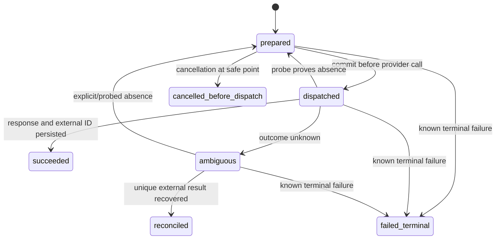

# Phase 3 可恢复 Workflow 端到端验证 / Recoverable Workflow E2E

> 状态：Active
>
> 不启动浏览器，不访问真实 NotebookLM/Z-Library，不读取真实账号凭据，也不执行 live-provider smoke。

## 1. 验证目标 / Goal

Phase 3 把同步导入流程升级为可持久恢复的 SQLite Saga。E2E 验证的不是“异常后重新从头跑”，而是以下完整恢复协议：

```text
submit Job + immutable payload
→ Worker atomic claim + Lease generation
→ Step input/output checkpoint
→ remote intent prepared
→ remote intent dispatched
→ provider call
→ succeeded/reconciled checkpoint
→ Source processing
→ final invariant verification
→ completed
```

进程可在任意已定义故障边界终止。新 Worker 只能在 Lease 到期后接管，接管会递增 `lease_generation`；旧 Worker 的 Job、Step 与远程 operation 写入均受 owner + generation fencing。

对应设计依据：

- [ADR-0004：持久化导入 Saga](../architecture/adr/0004-durable-import-saga.md)
- [两项目集成计划 Phase 3](../architecture/integration-plan.md#phase-3--pr-4可恢复-workflow)

## 2. 正交状态模型 / Orthogonal State Model

### Job lifecycle

```text
queued | running | blocked | completed | failed | cancelled
```

Job lifecycle 不再混入业务步骤。独立字段包括：

- `current_step`：`acquiring → storing → preparing → creating_workspace → uploading → processing → verifying`
- `blocked_reason`：`AUTH_REQUIRED | REMOTE_OUTCOME_AMBIGUOUS`
- `cancel_requested_at`：只表示已请求取消，不虚构 Provider 请求已经停止
- `lease_owner / lease_expires_at / lease_generation`：只在 `running` 有效
- `last_error_code / last_error_detail_redacted / retriable`：诊断与策略，不是 status

### Step checkpoint

每个 `job_steps` 记录保存：

```text
job_id, step, attempt, status,
input_hash, output_ref,
progress_current, progress_total,
error_code, error_detail_redacted,
started_at, completed_at, version
```

已完成 Step 只有在输入指纹一致时才可跳过；失败、阻塞或显式重试会创建新的 attempt 记录并保留历史。

### Remote operation lifecycle



`prepared`、`dispatched`、`ambiguous` 是未解析状态；Job 完成前必须不存在未解析 operation。没有本地 external ID 不能作为重建依据。

## 3. 执行 E2E / Run

数据库和 workspace 必须彼此分离且尚不存在：

```bash
uv run diandian phase3-e2e \
  --database .tmp/phase3-e2e/state/app.sqlite3 \
  --workspace .tmp/phase3-e2e/workspace
```

命令只使用 `FakeKnowledgeAdapter` 与 SQLite；不会创建浏览器、网络请求或凭据目录。重复执行同一路径会返回退出码 `2` 和无 traceback 的结构化错误，不覆盖已有数据。

成功时 stdout 返回结构化 JSON。当前确定性 fixture 的核心不变量：

| 字段 | 不变量 |
| --- | --- |
| `status` | `ok` |
| `schema_version` | `4` |
| `crash_boundary_count` | `11` |
| `completed_job_count` | `13` |
| `cancelled_job_count` | `1` |
| `auth_resume_count` | `1` |
| `manual_ambiguity_resolution_count` | `1` |
| `lease_generation_two_or_more_count` | `13` |
| `book_count` | `14` |
| `source_count` | `35` |
| `remote_operation_count` | `49` |
| `unresolved_operation_count` | `0` |
| `provider_workspace_write_count` | `13`，每个完成 Job 恰好一次 |
| `provider_source_write_count` | `35`，与完成 Source 数一致 |
| `job_event_count` / `job_step_count` | 均大于 `0`，且 event 多于 Step |

数据库物理路径只作为本地诊断输出；输出不包含 credentials root、Cookie、Token、Provider external ID 或请求正文。

## 4. 故障注入矩阵 / Crash Matrix

`phase3-e2e` 对以下边界逐一创建独立 Job，注入等价于进程死亡的 `BaseException`，确认旧 Lease 保持为 `running`，推进时钟越过 expiry，再由新 Worker 接管：

| 场景 | Checkpoint | 恢复依据 |
| --- | --- | --- |
| 本地 Step 已开始 | `AFTER_STEP_STARTED` | 同 attempt 的 running Step record |
| 本地 Step 已提交 | `AFTER_STEP_CHECKPOINT` / `acquiring` | 完成的输入指纹与 output ref |
| Workspace intent 已准备 | `AFTER_INTENT_PREPARED` | `prepared` 可安全 dispatch |
| Workspace 已标记 dispatched、尚未调用 | `AFTER_OPERATION_DISPATCHED` | probe 证明未落地后才二次 dispatch |
| Workspace Provider 已提交、尚未本地 checkpoint | `AFTER_PROVIDER_COMMIT` | authoritative operation key 恢复唯一 remote result |
| Workspace Step 已提交 | `AFTER_STEP_CHECKPOINT` / `creating_workspace` | 本地 mapping + succeeded intent |
| Source intent 已准备 | `AFTER_INTENT_PREPARED` 第 2 次 | Part 独立 intent |
| Source 已标记 dispatched | `AFTER_OPERATION_DISPATCHED` 第 2 次 | source probe 先于重发 |
| Source Provider 已提交 | `AFTER_PROVIDER_COMMIT` 第 2 次 | 恢复唯一 external Source |
| 已完成前两个 Source checkpoint | `AFTER_SOURCE_CHECKPOINT` 第 2 次 | 已持久化 Source 不重复写，progress 不回退 |
| Source wait 正在进行 | `SOURCE_WAIT_IN_FLIGHT` | 只重做安全 read/wait，不创建新 Source |

每个场景最终都满足：

- `lease_generation == 2`；
- 七个 Step 全部 `completed`；
- Workspace 写入一次、每个 Part 的 Source 写入一次；
- operation 全部为 `succeeded` 或 `reconciled`；
- 没有 `prepared/dispatched/ambiguous` 残留；
- Source progress 事件单调不回退；
- SQLite `PRAGMA integrity_check` 为 `ok`。

## 5. 认证恢复 / Authentication Resume

Provider 返回 `AUTH_REQUIRED` 时：

1. 当前 Step 记录为 `blocked`；
2. Job 进入 `blocked/AUTH_REQUIRED` 并释放 Lease；
3. 已 dispatch 但明确未发送的操作回到 `prepared`，保留 `dispatch_attempt`；
4. `resume_after_auth(job_id)` 先执行 `credential_is_healthy()`；
5. 健康检查失败时保持 blocked；通过后进入新的 attempt；
6. 从原 `current_step` 恢复，而不是重建 Book 或重复已完成 Step。

E2E 验证第二次 dispatch 使用同一 intent，最终 Provider Workspace 实际写入仍只有一次。

## 6. 不确定结果与人工解歧 / Ambiguous Outcome

当 operation 已 `dispatched`，但 probe 无法证明“唯一命中”或“明确不存在”时：

```text
running
→ blocked / REMOTE_OUTCOME_AMBIGUOUS
→ explicit external_id OR confirmed_absent
→ queued or cancelled
```

控制入口：

```python
resolve_ambiguous_operation(
    job_id,
    idempotency_key,
    external_id="...",       # 已确认唯一远程对象
)

resolve_ambiguous_operation(
    job_id,
    idempotency_key,
    confirmed_absent=True,   # 已明确证明未落地
)
```

必须且只能选择一种结果。`external_id` 将 operation 变为 `reconciled`；`confirmed_absent` 才允许回到 `prepared` 并再次 dispatch。未知 Job、未知 operation、非 ambiguous Job 或同时/均不提供两种结论都会被拒绝。

NotebookLM Adapter 当前声明 `probe_strategy=unsupported`：没有 external ID 时不会把“本地没记录”解释为远程不存在，而是保守要求人工解歧。

## 7. 取消语义 / Cancellation

取消 API 幂等持久化 `cancel_requested_at`：

- `queued` 且无远程 intent：立即 `cancelled`；
- `prepared` 且尚未下一次 dispatch：intent 变为 `cancelled_before_dispatch`；
- `running`：Worker 在安全点观察请求；
- `dispatched/ambiguous`：不能声称已取消，先进入 `blocked/REMOTE_OUTCOME_AMBIGUOUS`；
- 解歧完成且没有其他未知结果后：直接 `cancelled`，不会重新 claim 后继续写 Provider；
- 本地 Book/Asset 与已确认 external ID 保留，不执行无 intent 的远程删除。

E2E 同时覆盖“prepared 后取消，Provider 零写入”和“dispatched 后进程终止，解歧后取消”。

## 8. 自动化测试 / Automated Tests

主要覆盖：

- `tests/unit/test_jobs.py`：Job/Step 穷尽转换、Lease token、到期接管、进度、阻塞、重试与取消；
- `tests/unit/test_models.py`：RemoteOperation lifecycle、dispatch attempt、ambiguous、reconciled、terminal 与 safe cancellation；
- `tests/integration/test_sqlite_persistence.py`：Schema v4、CAS、Job/Step/Payload repository，以及旧 Worker 的 Job/Step/operation fencing；
- `tests/integration/test_import_workflow.py`：成功、事务回滚、429 有界重试、认证恢复、协议漂移、人工解歧与安全取消；
- `tests/integration/test_recoverable_workflow.py`：完整 crash matrix、自动/人工 reconciliation、confirmed absence 和 ambiguous cancellation；
- `tests/e2e/test_phase3_recoverable_workflow.py`：子进程 CLI、最终计数、无重复 Provider 写入和拒绝覆盖；
- `tests/contract/test_knowledge_adapters.py`：Fake 与 NotebookLM Adapter 的 health/reconciliation contract。

完整本地门禁：

```bash
uv run ruff format --check src tests
uv run ruff check src tests
uv run mypy src/diandianreading
uv run coverage erase && uv run pytest
uv run --isolated --python 3.11 pytest
uv run --isolated --python 3.14 pytest
uv lock --check
uv build --no-build-isolation
```

此外必须分别从 source tree 与安装后的 wheel 执行 Phase 0–3 CLI E2E。

## 9. 安全与范围边界 / Security and Scope

- 所有默认测试均为本地 Fake/SDK double，不访问 live Provider。
- 远程请求摘要和 baseline 字段只保存脱敏 JSON；不保存 Cookie、Token 或物理凭据路径。
- 所有运行中 Job 的 checkpoint 写入都要求当前 Lease owner + generation。
- SDK 写操作必须携带已持久化的 `RemoteOperationRef`。
- 不使用 `shell=True`、`notebooklm use` 或 `notebooklm._*` 私有模块。
- Phase 3 只交付 Import Saga；独立可恢复的内容生成/下载 Job 仍是后续范围。
- 本阶段不启动 Web server，因此不占用端口；未来开发服务器仍遵守唯一 `localhost:3000` 策略。

## 10. 当前验证证据 / Current Evidence

截至 2026-08-03，当前工作区已验证：

- Ruff format/lint：通过；
- strict mypy：46 个 source files 无问题；
- Python 3.11、3.12、3.14：各 `185 passed`；
- branch coverage：`90.46%`；
- `uv lock --check` 与 sdist/wheel build：通过；
- source tree 与 isolated installed-wheel 的 Phase 0–3 CLI E2E：全部通过；
- 不使用浏览器、真实凭据或 live Provider。

GitHub CI 结果以本 Phase PR 的 checks 为准；提交前不在仓库文档中预先声称 CI 已通过。
