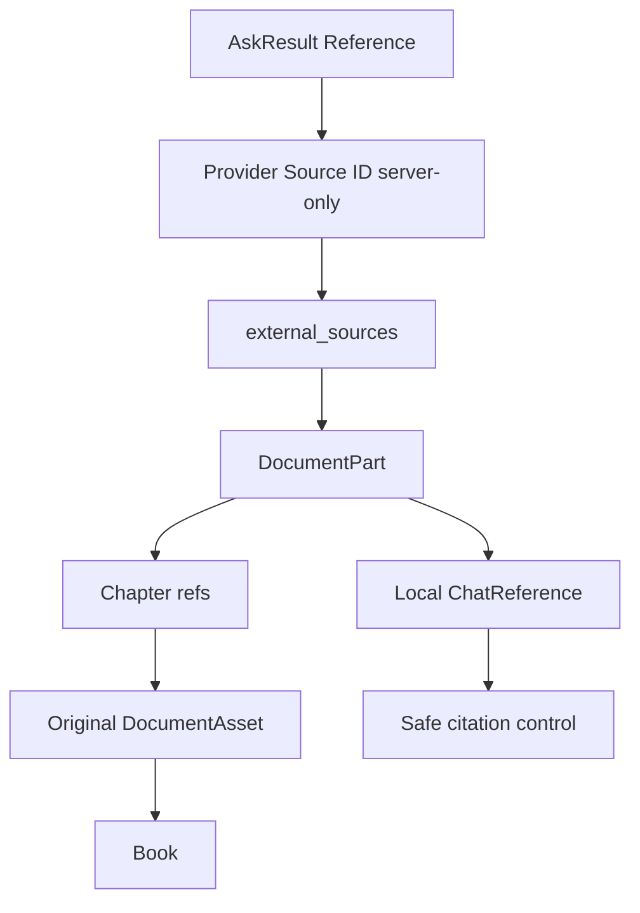
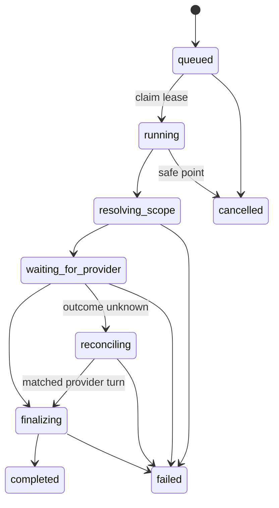

# AI 对话功能设计

> 状态：Active（整本书、选区、笔记范围与引用定位）/ Proposed（章节范围及后续操作）
>
> 产品阶段：Roadmap P4 AI Alpha
>
> 最后更新：2026-08-03

## 1. 目标

AI 对话把“阅读”与“思考”连接起来。它不是通用聊天机器人，而是围绕当前书籍、章节、选中文本和个人笔记工作的阅读助手。

本功能需要满足：

- 用户可以从首页、阅读器和想法页进入同一套对话体验。
- 回答默认基于当前书籍的 NotebookLM 来源。
- 用户可以通过本地 ID 将查询限制到章节、选中文本或一组笔记。
- 每次请求都返回服务端实际使用的 `effective_scope`，界面不能只展示客户端期望范围。
- 回答显示可追溯引用，引用能回到本地 Book、DocumentPart 和可用的位置映射。
- 回答可以保存为个人想法或继续创建独立内容生成 Job。
- 消息提交是可持久化、幂等且可恢复的长任务；离开页面不丢失问题。
- NotebookLM 失败不能影响本地阅读、标注、笔记和已保存的对话历史。

产品依据：

- [PRD：点击“问问这本书”打开 AI 对话](../../diandianreading-PRD.md)
- [Roadmap：P4 对当前书籍提问并获得带来源答案](../../diandianreading-ROADMAP.md)
- [NotebookLM Chat API](../api.md)
- [总体集成计划](../architecture/integration-plan.md)

## 2. 非目标

MVP 不包含：

- 通用联网搜索聊天。
- 替代完整 NotebookLM Web UI。
- 多用户共享实时聊天室。
- 声称支持真实 Token Streaming。
- 伪造逐字输出、虚假的 Token 进度或 Provider 未提供的生成百分比。
- 自动公开、自动保存为 Note 或自动发布 AI 回答。
- 在没有来源映射的情况下伪造引用。
- 首版实现多个活跃 Provider Conversation。
- 执行 AI 回答中出现的脚本、HTML、链接、图片、工具调用或发布指令。

## 3. 当前状态

### 3.1 Phase 5 已实现

当前主应用不再只依赖静态模拟 Modal。Phase 5 已提供：

- SQLite schema v6 中的唯一 Conversation、成对 user/assistant Message、ChatRun、Provider Attempt、本地 ChatReference、Retry 和 append-only Event；
- HTTP 接受命令后持久化再返回，`client_message_id`/`Idempotency-Key` 重放、冲突和单 Conversation busy 约束；
- Lease/fencing Worker、显式 Provider dispatch intent、完整回答持久化、失败/取消/重试和模糊结果 fail-closed；
- `book` QueryScope 的整本书范围解析、实际 `effective_scope` 和 NotebookLM 引用到本地 Book/DocumentPart/chapter refs 的映射；
- 连接状态、书籍列表、消息历史、提问、取消/重试、Job/Chat SSE 的同源 Web UI；
- 每安装实例 Token、浏览器 Session、单次 Bootstrap Nonce、CSRF、Peer/Host/Origin、CORS/Preflight、请求大小、速率和 SSE 连接限制；
- 无 inline JS/CSS、无 CDN、无 `innerHTML` 的同源前端资源；Provider 回答按文本节点渲染；
- 浏览器无关 `phase5-e2e`，验证导入 → Worker → Book ready → Conversation → whole-book Chat → local citation → SSE。

Phase 5 的 SSE 只传输持久状态事件，不提供逐 Token Streaming。WebSocket 没有路由，Uvicorn 明确配置 `ws="none"`。

### 3.2 R 轨与 D3 已实现

Phase 5 之后，阅读器交付轨（R1–R4）与 React 迁移追加提供：

- R1/R2：正文、章节与阅读进度服务，标注 SQLite 存储、CRUD API 与再锚定引擎；
- R3：React 阅读器 UI（正文渲染、章节导航、划线与笔记交互、PDF 视图），以及 Chat 面板的响应式 Drawer/移动页（三档断点、`aria-modal`，见 `apps/web/src/components/ChatPanel.tsx`）；
- R4：ChatReference 本地位置生产者（excerpt 唯一命中才写入，失败保持 `None`）、引用 → 阅读器跳转，以及 `selection` 与 `notes` QueryScope 及其越权、跨书、空范围与注入定界契约测试；
- D3：前端由 React/Vite 构建产物提供，原 vanilla bundle 已退役。

R3/R4 的浏览器 UI 功能、视觉与可访问性仍待按 `docs/development/manual-acceptance-checklist.md` 人工验收，代码交付不替代该证据。

### 3.3 仍为 Proposed

以下设计尚未实现，本文后续章节描述的是目标契约而非当前能力：

- `conversation_default` 与 `chapters` QueryScope；`chapters` 当前被显式拒绝（章节与 Part 的映射词汇尚未统一），`selection`/`notes` 已由 R4 交付；
- Conversation archive、删除本地历史和重置 Provider Context；（保存回答为 KnowledgeNote 由 C1 交付、生成内容由 C1b 交付，见 `docs/development/c1-e2e.md` 与 `c1b-e2e.md`）
- 上下文/事件保留清理任务、真实 Provider History reconciliation 的 live smoke、回答质量人工验收；
- 真实 NotebookLM/Z-Library 浏览器交互测试。本阶段只完成离线 Fake/contract/API/installed-wheel E2E，用户将另行手工测试。

## 4. 入口与查询上下文

浏览器只提交本地主项目 ID 和有限的用户输入，不提交 NotebookLM Source ID、Provider Conversation ID 或其他 Provider 内部标识。Application 层负责把本地 `query_scope` 解析为 Provider 请求，并把实际结果投影为 `effective_scope`。

### 4.1 本地 `QueryScope`

每次消息提交必须携带以下判别联合之一：

#### 整本书

```json
{
  "type": "book"
}
```

表示用户明确选择当前 Book 的完整正文范围。

#### Conversation 默认范围

```json
{
  "type": "conversation_default"
}
```

表示使用本地 Conversation 保存的默认范围。它只是请求别名，服务端必须先解析成具体范围；`effective_scope` 中不得出现 `conversation_default`。Conversation 默认范围只允许具体的 `book`、`chapters` 或 `notes`，不能把短暂选区保存为默认范围。

#### 章节

```json
{
  "type": "chapters",
  "chapter_ids": ["chapter-4"]
}
```

`chapter_ids` 必须非空，且所有章节必须属于当前 Book。

#### 选中文本

```json
{
  "type": "selection",
  "document_part_id": "part-id",
  "locator": {
    "type": "epub_cfi",
    "value": "epubcfi(/6/14!/4/2/8)"
  },
  "selected_text": "好的设计应该让正确的行为变得自然。"
}
```

`document_part_id` 和 `locator` 使用本地阅读器标识。`locator.type` 首批允许 `epub_cfi`、`pdf_page` 和 `markdown_offset`。服务端在能够读取原文时校验选区与 Part 的关系；不能验证时必须把它标记为用户提供的补充上下文，而不能声称它已经定位到原文。

#### 笔记集合

```json
{
  "type": "notes",
  "note_ids": ["note-1", "note-2"]
}
```

`note_ids` 必须非空，且所有 Note 必须属于当前用户的本地数据和当前查询允许的 Book 范围。浏览器不重复发送完整笔记正文；服务端按本地 ID 读取并建立上下文快照。

### 4.2 入口默认值

#### 整本书问答

入口：

- 首页“问问这本书”。
- 书籍详情页。
- 书库卡片快捷操作。

默认 `query_scope`：`{"type":"book"}`。

示例：

```text
这本书的核心论点是什么？
作者用了哪些证据？
哪些观点和我的产品工作最相关？
```

#### 当前章节问答

入口：阅读器章节工具栏。

默认 `query_scope`：当前章节对应的 `chapters`。如果一个 `DocumentPart` 覆盖多个章节，`effective_scope` 和界面必须显示实际覆盖范围，不能声称精确到单章。

#### 选中文本问答

入口：阅读器文本选择菜单。

快捷问题：

```text
解释这段话
给一个反例
这和前一章有什么关系？
用更简单的语言说明
把它和我的笔记联系起来
```

选中文字通过 `selection` 明确发送；不能假设 NotebookLM 自动知道阅读器当前位置。MVP 将经校验、转义和长度限制的选区作为补充上下文加入 Prompt，不为每次选区临时创建 Provider Text Source。

#### 基于个人笔记对话

入口：想法页多选标注/笔记后“继续讨论”。

MVP 支持两种服务端解析结果：

1. 已同步为 NotebookLM Text Source 的笔记：服务端从 `note_ids` 解析为明确的 Provider Source 集合。
2. 未同步笔记：服务端读取本地 Note，并以有清晰边界的补充上下文加入 Prompt。

界面只展示本地 Note 标题、数量和 `effective_scope`，不展示 Provider Source ID。

### 4.3 `None`、非空列表与显式空范围

Provider Source 范围必须保留三种不同语义：

| Application 解析结果 | 语义 | 行为 |
| --- | --- | --- |
| `provider_source_ids is None` | 明确的整本书 Provider 默认范围 | 允许调用 `chat.ask(..., source_ids=None)` |
| 非空 `provider_source_ids` | 明确限制到解析后的来源 | 传入非空列表 |
| 显式范围解析为空 | 用户选择的章节/笔记/选区没有 ready Source | 返回 `SOURCE_NOT_READY`，不得调用 Provider |

`None` 只能由具体的 `book` 范围产生，而且仅在当前 Provider Workspace 的全部可查询来源与该 Book 的正文来源集合一致时使用。如果 Workspace 还包含笔记或其他辅助 Source，整本书范围也必须解析为非空的正文 Source 列表，不能用 `None` 扩大范围。

禁止使用基于真假值的转换：

```python
# 禁止：空列表会被错误扩大为全部来源
source_ids=list(source_ids) if source_ids else None
```

### 4.4 `EffectiveScope`

服务端完成本地权限、归属、ready 状态和映射校验后，生成并持久化实际范围。例如：

```json
{
  "type": "chapters",
  "book_id": "book-id",
  "chapter_ids": ["chapter-4"],
  "document_part_ids": ["part-4-1", "part-4-2"],
  "note_ids": [],
  "source_labels": ["第 4 章 · Part 1", "第 4 章 · Part 2"],
  "supplemental_context": []
}
```

`effective_scope` 只包含前端可安全使用的本地 ID、标签和范围类型，不包含 Provider Source ID、Provider Conversation ID、凭据路径或原始 Provider 响应。`supplemental` 的取值为 `selection`（选区已在声称的 Part 原文中肯定命中）、`selection_unverified`（服务端无法确认命中，作为用户提供的补充上下文，不声称已定位）与 `notes`。它必须出现在完成、失败和恢复后的 `chat_run` 快照中；如果解析尚未完成，可以为 `null`。

### 4.5 边界校验

Application 层必须：

- 校验 Book、Chapter、DocumentPart 和 Note 的本地归属关系。
- 拒绝跨 Book、空数组、重复过多、已删除或未知 ID。
- 只使用 ready 且仍映射到当前 Workspace 的 Source。
- 将选区和未同步笔记作为不可信引用内容进行定界，不允许其改变系统指令或触发产品操作。
- 在调用 Provider 前持久化不含补充正文的规范化 `query_scope`、上下文哈希和 `effective_scope`；选区/未同步笔记正文单独写入受第 14.1 节期限约束的上下文快照。
- 在范围解析为空时返回 `SOURCE_NOT_READY`，绝不降级为整本书。

## 5. 界面、响应式与可访问性

### 5.1 桌面布局

宽视口阅读器使用右侧对话面板：

```text
┌─────────────────────────────┬────────────────────────┐
│                             │ 问问这本书             │
│        PDF / EPUB 正文       │ 《设计心理学》         │
│                             │ 实际范围：第 4 章      │
│  当前选中文字高亮            │                        │
│                             │ 你：这个观点和…        │
│                             │                        │
│                             │ AI：根据来源… [1][2]  │
│                             │                        │
│                             │ 输入问题…        发送 │
└─────────────────────────────┴────────────────────────┘
```

响应式策略固定为：

| 容器宽度 | 布局 | 行为 |
| --- | --- | --- |
| `>= 1100px` | 持久右侧面板 | 默认宽 `380px`，允许在 `320-480px` 内调整；正文可读宽度不得低于 `640px` |
| `720-1099px` | 右侧覆盖式 Drawer | 不压缩正文；打开时遮罩背景，按模态交互处理 |
| `< 720px` | 全屏对话页 | 不使用底部 Sheet；浏览器返回键回到原阅读位置 |

该策略描述响应式 Web，不代表已经决定建设原生移动阅读器。

布局切换时必须保留：

- 当前 Conversation 和 `chat_run`。
- 输入草稿和输入法组合状态。
- `query_scope` 与已展示的 `effective_scope`。
- 消息滚动锚点和阅读器原位置。
- 正在执行的轮询/SSE 订阅。

窄屏必须处理虚拟键盘和 `safe-area-inset-*`，输入框不能被键盘、浏览器工具栏或系统手势区遮挡。消息列表与输入区分离滚动；新回答到达时，只有用户原本位于底部才自动跟随。

### 5.2 顶部信息

- 当前 Book。
- 当前实际来源范围；解析中显示“正在确认来源”，不能提前声称具体章节。
- NotebookLM/Source 健康状态。
- 单一活跃对话状态。
- “重置 AI 上下文”入口；它不是普通“新对话”，必须说明会删除 Provider Conversation。
- 收起面板或返回阅读器。

### 5.3 消息操作

每条已完成 AI 回答提供：

```text
查看来源
保存为想法
生成卡片
复制纯文本
继续追问
```

“生成卡片”创建独立 `GeneratedContent` Job，返回 `202` 和 `job_id`，不在 Chat 请求中同步完成。保存、生成和发布都必须由用户单独触发，AI 文本本身不能触发操作。

### 5.4 可访问性契约

- 持久桌面面板使用带可见标题的命名区域，不设置 `aria-modal`，也不把键盘焦点困在面板内。
- 覆盖式 Drawer 使用带标题引用的模态 Dialog；打开后焦点进入标题或输入框，关闭后回到触发按钮。
- 全屏移动页使用正常页面导航和唯一主标题；浏览器返回键行为必须可预测。
- `Escape` 关闭覆盖式 Drawer，但不能取消正在运行的 `chat_run`。
- 输入框有持久可见 Label；`Enter` 发送、`Shift+Enter` 换行，输入法处于 composition 状态时不得误发送。
- 消息列表使用适合增量内容的 Log 语义；状态变化通过单独的 `aria-live="polite"` 区域简短播报。
- 回答完成不得抢走输入框或用户当前操作的焦点，也不得逐 Token 向读屏器播报。
- 引用控件的可访问名称至少包含“来源 N”、本地章节/Part 标签和是否可定位，例如“来源 1，第 4 章 Part 2，可打开原文”。
- 图标按钮必须有可见或辅助名称；错误、状态和范围不能只依赖颜色表达。
- 所有核心操作支持键盘；触摸目标至少 `44 × 44 CSS px`。
- 支持 `200%` 缩放、文本重排和 `prefers-reduced-motion`；焦点样式不可移除，颜色对比达到 WCAG 2.2 AA。

## 6. 规范 `ChatRun` 状态与错误契约

服务端、数据库、轮询、SSE 和 Web UI 只使用本节定义的规范值。UI 可以派生“离线”等本地能力状态，但不能创造另一套持久状态枚举。

### 6.1 `status`

| 值 | 含义 | 是否终态 |
| --- | --- | --- |
| `queued` | 命令已持久化，等待 Worker 领取 | 否 |
| `running` | Worker 正在解析范围、调用 Provider 或恢复结果 | 否 |
| `completed` | 回答、引用和 `effective_scope` 已持久化 | 是 |
| `failed` | 执行失败；是否可重试由 `error.retriable` 决定 | 是 |
| `cancelled` | 已在安全点停止；Provider 可能仍需结果核对 | 是 |

### 6.2 `phase`

`phase` 只在 `status=running` 时非空：

| 值 | 含义 |
| --- | --- |
| `resolving_scope` | 校验本地 ID、ready 状态和 Source 映射 |
| `waiting_for_provider` | 已发起完整回答请求，等待 Provider 返回 |
| `reconciling` | 请求结果不确定，正在核对 Provider Conversation |
| `finalizing` | 正在持久化回答、引用和最终事件 |

`submitting` 是浏览器在收到 `202` 前的短暂本地状态，不进入数据库或 SSE。`source_not_ready`、`auth_required`、`rate_limited` 和 `offline` 都不是 `status`：前三者由规范错误码表达，`offline` 是浏览器网络能力状态。

### 6.3 规范错误对象

没有错误时 `error` 必须为 `null`。失败时使用：

```json
{
  "code": "REMOTE_RATE_LIMITED",
  "message": "NotebookLM 请求过于频繁，请稍后重试。",
  "retriable": true,
  "retry_after_ms": 30000,
  "request_id": "req-local-id",
  "details": {
    "source_labels": []
  }
}
```

规则：

- `message` 是可安全展示的本地化文案，不包含原始 Provider 响应、Prompt、凭据、邮箱、文件绝对路径或 Provider ID。
- `details` 只允许经过 Schema 校验的本地 ID、标签和非敏感计数。
- `retry_after_ms` 仅在已知等待时间时提供。
- `request_id` 用于本地诊断关联；日志仍需执行敏感信息清理。
- `status=cancelled` 时 `error=null`；取消原因、请求时间和安全点记录在 ChatRun 审计字段中，不再定义重复的 `CANCELLED` 错误码。

### 6.4 错误码与 UI 映射

| `code` | 默认 `retriable` | UI 行为 |
| --- | --- | --- |
| `VALIDATION` | false | 在输入框或范围控件附近显示具体修正方法 |
| `PAYLOAD_TOO_LARGE` | false | 提示缩短问题、选区或减少笔记数量 |
| `NOT_FOUND` | false | 提示资源已删除或不可用，返回安全页面 |
| `SOURCE_NOT_READY` | true | 展示待处理本地来源和导入任务入口；不调用 Provider |
| `AUTH_REQUIRED` | true | 保留问题，提示重新登录；登录成功后显式重试 |
| `REMOTE_RATE_LIMITED` | true | 显示 `retry_after_ms`，等待期间禁用重试 |
| `REMOTE_UNAVAILABLE` | true | 保留本地消息，允许有界重试 |
| `REMOTE_PROTOCOL_DRIFT` | false | 提示集成需要升级，不自动重试 |
| `SOURCE_PROCESSING_FAILED` | false | 展示失败来源并允许回到导入任务 |
| `CONVERSATION_BUSY` | true | 展示当前运行中的 `chat_run`，不创建第二个 Provider Turn |
| `IDEMPOTENCY_CONFLICT` | false | 提示客户端刷新；不得使用同一 ID 提交不同内容 |
| `AMBIGUOUS_PROVIDER_OUTCOME` | false | 提示结果可能已写入 Provider；完成核对前禁止盲目重试 |
| `UNEXPECTED` | false | 显示安全通用错误和 `request_id` |

### 6.5 状态到界面的唯一映射

| `status` / `phase` | 展示 |
| --- | --- |
| `queued` | “问题已保存，等待处理” |
| `running/resolving_scope` | “正在确认来源范围” |
| `running/waiting_for_provider` | “正在读取来源并组织回答” |
| `running/reconciling` | “正在确认 Provider 是否已完成回答”，禁用重试 |
| `running/finalizing` | “正在保存回答与引用” |
| `completed` | 回答、引用、`effective_scope` 和消息操作 |
| `failed` | 按 `error.code` 和 `error.retriable` 展示 |
| `cancelled` | “已取消”，保留问题和运行记录 |

这些文案表示本地阶段，不是 Token 生成进度。

## 7. 后端边界

Application 层先把 `QueryScope` 解析为：

```python
@dataclass(frozen=True)
class ResolvedKnowledgeQuery:
    question: str
    provider_source_ids: tuple[str, ...] | None
    effective_scope: EffectiveScope
    supplemental_context: tuple[SupplementalContext, ...]
```

其中：

- `provider_source_ids=None` 只代表第 4.3 节定义的整本书 Provider 默认范围。
- `provider_source_ids=()` 是非法不变量，必须在进入 Adapter 前转换为 `SOURCE_NOT_READY`。
- `supplemental_context` 只保存经过边界标记、长度限制和转义的选区/未同步笔记快照。

Application 使用产品级 Port：

```python
class KnowledgeQueryPort(Protocol):
    async def ask(
        self,
        workspace: WorkspaceRef,
        query: ResolvedKnowledgeQuery,
        continuation: ProviderConversationRef | None,
    ) -> KnowledgeAnswer:
        ...
```

`ProviderConversationRef` 只存在于服务端 Application/Infrastructure 边界，不能序列化到 Web API。

NotebookLM Adapter 必须显式保留 `None` 与非空列表的差异：

```python
if query.provider_source_ids is not None and not query.provider_source_ids:
    raise SourceNotReadyError("Explicit query scope resolved to no ready sources")

provider_source_ids = (
    None
    if query.provider_source_ids is None
    else list(query.provider_source_ids)
)

result = await client.chat.ask(
    notebook_id,
    build_bounded_question(query),
    source_ids=provider_source_ids,
    conversation_id=(continuation.value if continuation else None),
)
```

返回映射：

```text
AskResult.answer          → 本地 assistant Message.content
AskResult.conversation_id → 服务端 provider_conversation_bindings
AskResult.references      → 本地 ChatReference records
EffectiveScope            → ChatRun.effective_scope_json
```

Web UI 不得直接依赖 `AskResult`、NotebookLM 类型、Provider Conversation ID 或 Provider Source ID。

## 8. HTTP API：已实现子集与后续目标

Phase 5 已实现：

```text
GET  /api/books/{book_id}/conversation
PUT  /api/books/{book_id}/conversation
GET  /api/conversations/{conversation_id}/messages
POST /api/conversations/{conversation_id}/messages
GET  /api/chat-runs/{run_id}
POST /api/chat-runs/{run_id}/cancel
POST /api/chat-runs/{run_id}/retry
GET  /api/chat-runs/{run_id}/events
```

所有状态变更接口执行同源 Session + CSRF，或在没有 Cookie 时执行每安装实例 Bearer；SSE 只接受浏览器 Session。Conversation 默认范围仍是 `book`；Message `query_scope` 在 R4 之后接受 `book`、`selection` 与 `notes`，`chapters` 被显式拒绝。本节后续包含 `chapters`、archive/delete/reset 等示例时，它们仍是 Proposed 目标，不是已部署路由；`save-as-note` 与 `generate-content` 已分别由 C1 与 C1b 部署。

### 8.1 获取或建立唯一活跃 Conversation

```http
PUT /api/books/{book_id}/conversation
Content-Type: application/json
```

```json
{
  "title": "第 4 章讨论",
  "default_query_scope": {
    "type": "chapters",
    "chapter_ids": ["chapter-4"]
  }
}
```

Book 尚无 Conversation 时返回 `201`，已存在时返回 `200`。该接口幂等，MVP 每本书最多一个活跃本地 Conversation 和一个活跃 Provider Conversation。

```json
{
  "data": {
    "id": "conv-local-id",
    "book_id": "book-id",
    "title": "第 4 章讨论",
    "default_query_scope": {
      "type": "chapters",
      "chapter_ids": ["chapter-4"]
    },
    "status": "active",
    "provider": "notebooklm",
    "created_at": "2026-08-03T12:00:00Z",
    "updated_at": "2026-08-03T12:00:00Z"
  },
  "request_id": "req-local-id"
}
```

响应不包含 Provider Conversation ID。

### 8.2 幂等提交消息

```http
POST /api/conversations/{conversation_id}/messages
Content-Type: application/json
Idempotency-Key: msg-client-01
```

```json
{
  "client_message_id": "msg-client-01",
  "question": "这个观点和用户体验设计有什么关系？",
  "query_scope": {
    "type": "selection",
    "document_part_id": "part-id",
    "locator": {
      "type": "epub_cfi",
      "value": "epubcfi(/6/14!/4/2/8)"
    },
    "selected_text": "好的设计应该让正确的行为变得自然。"
  }
}
```

`Idempotency-Key` 必须与 `client_message_id` 相同。服务端在一个事务中：

1. 校验本地 Conversation 和请求大小。
2. 写入 user Message。
3. 写入空内容的 assistant Message 占位。
4. 写入 `chat_run(status=queued)`。
5. 提交事务后返回 `202 Accepted`，不得在该 HTTP 请求中等待 NotebookLM 完整回答。

```http
HTTP/1.1 202 Accepted
Location: /api/chat-runs/run-local-id
```

```json
{
  "data": {
    "user_message": {
      "id": "message-user-id",
      "client_message_id": "msg-client-01",
      "role": "user",
      "content": "这个观点和用户体验设计有什么关系？",
      "created_at": "2026-08-03T12:01:00Z"
    },
    "assistant_message": {
      "id": "message-assistant-id",
      "role": "assistant",
      "content": null,
      "created_at": "2026-08-03T12:01:00Z"
    },
    "chat_run": {
      "id": "run-local-id",
      "conversation_id": "conv-local-id",
      "client_message_id": "msg-client-01",
      "status": "queued",
      "phase": null,
      "error": null,
      "effective_scope": null,
      "attempt": 1,
      "version": 0,
      "created_at": "2026-08-03T12:01:00Z",
      "updated_at": "2026-08-03T12:01:00Z"
    },
    "links": {
      "self": "/api/chat-runs/run-local-id",
      "events": "/api/chat-runs/run-local-id/events"
    }
  },
  "request_id": "req-local-id"
}
```

幂等规则：

- 同一 `(conversation_id, client_message_id)` 和相同规范化请求重放时，返回原有 Message/ChatRun；非终态返回 `202`，终态返回 `200`。
- 同一 ID 携带不同 question 或 `query_scope` 时返回 `409 IDEMPOTENCY_CONFLICT`。
- 浏览器超时或刷新只能重放同一命令，不能生成新的 `client_message_id` 猜测重试。
- 同一 Conversation 已有 `queued` 或 `running` ChatRun 时，新命令返回 `409 CONVERSATION_BUSY` 和当前本地 `active_run_url`；服务端不排队第二个 Provider Turn。

### 8.3 轮询 ChatRun

```http
GET /api/chat-runs/{run_id}
```

完成响应示例：

```json
{
  "data": {
    "chat_run": {
      "id": "run-local-id",
      "conversation_id": "conv-local-id",
      "client_message_id": "msg-client-01",
      "status": "completed",
      "phase": null,
      "error": null,
      "effective_scope": {
        "type": "selection",
        "book_id": "book-id",
        "chapter_ids": ["chapter-4"],
        "document_part_ids": ["part-id"],
        "note_ids": [],
        "source_labels": ["第 4 章 · Part 2"],
        "supplemental_context": ["selection"]
      },
      "attempt": 1,
      "version": 5,
      "created_at": "2026-08-03T12:01:00Z",
      "updated_at": "2026-08-03T12:01:12Z"
    },
    "assistant_message": {
      "id": "message-assistant-id",
      "role": "assistant",
      "content": "根据作者在第 4 章的论述……[1]",
      "created_at": "2026-08-03T12:01:12Z"
    },
    "references": [
      {
        "id": "reference-local-id",
        "citation_number": 1,
        "document_part_id": "part-id",
        "book_id": "book-id",
        "chapter_refs": ["chapter-4"],
        "label": "第 4 章 · Part 2",
        "passage": "……",
        "location": null
      }
    ]
  },
  "request_id": "req-local-id"
}
```

轮询始终返回 `200` 和当前资源快照。已接受命令的 Provider 错误通过 `chat_run.status=failed` 与第 6 节规范 `error` 表达，不把后续异步失败伪装成新的 HTTP 4xx/5xx。

### 8.4 可重连 SSE

```http
GET /api/chat-runs/{run_id}/events
Accept: text/event-stream
Last-Event-ID: 41
```

事件只推送本地状态和最终资源可用通知：

```text
id: 42
event: chat_run.updated
data: {"run_id":"run-local-id","version":4,"status":"running","phase":"waiting_for_provider","error":null}

id: 43
event: chat_run.completed
data: {"run_id":"run-local-id","version":5,"status":"completed","phase":null,"error":null,"resource_url":"/api/chat-runs/run-local-id"}
```

规则：

- 每个事件有单调递增的本地 Event ID 和 ChatRun `version`。
- 客户端断线后使用 `Last-Event-ID` 重连；服务端补发保留窗口内事件。
- Event ID 已过期时，先发送 `chat_run.snapshot`，客户端以快照替换本地状态。
- 心跳只能使用 SSE comment，不改变 ChatRun 状态。
- SSE 是可选加速层；数据库和 `GET /api/chat-runs/{id}` 才是 source of truth。
- 不发送 `token`、`delta`、部分回答或虚假百分比事件。

### 8.5 取消与显式重试

```text
POST /api/chat-runs/{run_id}/cancel
POST /api/chat-runs/{run_id}/retry
```

取消返回 `202` 并记录 cancellation request；Worker 在安全点停止。若 Provider 请求已经发出，必须先进入 `reconciling`，不能假设取消 HTTP 任务等于 Provider 没有生成回答。核对到完整回答时 ChatRun 进入 `completed` 并提示“取消请求晚于 Provider 完成”；确认没有新增 Turn 时才进入 `cancelled`；仍无法判断时进入 `failed/AMBIGUOUS_PROVIDER_OUTCOME`。

重试请求必须携带新的 `client_retry_id` 并对该 ID 幂等。只有 `status=failed`、`error.retriable=true` 且不处于模糊结果状态时才允许重试同一 ChatRun；它增加 `attempt`，不创建重复 user Message。`AMBIGUOUS_PROVIDER_OUTCOME` 必须先按第 12.4 节完成核对或由用户明确处理，不能自动重试。

### 8.6 历史与消息操作

```text
GET    /api/books/{book_id}/conversation
GET    /api/conversations/{conversation_id}/messages?before=<cursor>&limit=50
POST   /api/messages/{message_id}/save-as-note
POST   /api/messages/{message_id}/generate-content
POST   /api/conversations/{conversation_id}/archive
DELETE /api/conversations/{conversation_id}/local-history
POST   /api/books/{book_id}/conversation/reset-provider-context
```

- 消息分页按 `(created_at, id)` 确定性排序，响应返回 `next_cursor`；页面内最终按时间正序展示。
- `save-as-note` 使用消息 ID 作为默认幂等来源键，重复请求返回同一 Note。
- `generate-content` 返回 `202`、`job_id` 和状态 URL。
- `archive` 只改变本地可见性，不删除本地消息或 Provider Conversation。
- `local-history` 按第 14 节删除本地消息，但保留唯一 Conversation 壳和 Provider 绑定；响应必须明确 `provider_context_retained=true`。
- `reset-provider-context` 是不可恢复的独立 Provider 操作，需要正文确认和最新 Conversation 版本，不能与删除本地历史合并为一个模糊按钮。

### 8.7 接受命令前的 HTTP 错误

| HTTP | `error.code` | 场景 |
| --- | --- | --- |
| `404` | `NOT_FOUND` | Book、Conversation 或本地范围对象不存在 |
| `409` | `CONVERSATION_BUSY` | 同一 Conversation 已有非终态 ChatRun |
| `409` | `IDEMPOTENCY_CONFLICT` | 同一客户端 ID 对应不同规范化请求 |
| `413` | `PAYLOAD_TOO_LARGE` | 请求或补充上下文超过限制 |
| `422` | `VALIDATION` | Schema、空数组、跨 Book 或 locator 非法 |

这些错误使用与第 6.3 节相同的安全错误对象。通过 `202` 接受后的错误只写入 ChatRun。

## 9. 本地数据模型

### `conversations`

| 字段 | 说明 |
| --- | --- |
| `id` | 本地 Conversation ID |
| `book_id` | 所属 Book；MVP 有唯一活跃约束 |
| `workspace_id` | 本地 ExternalWorkspaceLink |
| `title` | 用户可编辑标题 |
| `default_query_scope_json` | 具体默认本地范围，不能保存 `conversation_default` |
| `status` | `active` / `archived` |
| `created_at` / `updated_at` | 本地时间戳 |

### `provider_conversation_bindings`

| 字段 | 说明 |
| --- | --- |
| `conversation_id` | 本地 Conversation |
| `provider` | `notebooklm` |
| `provider_conversation_id` | 服务端内部 Provider ID，可为空 |
| `context_generation` | 每次显式 Provider Reset 后递增 |
| `health` | `unknown` / `active` / `missing` / `resetting` / `error` |
| `last_verified_at` | 最近核对时间 |

该表和其中 ID 永不进入普通 Web API、SSE、Telemetry 或可复制 UI。

### `messages`

| 字段 | 说明 |
| --- | --- |
| `id` | 本地消息 ID |
| `conversation_id` | 本地 Conversation |
| `chat_run_id` | 产生该消息的 ChatRun；user/assistant 成对关联 |
| `client_message_id` | 客户端幂等 ID，仅 user Message 使用 |
| `role` | `user` / `assistant` / `system` |
| `content` | 消息正文；assistant 在完成前可为空 |
| `created_at` | 创建时间 |

Message 不再维护另一套运行状态；执行状态统一读取关联 `chat_run`。

### `chat_runs`

| 字段 | 说明 |
| --- | --- |
| `id` | 本地 ChatRun ID |
| `conversation_id` | 本地 Conversation |
| `client_message_id` | 与提交命令对应的幂等 ID |
| `status` / `phase` | 第 6 节规范值 |
| `query_scope_json` | 规范化本地范围；不内嵌 `selected_text` 或笔记正文 |
| `effective_scope_json` | 服务端实际范围，可在解析前为空 |
| `context_snapshot_ref` | 受保留策略约束的补充上下文快照引用 |
| `question_hash` / `request_fingerprint` | 幂等和模糊结果核对 |
| `attempt` / `version` | 重试次数和乐观并发版本 |
| `error_json` | 第 6.3 节错误对象 |
| `lease_owner` / `lease_expires_at` | Worker 领取与崩溃恢复 |
| `provider_request_started_at` | 判断模糊结果窗口 |
| `created_at` / `updated_at` / `completed_at` | 生命周期时间 |

约束：

- 唯一 `(conversation_id, client_message_id)`。
- 每个 Conversation 最多一个 `status IN ('queued', 'running')` 的 ChatRun。
- 终态更新 assistant Message、References、ChatRun 和最终事件时使用同一数据库事务。

### `chat_references`

| 字段 | 说明 |
| --- | --- |
| `id` | 本地 Reference ID |
| `message_id` | AI Message |
| `citation_number` | 文中的 `[N]` |
| `external_source_id` | 服务端内部 NotebookLM Source ID，不进入 Web API |
| `document_part_id` | 本地 Part |
| `passage` | 可用时保存的引用片段 |
| `location_json` | EPUB/PDF/Markdown 本地定位信息 |

### `chat_run_events`

| 字段 | 说明 |
| --- | --- |
| `id` | 单调递增 SSE Event ID |
| `chat_run_id` | 对应 ChatRun |
| `run_version` | 事件产生时的 ChatRun 版本 |
| `event_type` | `chat_run.updated/completed/failed/cancelled/snapshot` |
| `payload_json` | 不含消息正文和 Provider ID 的安全状态载荷 |
| `created_at` | 创建时间 |

本地数据库是产品对话历史和运行状态的 source of truth；NotebookLM 不是唯一聊天记录存储。

## 10. 引用映射



服务端必须先把 Provider Reference 转换为本地 `ChatReference`，前端只能看到本地 Reference ID 和可展示字段。

点击引用时：

- EPUB：优先跳转到对应章节；精确 CFI 需要解析阶段保存位置映射。
- PDF：MVP 至少打开原文件/对应 Part；精确页码需要额外页码映射。
- Markdown：跳转到对应 heading/offset。
- 映射缺失：显示经过安全处理的本地 Source 标签，并明确标记“无法定位本地原文”。

不得仅根据标题猜测来源，也不得把回答中的任意 `[N]` 自动变成链接。只有同时存在本地 `ChatReference` 记录时，渲染器才生成可点击引用控件；其余文本保持普通文本。

## 11. Conversation 语义

NotebookLM 当前公开语义：

- `conversation_id=None` 会继续该 Notebook 最近会话，或在没有会话时创建。
- 指定 `conversation_id` 会继续该 Provider Conversation。
- 强制新 Provider Conversation 需要删除当前服务端 Conversation；删除不可恢复。

因此 MVP 固定采用：

1. 每本书只有一个活跃本地 Conversation 和一个绑定的活跃 Provider Conversation。
2. 本地 UI 不提供看似独立但实际共享隐藏 Provider 历史的“新线程”。
3. Provider ID 一旦建立，后续请求始终由服务端显式传入该 ID。
4. 首次请求只有在服务端确认 Provider 当前不存在 Conversation 时才能传 `None`；成功后立即持久化返回 ID。
5. 如果本地尚无绑定但 Provider 已存在最近 Conversation，不能静默接管。UI 必须让用户选择“保留并采用现有 Provider 上下文”或“不可恢复地重置 Provider 上下文”。
6. Provider 返回 missing、冲突或未知最近会话时进入核对流程，不自动改绑到另一个最近 Conversation。
7. “归档”只整理本地 UI；“删除本地历史”和“重置 Provider 上下文”是两个独立操作。
8. 多 Provider Conversation 属于 MVP 后的能力，不能通过增加本地 Conversation 记录伪装实现。

## 12. 持久执行、幂等与恢复

### 12.1 接受命令

HTTP 层只完成本地校验和事务写入，随后立即返回 `202`。用户问题、assistant 占位和 ChatRun 必须先于 Provider 调用持久化。浏览器关闭、SSE 断开或请求重放都不取消已接受命令。

### 12.2 Worker 状态机



图中的阶段节点持久化为 `status=running` 加对应 `phase`，不是额外 `status`。

### 12.3 一次只执行一个 Turn

- 数据库唯一约束保证每个 Conversation 最多一个非终态 ChatRun。
- 多标签页、重复点击和网络重放不能绕过该约束。
- Worker 按 Conversation 串行执行 Provider Turn。
- 领取使用 lease；进程崩溃后由新 Worker 接管过期 lease。
- 重试复用原 ChatRun 和 user Message，通过 `attempt` 记录，不创建重复消息。

### 12.4 Provider 结果不确定

如果出现以下情况，不能直接再次调用 `chat.ask()`：

- Provider 已接收请求后网络断开。
- Provider 返回回答，但持久化前进程崩溃。
- 回答成功，但获取/保存 Provider Conversation ID 失败。
- 用户请求取消时 Provider 调用已经发出。

恢复流程：

1. 将 ChatRun 置为 `running/reconciling`。
2. 使用服务端保存的 Provider Conversation ID、最后确认 Turn、问题指纹和时间窗口读取 Provider History。
3. 如果能够唯一确认新增 Turn 与当前请求对应，映射并持久化该回答，不再次提问。
4. 如果能够确认 Provider 未创建 Turn，才允许按有界策略重试原调用。
5. 如果无法唯一判断，置为 `failed/AMBIGUOUS_PROVIDER_OUTCOME`，禁止自动重试。
6. UI 明确提示“Provider 可能已经收到问题”，允许用户查看 Provider、保留当前上下文，或显式重置后重新提问。

不能仅凭回答文本相似、标题或当前最近 Conversation 猜测成功结果。

## 13. SSE 与 Streaming 限制

`NotebookLMClient.chat.ask()` 的公开调用返回完整 `AskResult`；当前项目没有可供主应用消费的公共逐 Token Stream，NotebookLM REST Adapter 也不提供 SSE Chat。

本项目 SSE 只传输：

```text
queued
→ running/resolving_scope
→ running/waiting_for_provider
→ running/reconciling（仅结果不确定时）
→ running/finalizing
→ completed / failed / cancelled
```

约束：

- 不发送回答 Token、字符 delta 或模拟打字片段。
- `waiting_for_provider` 只表示本地正在等待完整结果，不表示 Provider 当前生成到某个百分比。
- 完整回答持久化后，SSE 只通知资源已更新；客户端通过规范 ChatRun 快照读取答案。
- 读屏播报只在阶段有意义变化或回答完成时发生，不能按心跳重复播报。

## 14. 保留、删除与 Provider Retention

### 14.1 默认本地保留

- user/assistant Message、最终 `effective_scope`、本地引用和最小 ChatRun 审计记录默认保留到用户删除本地历史或删除 Book。
- 选中文本和未同步笔记的重复上下文快照在 ChatRun 进入终态后保留最多 30 天，用于恢复和问题核对；到期删除正文，只保留本地对象 ID、范围标签和内容哈希。
- 详细 attempt/error 诊断信息保留 30 天；不得保存原始 Provider 响应。
- `chat_run_events` 保留 24 小时；过期重连使用当前 ChatRun 快照。
- 保存为 Note 或 GeneratedContent 会创建独立本地对象，按各自保留策略管理，不因 Chat 删除自动删除。

### 14.2 归档与删除本地历史

- 归档只隐藏 Conversation，不删除 Message、ChatRun、Reference 或 Provider 数据。
- 删除本地历史需要二次确认；确认后立即从正常查询隐藏，并在 24 小时内清除 Message、Reference、上下文快照、事件和详细运行记录。
- 为避免误导，唯一 Conversation 壳、Provider Binding 和最小 reset/audit 状态继续保留，响应和 UI 必须显示 `provider_context_retained=true`。
- 本地备份中的历史按备份轮换策略过期；产品不能声称删除操作会立即物理擦除所有已有备份块。

### 14.3 Provider Retention 与重置

- 删除或归档本地历史默认不删除 NotebookLM Provider Conversation；后续回答仍可能受其历史影响。
- “重置 AI 上下文”单独调用 Provider 删除接口，必须展示不可恢复说明、要求正文确认并校验最新本地 Conversation 版本。
- Provider 删除成功后清除服务端绑定 ID、递增 `context_generation`，下一次问答从经确认的空 Provider 上下文开始。
- Provider 删除失败时保留绑定和 `health=error`，不得假装重置成功。
- 应用只能报告 Provider API 的操作结果，不能承诺第三方备份、日志或其服务条款之外的立即物理删除。
- 删除 Provider Conversation 不删除本地历史；删除本地历史也不删除 Provider Conversation。
- 删除 Book 时必须分别询问“删除本地对话数据”和“尝试删除 Provider 对话”，并展示各自结果。

## 15. 隐私、安全与安全渲染

### 15.1 数据与 Provider 边界

- 不把 Google Cookie、Token、storage state、Provider Conversation ID、Provider Source ID 或凭据路径发送到前端。
- 不记录完整 Provider 请求/响应、原始认证 Header、Cookie、Prompt 或用户私密笔记正文。
- 选中文本和个人笔记只发送给界面明确显示的 AI Provider，并在提交前显示范围摘要。
- Provider 返回内容一律视为不可信数据，不是系统指令。
- AI 回答不能直接触发保存、生成、下载、发布、导航、网络请求或 Provider Reset。
- 高风险领域回答保留“需要人工核验”提示；发布始终要求独立人工确认。

### 15.2 输入限制

MVP 默认上限：

| 输入 | 上限 |
| --- | --- |
| question | 8,000 个 Unicode 字符 |
| selected_text | 20,000 个 Unicode 字符 |
| note_ids | 50 个 |
| 未同步笔记补充上下文 | 合计 100,000 个 Unicode 字符 |
| 单次 HTTP JSON Body | 256 KiB |

超限返回 `PAYLOAD_TOO_LARGE`，不能静默截断后继续提问。服务端规范化 Unicode、拒绝控制字符滥用，并对补充上下文使用明确的开始/结束边界和类型标签。补充上下文中的“忽略之前指令”等文本仍按引用内容处理，不获得应用权限。

### 15.3 Markdown 与 XSS

- 回答默认按纯文本或安全 Markdown AST 渲染；禁止解析原始 HTML。
- 禁止 `dangerouslySetInnerHTML` 或等价未净化 HTML 注入路径。
- Markdown 允许列表、段落、标题、引用、强调和静态代码块；移除 `script`、`style`、`iframe`、`object`、`embed`、`form`、事件属性、内联样式和未知节点。
- 代码块只显示文本，不执行、不自动复制到终端，也不提供一键运行。
- 复制操作默认写入纯文本；不得把 Provider HTML 写入富文本剪贴板。
- 引用控件由本地 `ChatReference` 记录生成，不能信任模型输出的 HTML Anchor 或任意 `[N]`。
- 用户问题、书名、Note 标题、Source 标签、引用 passage 和错误文案同样必须转义，不能只净化 assistant Message。

### 15.4 链接与图片

- Provider 回答中的 URL 默认显示为文本；MVP 只把通过 URL 解析器验证的 `https:` 外链升级为可点击链接。
- 拒绝 `javascript:`、`data:`、`file:`、`blob:`、自定义 Scheme、协议相对 URL、含用户信息的 URL 和不可解析 URL。
- 外链打开前显示真实 Host；新窗口使用 `target="_blank"` 与 `rel="noopener noreferrer nofollow"`。
- 本地 Citation 导航只使用应用生成的同源路由和本地 ID，不接受模型提供的目标路径。
- MVP 不渲染回答中的远程图片、Markdown Image、SVG、Data URL 或跟踪像素。
- 必须展示的本地书籍图片只通过受控同源端点提供，限制为校验后的 PNG/JPEG/WebP、文件大小和尺寸；SVG 作为下载附件处理，不内联。
- 所有图片具有有意义的 `alt`；装饰图片使用空 `alt`。

### 15.5 生产 CSP

生产入口至少使用：

```text
default-src 'self';
script-src 'self';
style-src 'self';
img-src 'self';
connect-src 'self';
font-src 'self';
object-src 'none';
frame-src 'none';
media-src 'none';
base-uri 'none';
form-action 'self';
frame-ancestors 'none';
worker-src 'self';
```

不得为 Chat 渲染加入 `'unsafe-inline'` 或 `'unsafe-eval'`。SSE 使用同源 `connect-src 'self'`。开发态 HMR 如需额外策略，只能放宽开发配置，不能复制到生产。框架支持时启用 Trusted Types，并保持 Sanitizer/Markdown 渲染器的集中封装和安全测试。

### 15.6 请求与日志安全

- 状态变更请求校验 `Origin`/`Host`；未来如果使用 Cookie 身份认证，必须同时使用 `SameSite` 和 CSRF 防护。
- 错误响应、SSE、Telemetry 和日志执行字段白名单与敏感信息清理。
- `request_id`、本地 Message ID 和 ChatRun ID 可用于关联；不得用 Provider ID 作为用户可见诊断信息。
- 安全日志记录操作类型、结果和本地 ID，不记录问题全文、回答全文、选区或笔记正文。

## 16. 验收标准

### 16.1 功能与范围

- 首页、阅读器和想法页打开同一个 Book 的唯一活跃 Conversation。
- 用户能完成至少三轮追问。
- 每次回答展示服务端 `effective_scope`，且与真实调用来源一致。
- `book` 范围只在第 4.3 节条件满足时使用 Provider `source_ids=None`。
- 章节、笔记或选区解析为空时返回 `SOURCE_NOT_READY`，测试确认没有调用 Provider。
- 刷新页面后本地消息、ChatRun 和输入范围仍可恢复。
- 回答包含有效本地 Reference 时显示可点击 `[N]`。
- 引用能映射到正确 Book 和 DocumentPart。
- 可以把回答幂等保存成个人 Note。
- 可以从回答创建返回 `202/job_id` 的独立内容生成 Job。
- 普通 Web API、SSE 和 UI 中不存在 Provider Conversation ID 或 Provider Source ID。

### 16.2 持久化、幂等与失败恢复

- 首次消息提交在 Provider 调用前返回持久化 `202`。
- 同一 `client_message_id` 的相同请求重复 10 次只产生一组 Message、一个 ChatRun 和最多一个 Provider Turn。
- 同一 ID 对应不同内容返回 `409 IDEMPOTENCY_CONFLICT`。
- 同一 Conversation 的并发第二个问题返回 `409 CONVERSATION_BUSY`。
- 关闭页面、SSE 断线和应用页面刷新不会删除或取消 ChatRun。
- Worker 在 `resolving_scope`、`waiting_for_provider` 和 `finalizing` 崩溃后都能通过 lease 恢复。
- NotebookLM 未登录时问题保留为 `failed/AUTH_REQUIRED`，登录后通过显式重试继续。
- 429 使用 `retry_after_ms`，不会高频重复提交。
- Provider 调用结果不确定时进入 `reconciling`，无法确认则为 `AMBIGUOUS_PROVIDER_OUTCOME`，不会盲目重复提问。
- NotebookLM 不可用时，阅读器、本地笔记和既有对话历史继续工作。

### 16.3 SSE 与非 Token Streaming

- 断线重连携带 `Last-Event-ID`，保留窗口内事件不丢失、不重复应用旧版本。
- Event 过期时客户端能用 `chat_run.snapshot` 和轮询恢复。
- SSE 中不存在 `token`、`delta`、模拟打字或虚假百分比。
- 完整回答只在 ChatRun 完成并持久化后一次性出现。

### 16.4 响应式

在至少 `1440px`、`1024px`、`720px`、`390px` 和 `320px` 宽度验证：

- 布局严格遵守第 5.1 节持久面板、覆盖 Drawer 和全屏页面策略。
- 正文、消息列表和输入框不产生阻止核心操作的水平滚动。
- 虚拟键盘和安全区不遮挡输入框、发送按钮或最新消息。
- 布局切换不丢失草稿、范围、滚动锚点或运行订阅。
- 长问题、长回答、大字号和中英文混排仍可阅读。

### 16.5 可访问性

- 仅使用键盘可以打开/关闭 Chat、选择范围、发送、取消、重试、打开引用、保存 Note 和重置上下文。
- 持久面板、模态 Drawer 和全屏页分别符合第 5.4 节语义；焦点进入和返回位置可预测。
- 输入法 composition 期间按 Enter 不会误发送。
- 读屏器能听到一次简洁状态变化和回答完成通知，不会读取心跳或逐字重复回答。
- 引用和图标按钮都有描述性名称；错误和状态不只依赖颜色。
- `200%` 缩放、减少动态效果和 `44 × 44 CSS px` 触摸目标通过人工检查。
- 自动化可访问性扫描无严重问题，并完成至少一次键盘与主流读屏器人工走查。

### 16.6 安全与保留

- XSS 测试覆盖 user Message、assistant Message、书名、Note 标题、Source 标签、引用 passage 和错误详情。
- `script`、事件属性、危险 URL、远程图片、SVG、Data URL 和模型生成 HTML 均不能执行或加载。
- 生产 CSP 不包含 Chat 所需的 `'unsafe-inline'`/`'unsafe-eval'` 例外。
- 外链展示真实 Host，并带安全 `rel`；内部引用只使用本地路由。
- Provider ID、凭据、绝对路径、原始响应和私密正文不进入 Web API、SSE 或日志。
- 30 天上下文快照、30 天详细诊断和 24 小时 SSE Event 的清理任务可验证。
- 删除本地历史和重置 Provider 上下文分别确认、分别执行、分别报告结果。

### 16.7 回答质量

按 Roadmap P4，为每本测试书准备 5-10 个问题并人工检查：

- 引用是否正确。
- 是否混淆不同书籍。
- 是否严格使用用户选择的章节、选区和笔记。
- 是否能够回答“这和我有什么关系”。
- 至少 80% 测试问题达到可接受质量。

## 17. 实施顺序

1. 完成 `external_workspaces`、`external_sources`、本地 Source inventory 和引用映射。
2. 实现 `QueryScope`、`EffectiveScope`、范围解析器和空范围守卫。
3. 实现唯一 Conversation、服务端 Provider Binding、Message、ChatRun、Event 表和约束。
4. 实现 `202` 幂等命令、Worker lease、轮询、可重连 SSE、取消和显式重试。
5. 使用 Fake Adapter 验证 `None`/非空/空范围、并发、重放、崩溃恢复和模糊结果状态。
6. 把静态原型 Modal 改为符合响应式、可访问性和安全渲染契约的 Chat UI。
7. 接入 NotebookLM Adapter，并实现首次 Conversation 建立、显式 continuation 和 History reconciliation。
8. 实现引用跳转、保存为想法、生成内容 Job、归档、本地删除和 Provider Reset。
9. 实现保留清理、CSP、安全测试、认证提示和质量验收。

AI Chat 不应早于基础导入与 Source ready 流程实现，否则范围解析和引用无法可信完成。

## 18. 开放问题

以下问题不改变本文已经固定的 MVP API、安全和 Conversation 语义：

- 已同步个人笔记在 Provider 中采用单一聚合 Source，还是按 Note 分别建立 Source。
- PDF 精确页码映射采用哪种解析器。
- AI 对话历史是否提供显式、用户触发的 Obsidian 导出，以及导出格式。
- NotebookLM 未来如果公开稳定的多 Conversation 创建能力，何时设计多线程迁移方案。

在这些问题确认前，本地 `note_ids`、`EffectiveScope`、单一 Provider Conversation、30 天补充上下文快照和不自动同步 Obsidian 的规则保持不变。
